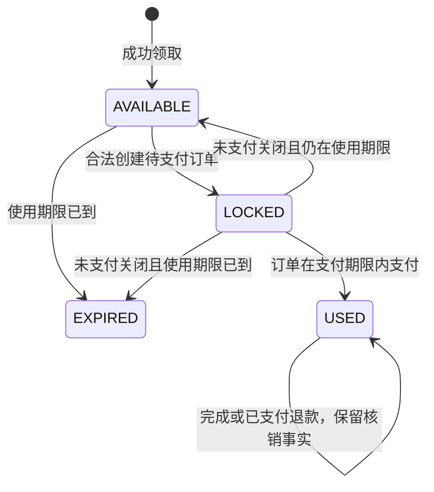
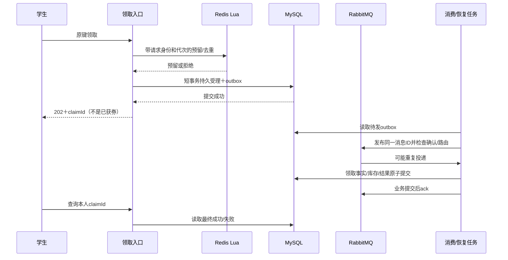

# M08.1：校园商家限量优惠券业务与一致性提案

日期：2026-10-29（America/New_York）。**状态：用户已明确采用第2～6节业务方案，授权从M08.2-A商家活动开始，正式决定见[ADR-0050](decisions/0050-coupon-business.md)。** 第7节仍为后续异步技术候选，具体协议待M03.1定稿。以下保留业务方案与未来批次边界，实际实现/验收进度以[路线图](roadmap.md)为准。用户要求先停止前端，M05.2已有交付及真实时段人工待办保留。

## 1. 已有能力与本次建议

| 范围 | 已有事实 | 本提案的新增部分 |
|---|---|---|
| 订单与金额 | 两类订单、原价/优惠/实付快照；实际优惠固定0；支付与退款按实付金额 | 店铺满减券、学生持有券、订单锁券/核销及冻结优惠说明 |
| 数据正确性 | RC写事务、RR读取、日期/文件保护、版本、资金唯一约束、创建幂等及超时扫描已验证 | 把券状态纳入原订单事务；为发行总量和账号限领增加独立约束，不另造订单/退款框架 |
| 技术深化 | M01 SQL、M02详情评分Redis缓存已落地；当前62操作、V16、24张应用表 | M08.2先验证MySQL闭环；M03可靠消息后，再做M08.3 Lua/MQ异步领取 |
| 已确认决定 | [ADR-0001](decisions/0001-v1-baseline.md)：店铺满减、一单一券、已支付退款默认不返券；现由ADR-0050补充第2～6节 | 具体异步受理/补偿协议尚未批准，领取及订单用券未因业务确认自动完成 |

源码核对依据：两类创建事务[预约](../src/main/java/com/campuslife/order/service/BookingOrderTransactions.java)、[打印](../src/main/java/com/campuslife/order/service/PrintOrderTransactions.java)仍设置`discountAmount=0`；[BookingCreate](../src/main/java/com/campuslife/order/dto/BookingCreate.java)/[PrintCreate](../src/main/java/com/campuslife/order/dto/PrintCreate.java)没有券字段。[打印报价](../src/main/java/com/campuslife/order/service/PrintQuoteService.java)也固定无优惠。[V9金额约束](../src/main/resources/db/migration/V9__create_booking_orders.sql)要求`payable_amount>0`，[创建幂等表](../src/main/java/com/campuslife/order/mapper/IdempotencyMapper.java)绑定非空订单ID，不能直接当作异步领券结果表。

本文件的第2～6节已获用户批准，实际A批仅实现商家活动并更新该6个运行操作；规划中的Redis领取、RabbitMQ、学生持有券/用券或通知不标为已实现。历史“本轮仅文档”指M08.1提案轮次，不能覆盖后续实现事实。

## 2. 推荐业务规则

业务场景：本校打印/理发商家发布有限张数的本店满减券，正常学生领取，用于该店实际BOOKING或PRINT订单。以“满30元减5元”带动正常交易为例，不销售券、不付费抢券，也不创建秒杀专用订单。

| 项目 | 推荐规则及理由 |
|---|---|
| 发行主体 | 正常MERCHANT、ACTIVE OWNER、APPROVED本店可创建/修改草稿/发布。停业或休息不阻止发券、领券；暂停审核资格或经营账号失效则不能新发布/领取。正常店主在暂停后仍可查询、停止原活动 |
| 适用范围 | 本店全部既有服务；不跨店、不指定单个理发师/文件、不叠加，一单至多一张。类别仍由店铺决定，不开平台通用券或可转赠券 |
| 限量/限领 | 每活动总量1～100000张；每学生账号每活动终身最多成功领取1张。用掉、退款或过期均不恢复领取次数，不代表现实中的实名防刷 |
| 金额 | 整数分，`1 ≤ reductionAmount < thresholdAmount ≤ 5000000000`；原价达到门槛才减固定金额。保证合法命中的订单实付至少1分，不截成零元或静默缩减优惠 |
| 时间 | UTC毫秒保存，校园上海时区展示；区间左闭右开。`useStartAt ≤ claimStartAt < claimEndAt ≤ useEndAt`；发布时领取结束须仍在未来。允许发布一个已经开始、尚未结束的窗口 |
| 草稿与发布 | DRAFT可修改；发布后金额、范围、总量、窗口全部冻结，改活动须新建。发布时版本匹配，字段完整；不增加库存、不删除已发活动 |
| 停止 | PUBLISHED→STOPPED，禁止新领取，不撤销已经成功领取的券；STOPPED不恢复。结束时间为派生展示，不靠定时任务更改活动状态 |
| 券使用 | 正常学生本人、同店、AVAILABLE且在使用窗口；店铺/服务/日期/文件等条件继续按原下单规则验证。休息时打印仍不能下单，原预约提前2小时规则保持 |
| 用户选择 | 由学生显式提供持有券ID；不自动挑最优券。指定券无效即拒绝，不自动退回原价下单或换券 |
| 管理边界 | 本批无平台补贴、人工赠券、退券特批、活动审批/删除或新增管理员营销后台；现有停用账号/店铺及异常订单接口继续适用 |

门槛以整单原价为基数：预约是冻结的服务单价；打印是页数×份数×印刷面单价，双面纸张取整规则不影响满减基数。一单一服务，因此不增加多商品优惠分摊。例：预约原价3000分，满3000减500，实付2500；打印原价400分、满500减100，返回未达门槛，不能直接按300分创建。

## 3. 券、订单和发行库存各自的生命周期

| 订单动作 | 券行为 | 原有资源/资金行为 |
|---|---|---|
| 报价或候选查询 | 只计算，不锁券、不延长有效期 | 原RR/候选不预留保持 |
| 创建待支付单 | AVAILABLE→LOCKED，记录唯一当前订单和完整优惠快照；失败全部回滚 | 原15分钟付款期限、预约HELD或打印文件引用保护同事务提交 |
| 首次支付 | LOCKED→USED，必须匹配该订单/学生/冻结金额 | 按实付生成唯一支付，订单/资源/事件同事务 |
| 未支付本人取消/超时/创建顺带清理旧单 | 匹配原订单才释放；尚有效回AVAILABLE，否则EXPIRED | 无资金，原关闭、资源释放/文件期限同事务 |
| 已支付取消/拒单/商家无法履约/管理员核实/待接单超时 | USED保持，不返券、不退领取次数、不回发行库存 | 退款等于原实付，不按原价退款；已有模拟资金开关与重复事实规则保持 |
| 正常完成 | USED保持；评价沿现有合法完成判断 | 预约CONSUMED/打印PICKED_UP与文件保护保持 |

**占用跨期推荐：**创建时券有效即可，在该订单原15分钟支付期限内仍允许支付，即使券随后过期或活动停止；不重判券使用结束时刻、不重新计价。订单过期的关闭流程照常先提交再返回原期限错误；释放的券若已过期不能再次使用。未提交关闭前，过期订单仍保守锁券，普通GET不自动释放。取消后原创建键重放仍返回原关闭单，想重新使用已释放券须用新订单创建键。

AVAILABLE的过期可在读取时派生为EXPIRED，不要求后台遍历更新；释放时可以落EXPIRED。LOCKED绝不因券自身到期直接释放，必须由其订单关闭事务处理；USED永不改回AVAILABLE。活动停止不等于券过期，学生/商家停用也不触发批量退券、退款或缩短文件期限。

库存指**成功发行张数**，不是可再次使用次数：`0 ≤ issuedCount = COUNT(user_coupon) ≤ totalQuantity`。发行成功后，即使券过期、未支付取消、已付退款，也不减issuedCount。只有异步路径中“尚未成功发行的失败预留”可以补回Redis预留额；两类操作必须分开。

## 4. 建议数据与幂等边界

M08.2整体预计新增4张应用表，各批仅落实际使用的表；A批V17先增加coupon_campaign至25表，其他三表尚未建立。金额long、ID/版本字符串、UTF-8及既有严格JSON习惯沿用。

| 表建议 | 职责与约束 |
|---|---|
| coupon_campaign | 本店活动规则/冻结字段、DRAFT/PUBLISHED/STOPPED、总量/累计发行数、独立版本与发布/停止时间；库存条件更新保证不超总量 |
| coupon_claim_request | 独立领取键、学生/活动、请求摘要和结果。M08.2只在领取成功事务保存SUCCEEDED，唯一`(student_id, request_key)`；不复用非空order_id的订单幂等表。M08.3再按正式协议扩展持久PENDING/FAILED及outbox |
| user_coupon | 成功发行事实、学生/活动/店铺/有效期、状态、当前锁定或核销订单、版本；唯一`(campaign_id, student_id)`；当前订单关联也须唯一 |
| order_coupon | 一单一条，保存持有券/活动ID、券名称、门槛/减额/有效期/来源版本等快照和LOCKED/RELEASED/USED及处理时间；保留历史订单用券事实 |

`order_coupon.user_coupon_id`不能永久唯一：未支付取消后同一券可以用于新单。当前占用由user_coupon的一处订单指针表达；历史order_coupon记录不覆盖。单券一个当前占用、一单一券、归属/状态一致由唯一约束、锁后校验和真实并发测试共同保证；外键及索引按实际查询设计。

领取请求键独立于CREATE_BOOKING/CREATE_PRINT，沿用1～64位合法Idempotency-Key。同学生同键同归一化活动ID重放成功结果；同键换活动409。换键重复领取同活动409，不追加第二张券/发行数。同步校验失败不保存成功幂等记录，沿现有订单创建“成功事实才固化”习惯；未来异步已受理后若终态FAILED，同键必须返回同一失败结果，新尝试用新键，仍受每活动限领约束。

草稿更新/发布/停止采用活动独立expectedVersion；实际修改版本+1，旧版本409，同版本无变化不写。合法发布/停止响应丢失仅允许匹配首次操作人、原版本和同一动作的重放，不静默覆盖新版本；相关首次操作事实需要在活动记录中保留。精确字段及错误码随M08.2-A落到正式契约。

发行计数独立于活动配置版本：领取递增issuedCount，不推进expectedVersion所对应的配置版本，避免正常领取使店主停止活动时版本不断失效。发布冻结后读取规则不以剩余库存变化为报价版本变化。

## 5. 对现有订单的接入方法

### 计价、查询与历史展示

两类创建增加可省略/显式null的`userCouponId`，省略和null统一为不用券；非法格式仍400。打印报价同样支持可选券，保持原文件404/410、服务/规格等错误优先，再校验券；返回原价/折扣/实付及可选券摘要。

预约匿名候选继续返回未优惠的服务价格/版本和UTC时段。新增正常学生的只读预约报价，输入serviceId和可选userCouponId：核对公开理发服务、本人券并计算金额，不校验人员/具体时段、不替代候选查询；停业仍可估价。创建同时校验原服务版本、时段与券，expectedPayableAmount对比最终实付。两类都不接收客户端自报discountAmount；报价不锁价、不锁券、不延长文件/券有效期，券状态变化返回明确冲突，价格/实付变化要求重新确认。

旧无券订单按无order_coupon读取，折扣继续0；新券订单在本人/商家/管理员详情中展示冻结优惠摘要，列表沿已有三个金额字段，不逐单额外查券。快照不能依赖活动实时名称，订单事件仍按一次业务动作一条，不为锁券另增订单版本/事件；券快照单独记录释放/核销时间。打印下单仍复核文件并保护全部引用，优惠券不授予PDF权限。

### 创建键兼容

已存在的[预约](../src/main/java/com/campuslife/order/service/BookingOrderPolicy.java)/[打印](../src/main/java/com/campuslife/order/service/PrintOrderPolicy.java)SHA-256规范串没有券字段。无券请求必须逐字保留原规范串与摘要；有券使用显式新域前缀、原字段和归一化持有券ID，避免拼接歧义。原操作名/键作用域不变。旧键不允许从无券变成带券，同键换券也409。

先按原身份和归属协议查成功创建事实，匹配后返回原单；不因券过期、活动停止、已释放或已核销而让原键失去重放能力。历史幂等记录不批量重算或迁移；须构造升级前真实记录，升级后用原正文/显式null/改券分别验收。

### 锁序与事务边界

继续使用原RC写事务。推荐将券加在既有资源/订单锁之后，不反向取得目标学生、商家账号锁：

| 入口 | 锁协议增量 |
|---|---|
| 活动维护/同步领取 | 操作者账号→会话→店铺（配置沿原资格保护）→活动X→领取记录/新持有券；领取的库存/成功请求/持有券同事务，活动只在发行时竞争 |
| 预约创建/支付/关闭 | 原账号→会话→店铺S→日期保护行→人员/占用/订单；**已有业务锁阶段结束后，受影响持有券按ID升序X锁**→用券事实/资金/事件 |
| 打印创建/支付/关闭 | 原账号→会话→店铺S→文件X→订单/明细→持有券X→用券事实/资金/事件；实例文件互斥继续在事务外等待 |
| 系统到期 | 无账号锁的原系统入口→店铺S→日期行或文件X→订单→持有券；不反向锁账号/会话 |

关键源码影响：预约create会遍历同一日期的旧占用，关闭到期旧单后再创建新单。不能在close辅助方法内随手先锁一个券，再返回循环继续锁其他旧订单。实现应在同一日期保护下收集所有相关旧订单及本次新订单，先完成业务锁阶段，再将旧单释放和新单锁定涉及的券去重、按ID升序一次获取；锁券后不再获取其他已有订单/日期/文件/活动锁。新订单可以先插入为未提交行，再在同事务完成锁券、金额复核和快照，任何失败整体回滚。

这是现有锁协议的必要增量，不替换日期/文件保护或把支付改成异步。用券不修改活动库存，也不需要反向取得活动X锁；发布后冻结规则及持有券有效期足以支持旧权益。最终时刻在所需业务/券锁取得后选定，并沿用提交前会话/时间复核；锁等待越过截止时间不得用旧now放行。

真实MySQL必须覆盖“两笔创建清理各自旧单，同时尝试使用对方仍锁定的券”等交叉竞争，验证无反向锁序，锁等待/死锁若发生能完整回滚并保留原键重试。不能只用单用户mock宣称正确。

## 6. API分批范围

路径均相对`/api/v1`；正式注解、错误码和导入文件随实现同步。整体预计新增11个操作、扩展既有报价/创建/详情；A批只落商家6操作，其余5个仍未实现，不能把规划数量当作已完成接口数。

| 入口 | 目的与权限 |
|---|---|
| GET /merchant/coupon-campaigns | 本店分页含草稿/停止活动，正常商家/有效OWNER可查历史 |
| POST /merchant/coupon-campaigns | 创建草稿，须本店获批 |
| GET /merchant/coupon-campaigns/{campaignId} | 本店活动详情/版本，跨店或不存在404 |
| PATCH /merchant/coupon-campaigns/{campaignId} | 仅草稿完整业务字段修改，须expectedVersion |
| POST /merchant/coupon-campaigns/{campaignId}/publish | 冻结完整规则并发布 |
| POST /merchant/coupon-campaigns/{campaignId}/stop | 停止新领取；不作废既有券 |
| GET /shops/{shopId}/coupon-campaigns | 匿名可见店铺，展示PUBLISHED且当前可领取活动；售罄可展示并标记，剩余量仅查询快照，不保证一定领到 |
| POST /coupon-claims | 正常学生，正文campaignId＋Idempotency-Key；M08.2首次201成功、重放200，M08.3首次可能202受理 |
| GET /coupon-claims/{claimId} | 正常学生本人结果，跨归属404；为未来持久处理中/失败提供查询位置 |
| GET /me/coupons | 正常学生本人分页，可选shopId/state，显示AVAILABLE/LOCKED/USED/EXPIRED及窗口；查询不自动关单 |
| POST /booking-quotes | 正常学生个人报价；原匿名候选保持公开无个性化 |

分页沿默认1/20、每页最多100和稳定创建时间/ID倒序，身份/归属/count/page短只读RR；返回前复核会话期限。匿名活动目录沿当前公开店铺资格，活动截止判断每请求一个Clock，错误token仍拒绝。M08.2先无Redis依赖；后续库存展示可带明确待处理含义，但不能把Redis剩余和数据库已发行混成一个精确承诺。

## 7. Lua、MySQL与MQ如何衔接（原候选已由ADR-0054细化）

2026-10-30补充：M08.2-A～C同步闭环已验证。[M03.1提案](reliable-messaging-design.md)建议先做公共可靠通知链，再以M08.3-A单独定稿本节Redis预留/失败墓碑/重建代次协议；该拆分已确认，M03消息链及故障验收已完成；具体协议已按[ADR-0054](decisions/0054-async-coupon-claims.md)确认，B发行底座、C Redis预留/恢复和D受控公开受理均已交付。下文是原候选推演，细则以[已确认协议](async-coupon-claim-design.md)为准；C证据见[报告](reports/coupon-redis-recovery-2026-10-31.md)，公开异步受理/维护见[D指南](async-coupon-admission.md)，性能/真进程窗口待M08.4。

先完成M08.2同步基线，领取事务的发行计数/业务唯一约束是最终兜底。Redis用于热点活动的快速去重、预留和无库存拒绝；MQ用于将已持久受理的领取任务与发行消费解耦。下单、付款、退款及锁券/核销继续同步MySQL事务，不通过MQ最终一致才决定金额或释放资源。

Lua只能根据Redis内的活动窗口、预留余量和请求/领取标记做预检查；账号、会话、店铺的实时授权及活动是否允许持久受理由MySQL入口复核。不能把缓存中的资格标记当成已通过当前数据库权限验证。

推荐后续研究的保守路径：

这是本项目基于现有交易约束的方案推导。Redis脚本的原子执行范围是Redis，且运行期间会阻塞其他活动，应保持有界；它不能包含数据库事务或Broker。参见[Redis脚本边界](https://redis.io/docs/latest/develop/programmability/eval-intro/)。RabbitMQ的publisher confirm与consumer ack相互独立，前者不能证明消费业务已提交；确认不确定会要求重发，消费必须业务幂等。参见[确认机制](https://www.rabbitmq.com/docs/confirms)及[可靠性说明](https://www.rabbitmq.com/docs/reliability)。

此路径**每笔通过Lua的请求仍需一次MySQL持久受理写入**，不是“数据库零压力”。它可能减少热活动库存X锁的同步等待、过滤大量重复/无库存请求，但增加数据库记录、后台发布和端到端延迟；是否有净收益必须与同步基线同条件测量。若无收益，保留数据和结论，不写虚构高QPS。

| 失败点 | 方案必须具备的恢复行为 |
|---|---|
| Lua预留后、DB受理前进程崩溃 | 唯一预留身份可枚举/对账；尚无DB请求的预留只能经持久终止标记或代次栅栏确认后条件释放，不能仅超时INCR。晚到受理必须被栅栏拒绝，防释放后又发行 |
| DB受理提交、HTTP返回前中断 | 原键查到同一PENDING/最终结果，不能再预留另一份；202只能在受理及outbox持久提交后发出 |
| outbox已提交、Broker不可用或确认丢失 | 原消息ID可恢复重发，发布在事务外；确认及路由失败分别处理，不能标记“学生已获券” |
| 消费提交后ack丢失 | request/活动＋学生唯一事实返回已有结果，发行计数不重复递增，不创建第二张券 |
| 消费前账号/资格/使用期限失效 | 复核业务条件并将请求变为可查询的失败终态；队列等待不要求原HTTP会话一直有效。正常的领取窗口结束不应让窗口内已持久受理自动失效；积压上限/处理截止须在M03.1定稿 |
| 活动停止与在途请求竞争 | 仅新受理被拒；停止前已持久受理的请求保留处理资格，仍受账号/店铺安全资格、使用期限和最终发行库存约束。单纯Lua预留不等于持久受理 |
| 失败补偿与成功消费竞争 | 先在MySQL对同一请求决定唯一终态，再依据该终态释放同身份/同代次Redis预留；终态失败拒绝晚消费，成功绝不再返预留 |
| Redis丢数据/不可信/需重建 | 关闭新异步受理，使用代次栅栏排除旧预留/迟到写；从MySQL已发及有效PENDING重建，不能只拿total-issued忽略处理中；对账后再开放 |
| Redis/MQ降级 | 普通订单旧单流程和评分缓存按各自边界运行。异步领取故障时明确暂不可用，不自动切回同步抢库存；切换模式须停受理、排空/终结并对账 |

M03.1需把上述代次栅栏、持久终止记录/查询范围、受理与停止/重建锁、超时终态、outbox/消费字段和有界重试落成可执行协议。尤其不能只写“有补偿任务”或把outbox当成Redis与MySQL的原子提交。Redis TTL只用于回收已安全终结的记录，不能担当库存恢复的唯一依据；M08.1不锁定RabbitMQ版本、容器、队列类型或具体Lua代码。

## 8. 分批实现与验收/停止条件

用户确认业务规则后，M08.2按小任务推进，不一次提交整个营销系统：

| 小任务 | 交付与完成标准 |
|---|---|
| M08.2-A 商家活动 | 独立活动模块及本店6操作；草稿/发布/停止、权限、版本、冻结、窗口和库存边界通过真实MySQL＋Swagger/Apifox验证。只落该批真正使用的表，不提前建空券/消息模块 |
| M08.2-B 同步领券 | 匿名活动查询、本人领取/结果/券列表；总量N、至少2N个不同学生竞争恰好N成功，失败无多余发行；同账号/不同键并发最多1张；响应丢失重放、跨归属读取及失败回滚验证 |
| M08.2-C 两类订单用券 | 预约报价、打印报价扩展、创建摘要兼容、冻结/占用/支付核销；两类未付关闭、顺带清理、已付退款、重复动作、券跨期和停活动逐路径验收；旧无券请求、升级前幂等事实及存量回归通过 |
| M03.1～M03.3 | 先定协议，再完成真实RabbitMQ通知链、outbox/确认/消费幂等与故障恢复；具体通知业务另定，不把券异步发行写成已完成 |
| M08.3～M08.4 | 接入Lua/MQ真实领取，覆盖上节故障点、库存重建和补偿竞争；测受理与最终成功两种延迟、发行结果、积压/恢复和数据库成本，与同步基线比较 |

重点金额/生命周期验收：门槛相等可用，少1分拒绝；0元配置拒绝而非夹断；打印50亿分上限无溢出；同券双订单仅一笔锁定；券到期前锁定后可在15分钟内支付；到期未支付关闭后不可重用；活动停止后已领仍可创建，原键始终回原单；已支付各种退款只退实付且不返券；释放/核销/快照任一写失败则原订单事务全部回滚。

核心并发使用独立真实MySQL；Lua/MQ阶段使用自有Redis/Broker、隔离数据库和可核对故障注入，不访问用户正式数据。所有新增操作维护注解、OpenAPI导入文件及点击流程；本轮仅检查文档/源码映射和改动范围，不启动服务或宣称上述用例已通过。

## 9. 已确认决定与后续实施边界

用户已整体采用第2～6节：本店全服务满减、终身每活动限领1张、固定发行总量、发布冻结、停止仅阻止新领；减额小于门槛保留正实付；创建锁券保留原15分钟支付权、未付关闭按有效期释放、已付退款不返券；兼容原无券创建键，两类订单在C批接入。

同时接受M08.2-A→B→C先做MySQL业务闭环的顺序，并明确授权从A批开始。第7节是后续技术可行性推荐与故障准入要求，具体异步协议仍在M03.1审阅确认，不能把本轮业务规则批准解释为RabbitMQ/Lua已经获准直接实现。

确认依据是[AGENTS.md](../AGENTS.md)的“新增或实质改变业务规则、订单模型、模块边界，或引入重要基础设施时，先给出具体推荐、影响及理由，再与用户讨论”。本方案涉及新增券规则和订单计价/释放行为，因此先提交可审阅方案；已确认的原退款、锁、幂等等行为继续复用。
