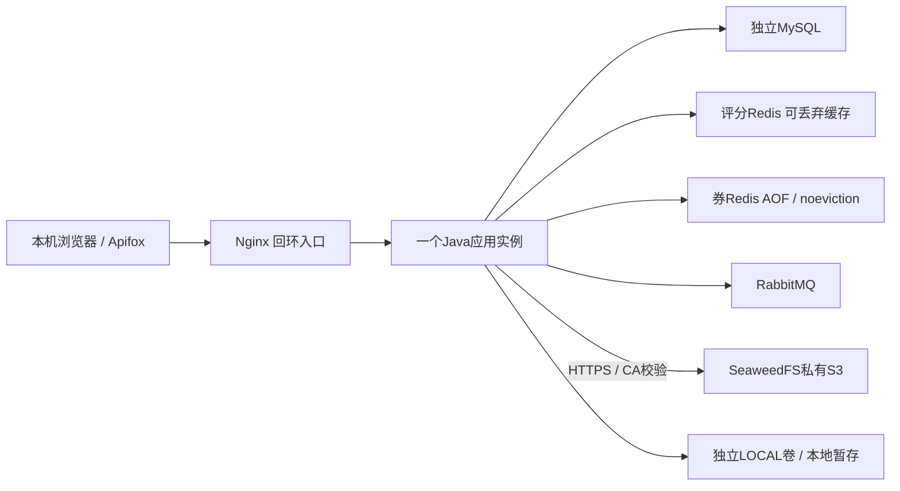

# M06.1 单实例部署与观测方案

日期：2026-11-02。状态：**用户已指示推进，按[ADR-0057](decisions/0057-single-instance-deployment.md)从M06.1-A0独立数据库兼容验证开始**；A0已[验证](reports/mysql84-compatibility-2026-11-02.md)，A基础环境已[交付验证](reports/base-deployment-2026-11-02.md)，B1双Redis/MQ已[交付验证](reports/component-deployment-2026-11-02.md)，B2原生S3 TLS已[交付验证](reports/storage-tls-deployment-2026-11-02.md)，C私有管理面已[交付验证](reports/private-observability-2026-11-03.md)，D容器组合/指南已[交付](reports/showcase-lifecycle-2026-11-03.md)，后续E隔离冷备恢复已[交付](reports/full-stack-recovery-2026-11-03.md)；用户已说明有阿里云，真实宿主尚未核对/部署。方案定稿轮仅核对源码/既有证据及官方资料，未启动Docker、构建镜像、改业务代码/依赖/DDL、读取开发秘密或搬迁数据。当前仍75业务操作/V24/32表、生产156依赖（C新增8项、原148保持）；仓库默认上传LOCAL、S3/评分缓存/消息/券Redis关闭，前端暂停。依据[路线图](roadmap.md)和[M04恢复证据](reports/s3-recovery-2026-11-02.md)。

## 1. 推荐与范围

推荐一个Java应用实例＋Docker Compose，先在本机Docker Desktop的Linux容器中验收。基础模式仅Nginx、应用、独立MySQL；完整技术演示模式增加独立评分Redis、券Redis、RabbitMQ和SeaweedFS，共7个常驻服务。复用既有业务与并发协议，面试展示重点是可复现启动、依赖隔离、失败定位和恢复。

增加Boot Actuator/Micrometer作为最小观测；当前已有traceId和部分组件日志，不等于已有Actuator/指标面板。本期不加入Prometheus/Grafana、ELK、分布式追踪、集群或Kubernetes。需要长期时序监测时再评估，不把组件数量当成果。

前端继续暂停，本期Nginx只代理现有API；人工业务验收使用受控的Swagger/Apifox。未来可挂载已构建静态页面，不在本轮改Vue、补券/消息页面或宣称前端已完成。公网域名/TLS证书申请、云服务器采购、真实库迁移和源文件删除另行授权。

## 2. 已完成与真实缺口

| 源码/证据 | 当前事实 | 本期拟补 |
|---|---|---|
| pom.xml、运行脚本 | Java21/Boot4.1.1，MyBatis-Plus、SDK2.57.8；Windows宿主运行 | 可审计Linux运行镜像/构建清单、Compose、持久卷与启动停止入口；不把测试夹具当部署 |
| application-mysql.properties、DatabaseMigrationConfiguration | MySQL8.0验收；启动Flyway，目标名须匹配campuslife或campuslife_字母数字后缀 | 新部署MySQL8.4 LTS兼容门槛；独立库/账号与配置，保留原开发服务 |
| RatingRedisConfiguration | 当前仅host/port，无用户名/密码注入 | 增加可选ACL配置；只在新部署要求专用凭据，保留既有回环开发兼容 |
| CouponRedisConfiguration、RabbitMessagingConfiguration | 券Redis已有独立ACL/AOF/noeviction；MQ已有vhost、确认、幂等及独立发布连接 | 配置真实服务名、持久卷与精确权限，保持两个Redis分离和MQ发布/声明连接设计 |
| S3StorageProperties | 明文HTTP仅允许127.0.0.1，其他endpoint要求HTTPS | 容器间原生S3 TLS＋JRE信任CA，保留校验及标识；先探针再集成，不放宽成任意明文地址 |
| TraceIdFilter、HealthController | 服务端生成X-Trace-Id；业务health只证明HTTP存活 | Nginx记录上游trace、耗时/状态；独立管理面与JVM/HTTP/连接池指标，业务health语义不变 |
| AdminBootstrap、MessageMaintenance、CouponMaintenanceBootstrap | 显式无HTTP维护；部分入口直接读取进程环境 | 同镜像受控CLI启动方式，秘密文件按需注入子进程，不增加公开维护接口 |
| M04-C | 单实例文件/数据库恢复及副本迁移已验证；一次冷恢复新写超时未定位 | 部署恢复须验证新写，不只读/health；补RabbitMQ与券Redis的完整恢复协调 |

拟议不增加业务表或订单规则。内部管理端点另列运维契约，不把75个业务操作数与Actuator路径混算；实际新增依赖/端点数量以实现报告为准。

## 3. 版本与兼容门槛

MySQL官方说明8.0于2026年4月结束生命周期，推荐向受维护的LTS版本迁移。新容器候选选择8.4 LTS；当前开发MySQL8.0、旧数据、旧测量报告保留。这里是新环境兼容验证，不执行本机升级或原地搬库。[官方8.0发布说明](https://dev.mysql.com/doc/relnotes/mysql/8.0/en/)、[8.4升级路径](https://dev.mysql.com/doc/refman/8.4/en/upgrade-paths.html)。

采用后先A0：固定实际可拉取的8.4补丁/digest，用新临时库验证24个迁移、32表、约束/外键、字符和时区、关键读查询等价、真实锁竞争/金额/幂等的代表性检查。旧8.0的SQL计划/性能数字不能直接当8.4结果。兼容失败时列原因与选择，再讨论需要实质改动的方案，不静默重写V1迁移、关闭约束或改查询语义。

Java维持21，Boot维持4.1.1，Actuator按同一Boot BOM解析；官方当前参考文档的更新不代表项目已经升级。Redis8.2.4/RabbitMQ4.3.6/SeaweedFS4.51及既有digest是已验证起点；A/B准备时核对维护状态，新增Linux运行时/MySQL/Nginx补丁与digest实际查证并记录。无latest、无编造digest；若必须换版本，单列影响和回归，不把“选了版本”算运行通过。

## 4. 拓扑与两种运行模式

| 模式 | 启用情况 | 初始数据/资金 |
|---|---|---|
| base，默认 | MySQL＋应用＋Nginx；LOCAL上传；其余客户端关闭 | 新库，无默认ADMIN或演示密码；模拟资金关闭，活动SYNC |
| showcase，显式选择 | 评分缓存、券Redis、消息生产/消费、私有S3启用，新上传S3；LOCAL卷继续保留 | 新库初始仍SYNC；只有显式演示操作才开模拟资金、建虚构账号/活动，并经既有维护协议切ASYNC |

Compose profile只控制组件选择，不会自动改变应用开关；拟议入口同时校验profile、配置清单和服务集合，避免开着客户端却未启服务。模式切换不改存量定位或活动门闩；已有S3/ASYNC数据不能直接套base配置当回滚，操作先检查/暂停/排空，选择保留后端或按原协议切换。

仅Nginx映射宿主127.0.0.1，建议18080为默认候选，允许冲突时明确配置；容器内应用须监听0.0.0.0，但不直接映射宿主业务端口。MySQL/Redis/AMQP/S3/管理端口均不默认发布；临时排障映射必须显式且仅回环。Nginx与应用位于入口网络；数据服务在私有网络，S3单独隔离到应用/存储网络。内部控制端口不能因为“未发布”就称具备认证，单机可信工作负载边界保持。

入口脚本及Compose应用身份限制一个实例，数据卷带项目/运行身份，不支持scale、多应用共用卷或跨机器共享当前互斥。脚本限制不等于分布式锁，绕过入口的多实例运行不在支持范围。

S3采用固定4.51源码提供的原生TLS参数，使用服务名SAN证书和本机生成的私有CA，应用加载信任库并验证主机名；不禁验证、不使用额外明文网关。官方源码只证明参数存在，B2必须实测正确CA成功、错CA/错主机名失败、20MiB与重启/新写、原权限不变；若不兼容，暂停B2讨论，不偷换产品。[固定版本TLS参数](https://raw.githubusercontent.com/seaweedfs/seaweedfs/4.51/weed/command/mini.go)。

Docker Desktop Linux容器验证不等于独立Linux宿主部署。Linux宿主步骤/配置可交付，真正宿主验收单列条件项；需要用户届时指定现有Linux/VM，未指定则保留未执行记录，不自动买服务器、安装发行版或把Windows结果改称Linux宿主结果。

## 5. 配置、秘密和维护

- 不读取/改写.vscode启动配置或开发.local文件；部署使用新根、新库、新卷。镜像仅复制可复现制品与必要入口，不包含.cache、.local、.tools、Git、测试类或秘密；运行用户非root，存储目录权限需要Linux容器实测。
- 使用Compose秘密文件和Spring configtree，常规host/端口/命名空间为非秘密配置；DB_PASSWORD、JWT_SECRET_BASE64、各组件密码等通过精确命名的秘密文件绑定。单机Compose采用本地文件挂载，不是加密秘密服务；文件权限/备份与宿主管理权限仍由操作者负责。模板不填默认密码，不把秘密放Dockerfile、命令参数或报告。[Compose secrets](https://docs.docker.com/compose/how-tos/use-secrets/)、[Boot configtree](https://docs.spring.io/spring-boot/reference/features/external-config.html)。
- 每组件独立账号，评分与券Redis不共用实例。应用SQL账号仅项目库所需权限；本期沿用启动Flyway所需DDL权限并明确这项取舍，不运行root、不暗称已做迁移/运行账号分权。MySQL库名保留已有单后缀校验，初始化只在自有新卷执行。
- 管理员继续显式AdminBootstrap创建；普通启动不建ADMIN。使用同一镜像的明确class path/入口运行现有CLI，不能假定改变java -jar的业务参数就能切main类。MessageMaintenance直接System.getenv，需受控包装器只给子进程读取所需秘密；Spring入口按configtree验证，不输出环境全集。
- S3桶/标识/私有ACL由独立一次性初始化身份准备；应用只拿既有窄前缀权限。证书/CA、RabbitMQ稳定节点名与cookie、券Redis ACL/AOF、LOCAL.storage-id和S3命名空间都在配置清单，不靠启动时重新随机生成“修复”旧卷。

## 6. 最小观测与入口行为

拟增加Actuator/Micrometer，部署配置显式开启；普通运行不开放管理HTTP面。管理面绑定容器内127.0.0.1的独立端口，不发布宿主、不经Nginx；仅GET的health/metrics白名单。metrics使用独立文件凭据的运维Basic认证，不依赖业务数据库或借用ADMIN JWT，便于数据库故障时仍诊断。health只暴露摘要，不开放env/configprops/heapdump/logfile/shutdown、动态改日志或JMX。必须测试本来已有SecurityFilterChain时的管理面访问控制，不能依赖Boot默认保护。[Actuator安全规则](https://docs.spring.io/spring-boot/reference/actuator/endpoints.html#actuator.endpoints.security)。

| 场景 | 观察方式 | 通过标准 |
|---|---|---|
| 请求慢/错误 | HTTP时长/状态计数、Hikari池、JVM堆/GC/线程；私有metrics | 能区分数据库等待、HTTP错误和JVM占用；无账号/订单/token等高基数标签 |
| 消息未到 | 原messageId/attempt/result日志；运维只读outbox状态/最老待处理时间快照；Broker ready/unacked/dead | 一次Broker停机积压→恢复发送/消费不重复的因果证据；不把SENT写成通知成功 |
| 异步领券失败 | 原结果查询、gate/代次/处理截止及Redis/MQ运行快照 | 解释202与最终结果、故障关闭及恢复门闩；不增加新业务接口或自动降级SYNC |
| 文件不可用 | 原存储异常日志、只读元数据/配置身份；隔离上传/下载/清理实测 | 区分权限/定位/内容故障；冷恢复后须验证新写，不能只有旧内容能读 |

不新建业务指标表/计费事件，不增加持续轮询全表的metrics任务。业务快照由运维按需只读获取，限固定聚合条件，不导出payload、姓名或内容。JVM/HTTP/池指标由Micrometer已有计量提供；没有时序数据库/告警平台则如实写为即时诊断，M06.2另保存固定时间样本。

原/api/v1/system/health继续只表示HTTP存活；liveness不依赖外部组件。管理readiness明确检查应用接受请求与MySQL可用性，缓存、MQ、券Redis、S3的故障单列能力降级，不把可选依赖故障当成重启整个应用的理由。Compose健康状态也不等于自动流量摘除或自动重启；应用仍须沿原协议处理运行期断连。[Boot探针语义](https://docs.spring.io/spring-boot/reference/actuator/endpoints.html#actuator.endpoints.kubernetes-probes)、[Compose启动顺序](https://docs.docker.com/compose/how-tos/startup-order/)。

Nginx上传总请求建议22MiB，后端单文件20MiB限制保持；请求/响应缓冲及临时目录分别明确，拟对PDF代理关闭请求/响应缓冲，避免额外落盘和掩盖断流边界。实际验证20MiB成功、超限413、中文文件名、断流无JSON尾接。写请求禁代理自动重试，原创建幂等键由客户端保持；Nginx自身413/502/504须单列并验证入口错误响应及入口request_id，不能冒充Java已处理或记录不存在的应用trace；读/上传超时只是部署参数，不改预约/支付截止或承诺慢客户端硬上限。Nginx记录上游生成的X-Trace-Id、状态/耗时，不记录Authorization、请求体、文件内容或完整含查询的URL；不信任外部自填traceId，不要求全局链路追踪。[Nginx代理行为](https://nginx.org/en/docs/http/ngx_http_proxy_module.html)。

## 7. 生命周期和恢复验收

启动使用组件就绪检查和有界重试，不靠固定sleep判成功；Compose依赖healthy只辅助启动顺序。初始化失败保留原卷与证据，不能删卷重建掩盖问题。镜像版本、配置摘要、数据库版本、存储身份和启用模式都需出现在脱敏运行清单。

分别提供状态查询、停服务保留卷、恢复启动及仅销毁自有测试项目入口。退出时区分容器/卷/测试进程、Docker Desktop和WSL；清理测试项目不自动退出用户Docker或执行wsl --shutdown。停止入口按应用→依赖顺序、有界等待，超时记为未完成/需恢复；8秒组件关闭预算不能写成整应用8秒保证。普通停止不使用down -v或prune；WSL关闭只由用户决定。

备份/恢复客户端随目标数据库版本固定并在容器中验证；现有宿主8.0脚本不能直接当作8.4备份已兼容。

E阶段仅对新部署测试数据：暂停异步活动并经原协议排空/核对，阻止新写与维护入口，停止所有应用/生产者/消费者，再停止Broker、券Redis和S3，取得同一维护窗口的MySQL、RabbitMQ整个状态（含稳定节点身份/cookie配置）、券Redis完整AOF/ACL、S3完整状态、LOCAL根和配置/密钥清单。评分缓存可丢弃重建；不是给所有组件分别拍快照就称在线一致备份。

恢复到全新项目/卷：先恢复持久组件及原身份，再启动应用与消费者，核对SQL、资金/券唯一事实、队列重投去重、文件；券Redis新runId需按原代次重建/核对，活动维持暂停直到受控Resume。依当前真实时间处理原截止，不人为续期或改测试时钟冒充恢复。S3验证身份/旧读/新上传完整回读及清理，保留冷写失败证据；仅当这些恢复条件通过才放行演示。未完成的新环境不覆盖旧环境，不承诺固定RTO/RPO或HA；真实数据Apply/删除依然另行授权。

## 8. 小批次顺序和停止条件

各行是独立任务，不因方案采用就一次执行完。每项只运行其相关检查，已有事务/锁/幂等和M04故障不重写；新数据库版本和受影响链路仍需实际验证。失败修复和重跑记录保留，不用累计重复用例营造覆盖数字。

| 批次 | 明确交付 | 验证与终点 |
|---|---|---|
| M06.1-A0 版本与数据库兼容（[已验证](reports/mysql84-compatibility-2026-11-02.md)） | 锁定8.4候选补丁/digest，新临时MySQL及既有代码兼容报告 | 24迁移/32表、约束/字符/时区/关键查询等价、代表性真实锁/金额/幂等通过；开发MySQL不变。失败先报告，不同时搭整套环境 |
| M06.1-A 基础容器交付（[已验证](reports/base-deployment-2026-11-02.md)） | Java21镜像、base Compose、Nginx、秘密/LOCAL卷、状态/停止脚本 | 新库启动、受控ADMIN、注册登录/打印基本链、20MiB/413、重启保留、非root目录权限、镜像不含秘密/测试类；没有基础环境就绪不启动全栈 |
| M06.1-B1 缓存与消息（[已验证](reports/component-deployment-2026-11-02.md)） | 两个Redis ACL/隔离与持久策略、RabbitMQ、CLI维护和显式演示开关 | 缓存命中/回源；真实通知与ASYNC领券闭环、队列/原幂等不重复、暂停/恢复，默认SYNC与消息关闭保持；不做性能排名 |
| M06.1-B2 私有存储TLS | **已验证**；[报告](reports/storage-tls-deployment-2026-11-02.md)。S3 TLS/CA、身份初始化和原权限、showcase配置 | 16策略单测、28存储组（含12原生组）、7默认回归与1组六服务配置通过；实际Java错CA/主机名拒绝、20MiB、代理鉴权、LOCAL共存、清理及重启新写；未放宽明文 |
| M06.1-C 最小观测 | **已验证**；[报告](reports/private-observability-2026-11-03.md)。Actuator/Micrometer独立私有管理面、原入口日志关联与固定只读快照 | 22相关JUnit、28真实管理/DB与Broker故障组、7base组、1组showcase配置通过；无秘密/路由标签泄漏，普通75业务操作保持 |
| M06.1-D 运行与Linux条件项 | **容器/指南已交付**；[报告](reports/showcase-lifecycle-2026-11-03.md)，24组生命周期及2项语法/入口检查 | 原五卷/身份/事实和受控恢复后新请求通过；用户明确暂无Linux环境，真实宿主条件项未执行，待指定现成环境补充 |
| M06.1-E 完整环境备份恢复 | **隔离验证已交付**；[报告](reports/full-stack-recovery-2026-11-03.md)/[指南](full-stack-recovery.md) | 单入口32组、独立18项、3默认配置组通过（重叠不累计）；完整停机五卷/身份、新卷33表摘要/去重/暂停代次/旧读/清理/新写通过，无真实迁移 |

完成已采用范围后转M06.2固定负载综合验证，再转M07材料；不追加业务模块或无限调参。A0/A/B1/B2/C/D/E明确拆开，是对最近单次任务过长的调整，不将每行再并成一个三十分钟以上的大包。

## 9. 采用范围

推荐采用：单实例Compose基础/完整演示模式；新部署8.4 LTS兼容验证且保留本机8.0；S3原生TLS；秘密文件与显式CLI；最小Actuator/Micrometer私有管理面；原协议的全栈离线恢复；按A0开始逐批实施。Linux宿主验收是环境条件项，前端保持暂停，公网/真实迁移不包含在本次授权。用户随后指示“进行下一项”，已建立ADR-0057并从A0开始；本方案采用本身不等于这些能力已实现。

## B1实际落地补充

components为显式六服务中间模式，S3仍关闭/上传LOCAL；新Redis在同8.2线采用已固定的8.2.9安全修复补丁，旧8.2.4报告不变。评分可选ACL、Rabbit原拓扑/私有身份、原维护CLI与显式DemoMoney已实现；默认base保持关闭。B1的20单测/34部署组/7base组及运行75操作证据见报告，不把本批或方案采用当作B2 TLS/C观测/D真实Linux条件项/E恢复已经完成。

## B2实现补充

[七服务使用指南](storage-tls-deployment.md)记录原生TLS-only主端口、私有CA、独立初始化/拒绝接管、只读公共JKS及秘密挂载。生产JAR/148依赖与B1相同，未改业务/DDL/前端；默认base与components保持LOCAL。B2普通整套重启后新写通过，不代表E完整恢复，亦未定位或修复M04-C冷恢复超时。证书续期未实现，SeaweedFS内部控制面仍依赖隔离网络；下一项仅C最小私有管理面。

## C实现补充

[私有管理面指南](private-observability.md)说明新实例显式-Observe、端口/身份/GET白名单与按需快照。默认普通运行及未选择的部署实例均不监听管理HTTP；不改原容器/业务health，readiness不代表所有能力就绪。28组真实故障检查已完成，showcase只补配置组合、不重复B2整链；下一项D完整组合运行及Linux宿主条件项，E恢复和性能仍独立。

## D交付边界

[Linux指南](linux-deployment.md)与七服务组合生命周期已交付，C制品/156依赖和生产源码保持；24组通过，真实宿主因用户暂无环境明确未执行。指南语法/CLI检查不当作宿主运行，普通Stop/Start不当作备份恢复。下一项仅E全持久组件/身份的新卷恢复。

## E交付与实机续验

冷备采用同版本完整卷，MySQL慢关闭，Rabbit保留节点/cookie，券Redis保留AOF/ACL，S3/LOCAL及配置身份同窗口，恢复到新项目新空卷；私有备份保留、运行资源清理。dataIdentity与运行归属分离仅用于显式test恢复，原实例默认不变；Windows权限按目录/文件区分，备份未加密，详见E指南。当前用户已有阿里云服务器，但未检查或操作；下一项D.2只读核对实际环境，之后实机验收与M06.2仍独立，前端暂停。
