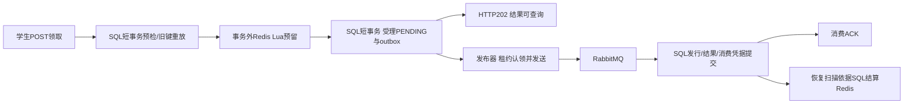

# CampusLife 关键源码复盘路线

2026-11-08首版。先读[证据地图](project-evidence.md)，再按本页顺序理解，不用从全部Java文件开始。[简历初稿](resume-draft.md)。本轮只核对源码和生成材料，尚未验证本人理解。

2026-11-12新增[亮点分级题库](highlight-question-bank.md)及[无答案自测版](questions-only.md)，将每个亮点展开为基础、深入、异常三层；本页继续用于定位和理解实际实现，不替代本人答题。

## 第一步：用自己的话讲清异步领券

先讲这段，再读实现：

> 学生提交领取请求后，系统先检查资格，在Redis中预留，再把受理记录和消息一起写进MySQL；只有持久受理成功才返回202。消费者后续在MySQL中完成最终发行。请求可能重复、进程可能中断，因此每一步需要可查询身份、幂等和恢复，不能把Redis扣减成功当成已经拿到券。

箭头跨越多个本地事务和系统，不是一个分布式原子事务。同步模式走原同步事务；当前默认SYNC，Redis/MQ异步能力需要显式开启，不能说每个请求都经过图中全部步骤。

按顺序只读这些入口：

| 步骤 | 阅读位置 | 要找到什么 |
|---|---|---|
| 1 | [CouponAdmissionService.claim](../../src/main/java/com/campuslife/coupon/service/CouponAdmissionService.java) | 外层Propagation.NEVER；先plan，再reserve，再accept；异常分支先查持久结果，没有直接INCR |
| 2 | [CouponAdmissionTransactions.plan/accept](../../src/main/java/com/campuslife/coupon/service/CouponAdmissionTransactions.java) | 两个短RC事务，锁后复核账号/会话/店铺/门闩/活动资格，PENDING与消息同事务提交；5分钟处理期限仍受券截止约束 |
| 3 | [reserve.lua](../../src/main/resources/redis/coupon/reserve.lua)及[common.lua](../../src/main/resources/redis/coupon/common.lua) | 校验代次、身份、已有预留及计数，最后一个HSET保存可识别预留和free/held变化；不要说“Lua错误一定会回滚之前的写入” |
| 4 | [CouponIssuance.consume](../../src/main/java/com/campuslife/coupon/service/CouponIssuance.java) | 锁后检查截止/资格/库存；持有券、累计发行、请求终态和消费凭据一起提交；Redis预留后SQL仍有最终判断 |
| 5 | [CouponIssueListener](../../src/main/java/com/campuslife/coupon/service/CouponIssueListener.java) | 调用独立事务Bean返回后才ACK；数据库异常最多三次有限尝试，其他非法输入拒绝；死信不是发行成功 |
| 6 | [CouponRedisRecovery](../../src/main/java/com/campuslife/coupon/service/CouponRedisRecovery.java)、[CouponRecoveryTransactions](../../src/main/java/com/campuslife/coupon/service/CouponRecoveryTransactions.java) | 依据SQL终态结算，孤儿先用数据库失败记录仲裁；重建有generation、token和lease，旧任务不能覆盖新代次 |

对照[V18唯一键](../../src/main/resources/db/migration/V18__create_coupon_claims.sql)和[V22异步约束](../../src/main/resources/db/migration/V22__async_coupon_foundation.sql)：每学生/活动持有券唯一、学生/请求键唯一、活动中的领取请求约束、reservation唯一，职责不同。

**重点故障例子：** Redis预留后连接断开，客户端不知道SQL是否提交。如果直接返库存，已提交PENDING可能继续发行，额外库存会被再次预留。当前先查持久请求；无确定结果交给孤儿仲裁/恢复，不能用网络异常推断数据库回滚。[故障证据](../reports/coupon-faults-2026-10-31.md)。这套协议仍有MySQL写入、行锁和消息成本，不是Redis扛住全部业务。

## 第二步：消息为什么可能重复，业务为什么不重复

读[OutboxTransactions.claim/finish](../../src/main/java/com/campuslife/messaging/service/OutboxTransactions.java)→[RabbitOutboxTransport.publish](../../src/main/java/com/campuslife/messaging/service/RabbitOutboxTransport.java)→上面的消费事务/ACK。

发布分为短事务认领30秒租约、事务外发送并等待confirm、短事务按原leaseToken回写。Broker确认后发布进程崩溃，DB可能还显示PUBLISHING；租约到期重新发送同一消息，因此可能重复。消费提交后ACK丢失也可能重投。处理依靠锁后状态、唯一消费凭据及内容身份检查，不是Exactly Once投递。

再读[OutboxPublisher.scheduled/attemptOne/stop](../../src/main/java/com/campuslife/messaging/service/OutboxPublisher.java)：私有单线程＋SynchronousQueue不积压任务；每轮最多32次逐条认领，只有ACK且回写成功才继续；1秒只限制继续认领，在途发送仍有独立截止。8秒是关闭共享等待预算，不代表整个应用必在8秒退出。它减少的是排队等待，不保证每条SQL更快。[完整对照口径](project-evidence.md#指标只能带着口径使用)。

## 第三步：缓存旧回填为什么不会覆盖新版本读取

读[PublicShopCatalogService.detail](../../src/main/java/com/campuslife/merchant/service/PublicShopCatalogService.java)→[PublicShopDetailTransactions.read](../../src/main/java/com/campuslife/merchant/service/PublicShopDetailTransactions.java)→[RatingCache.Load](../../src/main/java/com/campuslife/merchant/cache/RatingCache.java)。然后看[评价事务](../../src/main/java/com/campuslife/order/service/OrderReviewTransactions.java)和[版本Mapper](../../src/main/java/com/campuslife/merchant/mapper/RatingRevisionMapper.java)。

一次详情读取在RR快照中拿到资格、统计版本与对应统计。评价新增/首次隐藏在原事务里推进版本。缓存键带shopId和revision；旧事务迟到回填旧键，新快照按新版本读其他键，不靠删除旧键的先后顺序。旧请求仍可返回其合法旧快照，不是让所有在途请求瞬间变成最新。

外层detail不占数据库事务，RR方法返回并提交后再commit缓存加载；回滚路径不会正常发布加载结果。相同键通过CompletableFuture合并，最多256个进程内在途槽，等待20ms后按自己的快照回源；这是单实例优化，其他实例仍可重复回源。

再看[RedisRatingStore](../../src/main/java/com/campuslife/merchant/cache/RedisRatingStore.java)：非零评价TTL300～360秒、零评价30～45秒；Redis故障短时绕过并回源。资格/营业信息继续读MySQL，列表也不是该缓存范围。为什么保留开关？因为普通/零评价的便宜聚合可能比额外Redis往返更划算。[真实正反结果](../reports/redis-rating-cache-measurement-2026-10-28.md)。

## 第四步：预约并发为什么不是先查再插

读[BookingOrderTransactions.create](../../src/main/java/com/campuslife/order/service/BookingOrderTransactions.java)，依次找到身份/会话、shop共享锁、排班日期保护行、锁后配置/时间复核、lockOccupied和订单写入。保护行由已有排班提供，不在并发下单时临时创造缺失保护行。

半开区间重叠为`a.start < b.end && a.end > b.start`；不能只给startAt加唯一键，因为部分重叠的开始时间可以不同。同理发师/日期相关写入在保护行后串行重判，代价是热点日写并发受到限制。重试同一个创建键还须比对请求摘要，不能把改了内容的重试当作原请求。[V1导读](../design-walkthrough.md)可继续解释锁顺序、状态和模拟资金。

## 第五步：扩展追问再看SQL和S3

SQL：读[PublicShopCatalogService.list](../../src/main/java/com/campuslife/merchant/service/PublicShopCatalogService.java)中的条件分派，再看[categoryFirstPage](../../src/main/java/com/campuslife/merchant/mapper/PublicShopMapper.java)。完整资格过滤在LIMIT前，避免先截取原始ID再过滤导致短页。只采纳有证据的分类首页路径，优化不等于四处加索引。[采纳范围](../reports/public-shop-list-adoption-2026-10-28.md)。

S3：读[FileUploadService.upload](../../src/main/java/com/campuslife/file/service/FileUploadService.java)的暂存、SQL reserve、IO write和SQL publish；再读[FileCleanup](../../src/main/java/com/campuslife/file/service/FileCleanup.java)的墓碑扫描。SQL和对象存储不能一次原子提交，未知PUT可能晚到，因此保留持久墓碑循环处理，而不是超时后DELETE一次就当结束。[真实晚到PUT测试](../reports/s3-recovery-2026-11-02.md)。当前单实例文件互斥不等于分布式锁；下载同长外部覆盖的限制也要能说明。

## 本人复述检查，下一项从前三题开始

| 题目 | 讲清楚的标准 |
|---|---|
| 1. 202为什么不是拿到券？ | 区分预留、持久受理、SQL发行和结果查询；指出accept事务 |
| 2. Lua已经扣减为什么还写MySQL？ | Lua原子范围、最终事实、幂等约束、故障恢复和写成本 |
| 3. SQL提交未知为什么不能直接加回库存？ | 给出已提交但响应丢失的反例，说明先重放/数据库仲裁 |
| 4. Broker confirm和消费ACK区别？ | 指出发布回写前与消费提交后两个重复窗口 |
| 5. 旧缓存回填和“最新一致”是什么关系？ | 版本键、RR旧快照、新请求读新版本，不夸大在途实时性 |
| 6. 为何同一天保护行而非startAt唯一索引？ | 区间部分重叠与稳定互斥点，说明串行代价 |
| 7. 新版p95到底量的是什么？ | POST开始至可观察成功、250ms轮询、三轮中位数、固定负载，非线上QPS |
| 8. 当前项目还有哪些限制？ | 模拟资金、单实例、前端增量暂停、云端探针/综合测量未收口 |

能用自己的话说出反例、代价，并打开相应方法，才算理解。材料存在、测试历史通过或背出缩写均不代替本人复述；本轮不预先勾选任何一题通过。
