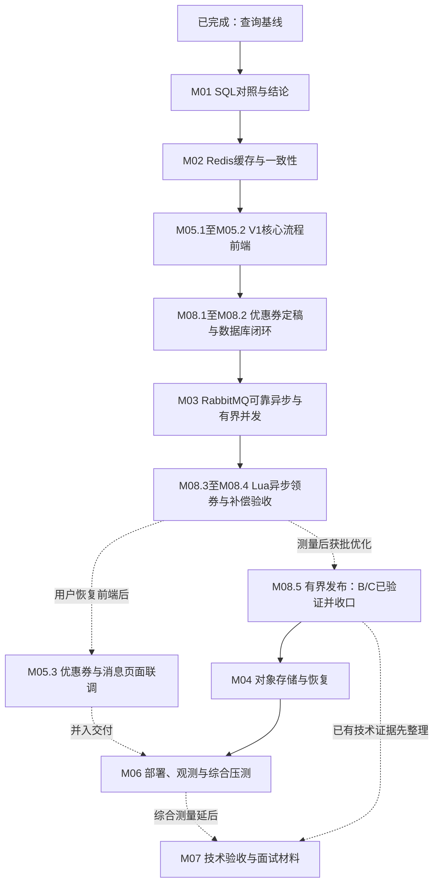

# CampusLife 执行路线图

更新：2026-11-12（按用户要求完成4核心＋3备选亮点的分级题库，63道亮点题＋6道整体题，附回答要点/源码/边界及无答案版；本人回答未验收。首版简历和证据材料保持，下一步优先核心12道基础题自测或逐题讲解，不新增题库支线；服务器/镜像/综合测量延后且未完成，前端暂停）。目标：形成能写入Java后端实习简历、能通过源码和实测回答追问的校园本地生活交易项目，承担“点评类项目”的后端技术展示角色。

**当前定位：V1后端闭环、M01 SQL、M02缓存、M03消息、M08优惠券及故障／测量证据、M05.2最小前端已交付；整个面试项目仍需工程交付与材料收口。** M08.4-B记录旧异步的完整延迟代价；M08.5-C已完成固定旧新对照，完整获券p95中位由约19秒降至0.58～1.15秒，保留180/20券DML成本，不能称整体优于SYNC。M05.2的A～D页面及可操作阶段已验收；预约新单真实到店履约/新评价仍待人工时段，不冒充已通过。M08.5收口，M04.1方案已采用、M04.2-A/B已验证；文件链已支持LOCAL/S3及V24，C故障/备份恢复/隔离预演已验证；M06.1部署/观测方案已采用，A0独立MySQL8.4兼容、A基础Compose、B1双Redis/MQ、B2原生S3 TLS七服务及C私有管理面已验证；D容器组合与指南已交付；E完整隔离冷备恢复已验证；用户后续已说明有阿里云，新ECS条件、工具及基础镜像已核对，云端构建已验证，D.6i已完成维护缺陷回归和剩余定向实机断言；原整链失败及健康探针/SSH观察保持，综合测量延后，面试材料初稿已交付、本人复盘与最终确认未完成。默认LOCAL，临时环境已清理，开发依赖未启用，前端继续暂停。

本文件作为当前任务顺序、状态和剩余范围的统一入口。业务规则以用户明确确认及相应ADR为准，历史报告保留当时事实。用户接受的是定位与优先级调整，具体业务/基础设施方案在对应“定稿”任务中讨论。保留原M01～M07编号，新增M08优惠券；编号用于追踪，执行顺序以下表为准。

## 1. 当前任务指针

| 项目 | 当前状态 |
|---|---|
| 本轮任务 | **M07.1-B题库资料已交付，本人口述未验收**；[亮点/回答要点](interview/highlight-question-bank.md)/[自测问题](interview/questions-only.md)/[核对](reports/interview-questions-2026-11-12.json)。这是用户新明确要求，不是答题通过 |
| 最近完成 | 4核心＋3备选亮点，各3基础/3深入/3异常＝63，另6道整体题共69；映射源码、证据、简历表述与限制，包含本人真实参与/AI辅助/验证问题 |
| 推荐下一项 | **本人自测或逐题讲解**：先H1～H4的12道基础题，或从H3-B1/B2/B3开始；按真实回答补知识和定位源码，不以材料存在自动标理解通过，不继续扩大题量 |
| 延后事项 | 服务器客户端依赖/原七服务C.3/Pilot/综合测量继续未完成，旧失败/探针保持；前端暂停，没有恢复服务器或构建派生镜像的授权 |
| 本项边界 | 仅问答材料和当前文档，463正式输入/29辅助/JAR/133旧证据文件保持；未连ECS/启Docker/构建或运行新测试，没有新性能结论 |
| 之后去向 | 基于本人回答逐题讲解/源码核对→按理解精简简历→本人确认。M07整体/最终简历未完成，云端和前端是否恢复另行明确 |

“进行下一项”默认指本表推荐的一个小任务，不指一次性执行全部路线图。任务完成后更新状态、证据和指针；未开工项不得写成“进行中”。

## 2. 对照最初的V1～V4目标

| 原阶段 | 已交付/现状 | 后续安排建议 |
|---|---|---|
| V1：业务基础与闭环 | 62个已实现操作；理发预约、打印、模拟资金、评价、管理；V1～V15/23表 | 保留为技术深化的业务基础，不重做已验收事务与锁 |
| V2：平台业务完善 | 商家经营、评分、异常处理、文件、同步用券、公开异步领取/恢复及专项故障/测量已交付 | 保留已验收成果；ZSet排行次优先级候选，其余设施/收藏/统计不默认开发 |
| V3：后端技术深化 | SQL采纳、真实缓存一致性、MQ可靠链、Lua/持久化/补偿及JUC已落地并有专项证据 | 不重复事务、锁或幂等；最终版本的综合负载口径和测量仍待M06.2 |
| V4：工程与面试准备 | 最小前端、对象存储、单实例部署/私有观测/备份恢复及实机整改已交付；综合测量延后，面试材料初稿已交付、本人口述待验收 | 前端增量暂停；常驻实例可选，综合测量与源码复盘/材料为后续主线 |

原V2其余需求保留在候选池。Redis/MQ的本地运行环境在对应任务中准备，最终Compose整合不应成为前面所有工作的前置阻塞。另一个AI/Agent项目不进入本项目范围，不要求CampusLife集成大模型来凑齐简历项目类型。

### 状态边界

| 分类 | 本次如何处理 |
|---|---|
| 已完成的事实 | C01～C06的V1基线保持，不重复实现事务、锁、幂等和扫描；当前优惠券/消息交付后为75操作/V24/32张应用表；M02的V16统计版本协议保持 |
| 原定技术主线 | M01 SQL、M02缓存、M03可靠消息、M04对象存储已验证；M05核心页面交付/增量暂停；M06部署实机整改已交付、综合测量待做；M07初稿已交付、本人复述和最终确认待验收 |
| 原有需求升优先级 | 校园商家优惠券原在候选池，现在进入M08主线；热门排行仍是次优先级候选 |
| 仍待实现 | M05.3券/消息页面暂停，M06.2方案已采用/B.1及B.2-A/B/C.1/C.2已验证，C.3代码已接入但健康门槛验收失败，D.7.1限定探针专项/剩余接线及实际测量、M07复盘材料初稿已交付、本人复述待验收；D.7探针/可选实例仍待独立采用，排行等仍为候选 |

## 3. 完成项与证据：后续直接复用

| 编号 | 已交付能力 | 证据与限制 |
|---|---|---|
| C01 | 认证、会话、权限、资料与管理员账号状态 | [全量报告](reports/v1-acceptance-2026-10-26.md)账号模块；JWT＋数据库会话，不是完全无状态认证 |
| C02 | 商家入驻/审核、营业、服务/价目、人员与排班 | 同份全量报告与[包结构](project-structure.md)；版本/批量/存量保护已验证 |
| C03 | 两类订单、模拟支付/全额退款、履约、异常、评价 | 2026-10-26全量55类2675用例通过；4条预约、6条打印HTTP旅程；不是覆盖率或容量指标 |
| C04 | MySQL事务、日期保护行/文件行锁、版本、幂等、唯一约束和恢复扫描 | 真实MySQL并发/回滚测试已有；无需为了技术深化再重做一套锁方案 |
| C05 | 私有PDF及已有JUC应用；文档与人工/自动验收材料 | [文件上传](print-file-upload.md)、[设计导读](design-walkthrough.md)；Semaphore限制两个处理请求、实例内ReentrantLock互斥。打印[人工16项](manual-print-acceptance.md)通过；预约[即时自动报告](reports/booking-immediate-2026-10-27.md)通过，人工履约清单仍未完成 |
| C06 | 公开商家SQL/HTTP查询基线 | [2026-10-28报告](reports/public-shop-query-baseline-2026-10-28.md)：两档1,000/10,000店、11类场景；最终173用例通过；生产SQL/索引未改、无缓存；单并发热读，不是系统容量 |

C01～C06标为“已验证”。这些是特定日期、特定范围的证据；后续改动需做相应回归，不能把旧报告自动当成新版本已验收。

## 4. 推荐执行顺序与依赖

箭头表示推荐推进顺序，不代表所有相邻项存在硬依赖。前端在V1基础上就能开发，MQ也不依赖Redis缓存；该排序方便一次关注一个主题。优惠券异步领取则必须依赖已定稿的优惠券模型和消息协议。暂不指定完成日期，不以赶进度省略故障验证。

2026-11-01新增的M08.5检查点已完成：M08.4-B定位单条发布调度限制，B实现、C真实故障及一次完整固定参数对照已验证并达到目标，停止调参。原M05.3用户暂停继续有效，故后端下一项M04.1方案先行，其余工程目标不删。

| 顺序 | 任务 | 技术目标与本阶段终点 |
|---|---|---|
| 1 | M01 | SQL计划与同条件对照形成结论，避免无限微调 |
| 2 | M02 | 一个真实Redis缓存场景，完成并发失效/回填、故障与测量 |
| 3 | M05.1～M05.2 | 尽早用页面走通学生、商家、管理员的现有业务，不等待对象存储 |
| 4 | M08.1～M08.2 | 定稿优惠券与订单关系，先建立MySQL可验证的完整闭环 |
| 5 | M03 | 建立实际通知链及供领券复用的可靠发布/消费、幂等和恢复协议 |
| 6 | M08.3～M08.4 | 将Lua受理与MQ持久化接入领券，验证库存、结果查询与补偿 |
| 7 | M05.3 | 在原前端补优惠券/消息入口，验证跨角色的营销到履约流程 |
| 8 | M04 | 验证真实私有对象存储及失败恢复；控制为单实例，不追加大文件进阶 |
| 9 | M06 | 部署可复现、可观测，做固定条件下的综合回归/并发/恢复测量 |
| 10 | M07 | 依据真实完成项整理简历与追问材料，用户能够解释源码与取舍 |

### M01：SQL分析与优化结论

技术目标：能用索引、执行计划、实际rows/loops和对照数据解释查询成本。

| 任务 | 状态/前置 | 具体范围 | 验收与停止条件 |
|---|---|---|---|
| M01.1 对照实验 | **已验证**；[2026-10-28报告](reports/public-shop-sql-experiment-2026-10-28.md) | 原版、EXISTS/ID派生分页、限制半连接候选；两档/7场景/两实例，分轮测量；测试夹具复用，生产SQL/索引未改 | 5,040个正式count/page事务样本、18项额外语义检查/档和真实RR验证通过；原HTTP基线复验通过。有收益和回退均保留，不全局套提示 |
| M01.2 采纳或保留 | **已验证**；[报告](reports/public-shop-list-adoption-2026-10-28.md)、[ADR-0047](decisions/0047-public-shop-list-query.md) | 仅分类＋无有效关键词＋第1页采纳静态EXISTS/ID派生分页提示SQL；count、未分类、搜索、后续页/详情保留，未新增索引/迁移 | 两档、三资格分布、九场景；正式采纳3,888个完整HTTP样本、额外语义/RR检查通过；相关回归325项及mysql JAR检查通过，临时实例清理。小档稀疏size100无明显收益，不泛化为所有请求加速 |

已有基线中的评分覆盖索引、评价深分页延迟关联列为后续候选，不全部塞进M01。本阶段不改成前缀搜索、游标分页或预计算统计；这些改变需另行讨论。原事务正确性与RR读取承诺持续保留。

### M02：Redis商家查询缓存

技术目标：真实应用Redis，解释数据库与缓存职责、并发回填、陈旧窗口与降级，用同条件数据证明效果或代价。

| 任务 | 状态/前置 | 具体范围 | 验收与停止条件 |
|---|---|---|---|
| M02.1 缓存方案定稿 | **已确认**；用户明确采用并实现 | [方案及取舍](redis-rating-cache-design.md)、[ADR-0048](decisions/0048-public-rating-cache.md)：详情评分统计，MySQL版本键保留RR，资格/展示/时段仍DB读取 | 已确认V16技术元数据、两个原评价事务内版本维护、Spring Data Redis/Lettuce及可降级本地实例；未将授权扩为其它缓存 |
| M02.2 最小缓存实现 | **已验证**；[指南](redis-rating-cache.md)、[报告](reports/redis-rating-cache-2026-10-28.md) | 详情SUM/COUNT版本键/TTL、有界在途合并、故障绕过；V16回填及原事务维护；固定镜像、专用回环开发/测试Redis，默认关闭、本机显式启用 | 514个不同用例零失败/错误/跳过，含19缓存联测及真实V15升级；命中2/未命中3条业务SQL，RR/晚回填/回滚/并发/真实停机恢复通过，自有测试资源清理。本机启停已验证，用户应用未代重启；无新路径，不宣称速度收益 |
| M02.3 故障与对照验收 | **已验证**；[报告](reports/redis-rating-cache-measurement-2026-10-28.md)、[方法](redis-rating-cache-measurement.md) | 两档/三个店型/1、4、16线程；冷与批量到期、真实暂停/拒绝SET/停机恢复、并发隐藏；事务对照测版本写成本，无生产修改 | 两独立轮次各190普通/Web＋专项1零失败/错误/跳过，原始样本及SQL/锁计数保留。热门明显受益，普通/零评价中位更慢；写开销/锁等待及尾部异常如实记录。M02结束，不追加其它缓存或SLA承诺 |

候选包括Spring Data Redis等适配，但本路线图不固定版本或要求同时使用Spring Cache、Redisson、Lua。后者仅在问题确需且方案定稿后引入。当前定时扫描能从数据库恢复超时处理，不以Redis键过期通知替代唯一可靠入口：该通知基于Pub/Sub，断连会漏事件。[Redis官方说明](https://redis.io/docs/latest/develop/pubsub/keyspace-notifications/)

### M03：RabbitMQ可靠异步、通知与JUC

技术目标：以订单通知形成第一条可运行消息链，并让优惠券异步领取复用可靠发布、消费、幂等与恢复能力。用户已接受RabbitMQ这条主线，具体版本、部署及协议实施前定稿。

| 任务 | 状态/前置 | 具体范围 | 验收与停止条件 |
|---|---|---|---|
| M03.1 可靠消息与通知方案 | **已确认**；[方案](reliable-messaging-design.md)/[ADR-0053](decisions/0053-reliable-order-messaging.md) | 建议BOOKING_ACCEPTED/PRINT_READY_FOR_PICKUP发学生；本人分页/首次已读/90天展示；订单同事务outbox、独立发布确认/消费提交后ACK、去重/有限重试/死信；未来领券消息身份约束 | 通知规则/开关/基础设施及A/B、M08.3-A拆分已确认；Redis具体协议现按ADR-0054确认，C/D尚未实现，不能据公共outbox通过认定跨系统受理安全 |
| M03.2 通知与MQ闭环 | **A/B已验证**；M08.2已满足 | A已实现隔离环境/outbox/两个事务写点/可靠发布，V20一表；B已实现消费去重/通知及本人两入口，V21两表至75操作/31表，不先造通用消息框架 | A的403项不同相关检查分轮最终通过、两个mysql JAR与本机启停通过；B补消费/ACK/权限，M03.3补真实进程/死信故障证据。当前75操作/31表，不能把发布ACK当通知已消费 |
| M03.3 故障与并发控制验收 | **已验证**；[报告](reports/messaging-faults-2026-10-30.md) | 真实子JVM提交前/提交后ACK前/发布确认后中断，重启/接管及死信目标缺失恢复；有限退避/退出预算，8条成本样本 | 65项不同相关检查分轮最终通过，JAR与自有资源清理通过；生产树/POM/迁移未变。不将小样本或单节点结论写为QPS/HA保证 |

RabbitMQ的发布确认与消费确认覆盖不同链路，因此二者及应用事务边界要分别验证。[RabbitMQ官方说明](https://www.rabbitmq.com/docs/confirms)

已有Semaphore/ReentrantLock应用计入JUC成果。M03继续训练任务调度、共享状态和背压，不强求单独制造没有业务用途的线程池。消息用于定稿的通知与优惠券领取职责；原支付/退款、预约占用和到期扫描继续保留，若要异步化资金或替换扫描须单独讨论。

### M08：校园商家限量优惠券（同步闭环及异步入口／恢复已验证；故障与性能分批验收）

业务场景：校园商家发布有限数量的店铺优惠券，学生领取后用于本店现有预约或打印订单。目标是把领取资格/库存、优惠计价、订单履约与取消退款串联，形成有故障验证的营销闭环。优惠券是原有需求，本次新增的是主线优先级、任务拆分和与Redis/MQ的联合研究安排。

**当前源码现状**：M08.2-A～C已经实现活动、同步领取和两类订单用券；创建DTO有可选userCouponId，个人报价/冻结、锁券/释放/核销及旧摘要兼容已接入。[ADR-0052](decisions/0052-order-coupons.md)/[报告](reports/order-coupons-2026-10-30.md)是当前证据。创建事务内初始setDiscountAmount(0L)只是插入占位步骤，随后计算并写入最终优惠，不能据此误判未实现。M08.3-B～D已实现MySQL异步发行、Lua预留／恢复和公开入口，默认仍SYNC；故障验收及性能证据按M08.4-A/B分别维护。

| 任务 | 状态/前置 | 具体范围 | 验收与停止条件 |
|---|---|---|---|
| M08.1 优惠券业务与一致性定稿 | **已确认**；用户明确采用第2～6节及从A开始，[方案](coupon-business-design.md)/[ADR-0050](decisions/0050-coupon-business.md) | 本店满减、终身每活动限领一次、固定总量、发布冻结/停止不撤回既有权益；正实付、原15分钟支付权、未付释放/已付不返、原摘要兼容已确认 | 公共消息链M03已验证；Redis特有协议见已确认ADR-0054，不能把业务批准当作Redis/MQ实现 |
| M08.2 MySQL优惠券与订单闭环 | **A～C已验证**；[活动指南](merchant-coupon-campaigns.md)/[报告](reports/coupon-campaigns-2026-10-29.md) | A本店6操作/V17，B同步领取4操作/V18两表；C两类订单报价/冻结/占用/释放/核销及旧摘要兼容已实现。累计发行/券/请求同事务，RR及安全重放已验证 | A74专项及相关回归最终跨轮去重516项通过，真实锁等待/版本竞争/会话到期回滚、68操作契约及JAR/清理通过。B已验证不超发/超领；C新增19项MySQL专项、2项摘要兼容，相关659项分轮最终通过及JAR/文档/清理通过，见[报告](reports/order-coupons-2026-10-30.md)。不计Lua/MQ完成 |
| M08.3-A 异步受理协议定稿 | **已确认**；[协议](async-coupon-claim-design.md)/[ADR-0054](decisions/0054-async-coupon-claims.md) | 5分钟处理、30秒孤儿仲裁、独立Redis、门闩/代次重建及B/C/D拆分获批，202不保证发行 | 按批实施，不将完整协议批准等同Lua/补偿已实现 |
| M08.3-B MySQL异步底座 | **已验证**；[报告](reports/async-coupon-foundation-2026-10-30.md) | V22/gate、PENDING/FAILED、专用路由/消费凭据、超时；同步/商家写入同一门闩，存量成功保持 | 212项不同检查分轮最终通过，75操作/32表；默认SYNC、公开ASYNC不可启用，Redis未接入 |
| M08.3-C Redis预留与恢复 | **已验证**；[报告](reports/coupon-redis-recovery-2026-10-31.md) | V23保留恢复阶段；独立ACL/AOF/noeviction、Lua条件结算/孤儿仲裁、分批重建/租约接管、私有无积压工作线程 | 191项相关检查分轮最终通过；真实Redis stop/kill/OOM、MySQL竞争、MQ、双实例隔离和升级。未开放新ASYNC受理，不替代M08.4性能/真实JVM故障 |
| M08.3-D 入口联调与受控切换 | **已验证**；[报告](reports/async-coupon-admission-2026-10-31.md) | 三阶段HTTP/首次202/Location、原键查询；本机无HTTP维护与controlVersion、暂停排空/新代次切换，Swagger与同步/订单兼容 | 147项不同检查分轮最终通过，含真实HTTP→Lua→outbox→Rabbit→发行→结算、维护子JVM及并发切换；默认SYNC/依赖关闭，不替代M08.4 |
| M08.4-A 真实进程故障 | **已验证**；[报告](reports/coupon-faults-2026-10-31.md) | 8个测试子JVM真实强杀/重启窗口；真实30秒仲裁/接管，修复四消费者通道耗尽及声明回调争用 | 最终110项相关检查全部通过；库存/截止/恢复意图及SENT/排空保持，独立发布/声明连接负向对照、原路由/Broker恢复与JAR通过；不替代性能/HA测量 |
| M08.4-B 同条件性能对照 | **已完成**；[报告](reports/coupon-measurement-2026-11-01.md) | 独立无mock应用，24轮/2052 POST；三档各3组配对，SQL/Redis/MQ/进程及请求CSV | 不变量/9项不同检查、统计复算、JAR及清理通过；行锁等待局部改善，DML60→180，ASYNC完整p95约19秒受1秒单条发布限制；无整体加速/容量结论 |
| M08.5-A 有界发布优化定稿 | **用户已明确采用**；[方案](outbox-bounded-publishing-design.md)/[ADR-0055](decisions/0055-bounded-outbox-publishing.md) | 私有单线程/SynchronousQueue、32次逐条claim/1秒继续预算、失败结束/总8秒关闭及B/C拆分已获批 | 业务规则和原持久化协议保持，批准不等于性能验收 |
| M08.5-B 发布实现与正确性 | **已验证**；[报告](reports/bounded-outbox-publishing-2026-11-01.md) | 已封存旧376类/资源与JAR、115依赖指纹；发布组件/配置及42个新增边界检查，复用原claim/finish/transport | 182项不同相关检查分轮最终通过，真实MySQL/Broker/Redis、订单到期调度隔离与JAR/清理通过；无HTTP/迁移/依赖/前端变更，不称收益已验证 |
| M08.5-C 真进程故障与一次对照 | **已验证并收口**；[报告](reports/outbox-publisher-comparison-2026-11-01.md) | 完整类路径替换/哈希与唯一资源校验；11个真实JVM窗口；正式旧新各24轮/4104 POST | 62项不同相关检查最终通过，各档完整p95中位0.58～1.15秒、较旧异步降93.88%～96.95%，目标通过；首次第11轮队列断言失败及修复/重跑、成本/时序漂移保留，不外推容量/HA |

2026-10-31将M08.4拆为A故障、B测量：真进程恢复需要独立停点和等待，性能需要固定健康负载与配对口径；拆开避免把正确性通过当成性能通过，不改变已批准协议或引入新技术。

**原M08.1定稿问题（已由ADR-0050/0052及M08.2回答，作为历史核对清单，不重复确认）**：

- 发行库存是“能发多少张券”，持有券是否可用是另一条生命周期；未支付取消后释放持有券，不等于自动补回活动发行库存。两类规则分别定义，不能用一个库存数代替。
- 满减基数、最大优惠、是否允许0元单、报价后规则变化、领券到期与订单占用跨期如何处理。当前正实付约束需要明确保留或通过新决策调整，不能靠夹断金额掩盖。
- 学生限领按账号/活动如何定义，学生或店铺停用后的领取/使用/旧单处理、商家改券/停券与已领取权益如何协调。
- 券ID如何进入创建归一化摘要和冻结快照；如何兼容既有幂等记录，避免新增字段导致旧键无法重放；取消/超时/支付与券操作如何按原锁协议一致提交。
- 已支付退款按原基线默认不返券；未支付取消/超时/券到期释放细则已按ADR-0052实现。营销审计与订单事件各记录什么，也需限定。

**技术可行性与待选择边界**：

| 技术 | 业务职责候选 | 必须验证的边界 |
|---|---|---|
| Redis Lua | 限量领取的原子资格/库存预检查与受理去重 | 原子性覆盖Redis脚本操作，不能自动包含MySQL与MQ。预扣后发布前崩溃、响应丢失和脚本重试都需有可恢复身份 |
| MySQL | 券/领取/订单优惠的持久事实、库存与业务唯一约束、券占用核销事务 | 异步消息重复或Redis数据丢失也不能超发、重复领券/核销；库存更新、领取事实和结果写入的原子性用真实数据库验证 |
| RabbitMQ | 削峰并异步持久化已受理领取，通知沿M03独立承载 | 发布与消费确认不等于跨系统原子提交；确认丢失会触发重试，消费业务必须幂等。积压、重试上限、结果可查询与恢复必须可观测 |
| 对账/补偿 | 恢复失败预留、核对发行库存和领取事实、重建Redis | 补偿与成功消费竞争时不能重复返还；数据库与Redis不一致时明确以什么事实重建，不能定时盲目把缓存库存写回数据库 |

候选研究“数据库受理记录/outbox”或其他具备可恢复来源的转发协议。仅“Lua预扣后直接发MQ”会留下崩溃窗口；outbox只能保护其所在数据库事务，不能把Redis预扣一起变成原子事务。若受理本身需要数据库写入，必须计入成本，不预先承诺数据库完全不承压。具体路径在M08.1/M03.1确认，不在此伪装成已完成方案。

本模块按校园商家优惠券规则建模，不复制教程的秒杀订单表或脚本。先把M08.2做正确，再用同条件实验评估异步路径的吞吐、延迟和恢复代价；不把购物优惠券做成独立、与原订单无关的并发演示。[Redis脚本原子执行边界](https://redis.io/docs/latest/develop/programmability/eval-intro/)、[RabbitMQ可靠性](https://www.rabbitmq.com/docs/reliability)供设计时参考。

### M04：对象存储与文件恢复

技术目标：在已有受控PDF业务上应用对象存储，解释元数据、对象IO、访问权限与恢复的边界。

| 任务 | 状态/前置 | 具体范围 | 验收与停止条件 |
|---|---|---|---|
| M04.1 存储与迁移方案 | **用户已采用**；[方案](object-storage-design.md)/[ADR-0056](decisions/0056-private-object-storage.md) | SeaweedFS单节点S3＋SDK 2.x；LOCAL存量共存、新上传显式选后端、代理下载、未知PUT墓碑复核；不自动迁移实际文件 | 已确认A/B/C范围，真实搬迁/删除另行授权，批准不等于实现 |
| M04.2-A 隔离兼容底座 | **已验证**；[报告](reports/s3-compatibility-2026-11-02.md) | 固定4.51 digest及SDK2.57.8/Apache5，test profile隔离、专用资源；实际固定长度编码及最小权限组合、重启/超时 | 33协议＋38原LOCAL＝71项最终通过；115生产依赖指纹保持，497个既有代码/脚本/前端文件保持，普通构建/web-only JAR/清理通过。启动/编译/首轮33失败及修复保留，无业务/DB集成 |
| M04.2-B 文件链与存量兼容 | **已验证**；[报告](reports/s3-file-chain-2026-11-02.md)/[指南](s3-file-storage.md) | LOCAL/S3完整定位路由、共享暂存/互斥、V24约束/索引；原HTTP链及首次打印创建、私有清理/永久墓碑，默认LOCAL | 918项不同相关检查分轮通过；真实MySQL＋S3权限/事务外IO/原引用和资金保护、V23升级、JAR与清理。75操作/32表，无真实文件搬迁；迟到IO真进程与备份留C |
| M04.2-C 故障与恢复验收 | **已验证**；[报告](reports/s3-recovery-2026-11-02.md)/[指南](s3-recovery.md) | 真JVM/原始迟到PUT、完整DB/存储/LOCAL备份恢复、仅恢复副本的迁移/丢响应重试、限时Swagger环境 | 110项不同检查通过；4业务强杀窗口，新实例33表含Flyway/旧内容一致，原LOCAL保留；无生产改动，运行资源清理。下载SHA边界/冷写超时记录，不承诺HA/RTO |

现有本地存储是[ADR-0031](decisions/0031-print-file-upload.md)明确确认的选择，不是未接好对象存储的缺陷。本阶段是原始技术目标的后续深化。对象存储不自动使应用支持多实例；原实例互斥、任务协调与数据库规则仍需按方案处理。

### M05：最小业务前端与联调

技术目标：使三种角色可以使用核心业务，展示接口协作、鉴权和失败反馈；控制UI投入。

| 任务 | 状态/前置 | 具体范围 | 验收与停止条件 |
|---|---|---|---|
| M05.1 页面与接口清单定稿 | **已确认**；2026-10-29用户采用[方案](minimal-frontend-design.md)，[ADR-0049](decisions/0049-minimal-frontend.md) | Vue3/Vite/TypeScript/Router/Element Plus，13模块覆盖61业务操作；轻量会话与fetch、同源开发代理；无订单/评价管理列表接口则按ID处理 | 接口/源码映射及登录/版本/报价/网络未决创建/下载/时区交互定稿，A→B→C→D逐批推进，不重复询问已确认选型 |
| M05.2 V1最小前端与联调 | **A～D已交付，可操作阶段已验证；真实时段预约末段待补**；[A](reports/frontend-batch-a-2026-10-29.md)/[B](reports/frontend-batch-b-2026-10-29.md)/[C](reports/frontend-batch-c-2026-10-29.md)/[D报告](reports/frontend-batch-d-2026-10-29.md) | 61业务操作映射；认证/经营/打印/预约/异常与管理。D114客户端测试、28功能＋4窄屏浏览器点及191项后端定向/JAR/清理通过；C窄屏补齐，A用户改密证据保留 | 本阶段页面与可操作流程停止扩张，转M08.1；新预约到店开始/完成及随后评价尚未等真实窗口，按指南用日常后端人工补验。预览最长90分钟不等2小时前置，不以历史时钟/合成完成单冒充 |
| M05.3 优惠券/消息联调 | **当前停止前端推进**；保留后续候选安排，待M08.4/M03及用户恢复前端 | 在已有页面补商家发券、学生领取/查询结果、下单选券、券订单/退款结果及定稿通知入口，管理员仅接已确认管理范围 | 恢复后用真实浏览器核对异步受理与最终结果、优惠金额、券状态和消息归属；当前不改前端、不借联调继续扩UI |

用户已接受最小前端前移及M05.1具体方案。A～D页面与可操作阶段已交付，真实时段预约末段单独保留；后续M05.3增量接券/消息，不追加大屏等功能。前端不阻塞SQL与缓存验证，也不要求先完成全部营销页面再研究MQ。

### M06：部署、观测与综合性能验证

技术目标：在可复现环境中运行、定位问题、展示故障恢复和有边界的性能结果。

| 任务 | 状态/前置 | 具体范围 | 验收与停止条件 |
|---|---|---|---|
| M06.1 单实例部署与观测 | **部署/恢复及实机整改已交付，D.7交接方案已整理**；[D.6i报告](reports/cloud-final-remaining-2026-11-06.md)/[交接方案](cloud-operations-handoff-design.md) | 原main恢复/实际领券及安全钩子通过；保留探针/SSH观察，回执基础随M06.2-B.1交付，D.7其余建议未实施 | 不追加常驻部署为必选项；正式测量前明确探针与运行器条件，无公网/真实迁移默认授权 |
| M06.1-D.3 小内存演示适配 | **已授权/交付并预验证**；[指南](compact4g-deployment.md)/[报告](reports/compact4g-deployment-2026-11-04.md)，29组实链/资源＋5组配置 | 显式新showcase/同一业务JAR，七服务共用两CPU、常驻上限3 GiB；不靠Swap或关闭组件过关 | 本地预验证已收口，不追加故障/压测；约7.60 GiB宿主不等于4 GiB实机，临时CLI额外占用、E冷备暂拒绝该profile |
| M06.1-D.2 云端条件核对 | **新机只读条件核对完成**；[报告](reports/cloud-preflight-2026-11-04.md)，未安装或部署 | 新机SSH及资源已读；环境工具缺失，Docker Hub探测超时；云安全组未核对 | 本项已收口，不把只读检查当业务运行验收 |
| M06.1-D.4 新机环境/固定镜像准备 | **已完成：工具/账号及六种原固定基础镜像已验证**；[阶段记录](reports/cloud-tools-2026-11-04.md) | 原官方签名源安装完成，专用用户经明确授权；保留自动pull/传输失败，用户PowerShell六包已完整到达并核验 | 六种原固定引用/ID/平台/层均一致，containers/volumes为空，未构建或启动业务，不追加云服务/未知代理/改摘要 |
| M06.1-D.5 云端构建准备与验证 | **已完成**；[操作](cloud-build.md)/[报告](reports/cloud-build-2026-11-04.md) | 先形成明确白名单源码包/摘要清单，排除开发目录/秘密/数据，再传输并在业务未运行时构建JAR及应用镜像 | 目标源码摘要与批准包一致、实际构建/制品证据通过才收口；依赖下载失败如实保留，不复制整个工作区，不启动实例或公网服务 |
| M06.1-D.6 compact4g实机运行验收 | **维护整改及剩余断言已收口，原三轮整链仍为失败**；[原报告](reports/cloud-host-acceptance-2026-11-05.md)/[D.6i报告](reports/cloud-final-remaining-2026-11-06.md) | 原交易/原卷重启证据保持；D.6g修复和D.6h新制品后，D.6i单次32项＋5组配置实际回归/剩余钩子通过 | 不拼接成一轮新整链通过；保留探针/SSH观察，无运行实例，不作持续健康/容量/HA结论，交接随后定稿 |
| M06.1-D.6a Resume专项诊断 | **已完成诊断，未修复**；[报告](reports/cloud-resume-diagnosis-2026-11-05.md) | 真实原五卷重启＋技术已发券记录，单次原Resume的首次runId/INFO冷连接捕获RedisCommandTimeoutException；SQL新票据仍有效，发行计数保持 | 原制品/预算不改、资源清理；不据本次异常追认两次旧泛化失败同因，不将诊断退出0当Resume成功 |
| M06.1-D.6b 冷/热连接只读对照 | **已完成**；[报告](reports/cloud-connection-comparison-2026-11-05.md) | 原五卷重启、同维护上下文两次INFO：3619ms超时/311ms成功；无票据，门闩/计数不变 | 未修改预算/业务/制品，资源清理；没有调用Resume，不将对照通过写成D.6通过 |
| M06.1-D.6c 维护票据前连接预检 | **已采用/实现并定向验证**；[报告](reports/maintenance-preflight-2026-11-05.md)/[方案](coupon-maintenance-preflight-design.md) | 两生产类变化；同类连接超时最多再读一次，中断停止，失败无新票据；35项相关检查/新本机JAR、云端新源码真实Redis链通过 | 156依赖/预算/HTTP/后台保持；云端旧release未改，临时编译类不冒充正式新JAR/镜像验收，D.6仍未通过 |
| M06.1-D.6d 修复版云端制品核验 | **已完成**；[报告](reports/cloud-preflight-build-2026-11-05.md) | 新release5382d9dd9ca2，462项/652140字节包；单次构建91.229秒，正式新JAR/镜像生成，原Linux缓存复用 | 649条目内容全同已验证本机新包/156依赖保持、平台/用户/JRE层/标签通过；测试未执行、未运行业务，旧有效源码/制品和空运行资源核对 |
| M06.1-D.6e 新制品剩余实机边界 | **已执行，未通过**；[报告](reports/cloud-remaining-acceptance-2026-11-05.md)/[范围](cloud-remaining-acceptance.md) | Admin目录umask问题已修复且正常审核完成；末次初次Resume在预检返回固定拒绝码，13检查＋5配置；后续发行/重启/最终钩子未执行 | 两次失败分别留证不累计，正式制品/业务规则保持，资源/秘密清理；部分40采样不能当资源验收通过 |
| M06.1-D.6f 正式维护预检诊断 | **已完成诊断，新修复未实现**；[报告](reports/cloud-preflight-trace-2026-11-05.md) | 首次握手超时栈已捕获，二次成功、原Resume完成；同字节库确认500ms进入初始化计时器；SQL前后PAUSED→OPEN无遗留票据 | D.6e最终拒绝未复现，extra观察入口非原main且影响时序；不追认全部旧失败根因，不判验收通过，预算/制品保持、资源清理 |
| M06.1-D.6g 维护初始化预算隔离 | **已采用/实现并定向验证**；[方案](maintenance-initialization-budget-design.md)/[报告](reports/maintenance-initialization-budget-2026-11-05.md) | 真实Redis最终五项＋14单元＋12真实MySQL通过，新JAR启动通过；仅维护profile初始化/URI及同步等待5秒，固定expiry500ms | TCP300/HTTP后台500/两次预检/lease30/CLI90保持；原失败留证，云端正式包未更新，无原main恢复/重启/新领券验收，不称D.6通过 |
| M06.1-D.6h 修复配置正式制品 | **已完成构建/静态核验**；[报告](reports/cloud-initialization-build-2026-11-06.md) | 463项/653227字节包，新release1cf0cb53a24a，JAR6311c16a.../镜像76569040...；与D.6g本机649条目内容全同/156依赖保持，旧两版本保留 | 单次88.580秒，测试仅编译未执行；资源为空，未Init/运行业务，不称D.6通过 |
| M06.1-D.6i 新正式包剩余实机边界 | **单次通过**；[范围](cloud-final-remaining-acceptance.md)/[报告](reports/cloud-final-remaining-2026-11-06.md) | 841.056秒，32项＋5组配置；初次/重启后原main Resume与实际发行、原事实/会话/幂等、资源/安全钩子全部通过 | 73采样非容量结论；Rabbit健康探针超时和SSH重置留证、原因未定；同轮回执恢复非重跑，全部自有资源/生成秘密清理 |
| M06.1-D.7 云端观测与交接 | **方案已整理，回执/资源底座分批交付，其余建议待采用**；[方案](cloud-operations-handoff-design.md) | 推荐无常驻实例；C.3因原探针门槛失败停止，先具体D.7.1诊断范围，不默认新实例或SSH排障 | 原Rabbit/SSH原因仍未定；历史失败与资源回执保持 |
| M06.1-D.7.1-A 探针具体诊断方案 | **用户已采用**；[方案](rabbit-probe-diagnosis-design.md) | 单Broker480秒含清理，原探针/资源/权限不改，两个60秒固定观察及单条/组合副本，HTTP语义和权限单列 | 仅辅助与一次诊断，不承诺找到旧根因；候选未验证，处理另据证据讨论，不自动C.3/Pilot |
| M06.1-D.7.1-B 诊断辅助与单次执行 | **B/B.1准备失败保持，B.2按规则截断结束**；[最新观察](reports/rabbit-probe-observation-2026-11-07.md) | A完整、B组合副本5.006秒截止，第一段结束后第二段未返回；原输出-1仍UNKNOWN | 未确定旧根因，C.1随后确认原镜像缺客户端，未换探针；收尾路线见当前指针，不自动追加诊断 |
| M06.2-A 综合负载方案 | **已采用，分批实施**；[方案](comprehensive-load-design.md) | 正式包固定混合四类前台请求，3档前台并发/3批平衡，先单Pilot；合成历史与计时准备明示，端到端完成/成本/正确性分别报告 | 工具与挂载已分批验证，C.3健康门槛未通过，Pilot/正式批次预算尚未执行；禁止拿202当发券吞吐或跨旧报告计算收益 |
| M06.2-B.1 监督与同case回执 | **已验证**；[报告](reports/case-runner-2026-11-06.md) | 单次启动/查询/原子结果、输入和进程身份、绝对截止/清理；Linux16项及一次真实SSH客户端关闭后原case取回通过 | 只覆盖可信脚本会话/work；无Docker适配/自动接管/SIGKILL或宿主重启清理保证。未启动业务依赖或正式负载，不能仅用SSH退出码判断任务结果 |
| M06.2-B.2-A V24数据夹具 | **已验证**；[报告](reports/measurement-fixture-2026-11-07.md) | 独立源码/库版本与空库保护，固定1000店/11000历史订单评价/180学生/暂停活动，预期与完整回滚核对 | 单次24Java＋6宿主检查；只测FORMAL种子，PILOT分支及HTTP未验证。普通收尾通过，不代表七服务故障清理或性能 |
| M06.2-B.2-B 请求与统计工具 | **受控验证完成**；[报告](reports/measurement-driver-2026-11-07.md) | 最终54项，固定计划/并发、超时和未发送、轮询/删失、响应预期、nearest-rank及原始JSON/CSV | 仅临时本机HTTP端，无DB/ECS或业务性能；实际发行与排空由外部事实核对，FIXED3/90/60及250/25ms保持 |
| M06.2-B.2-C.1 资源登记与清理 | **已验证**；[报告](reports/measurement-resources-2026-11-07.md) | 原子先登记根目录、原部署实现进程内输出绑定、初始化强杀/已创建未落账接续；资源/清单/链接与未知状态保护 | 最终30项，不运行DB/业务；未知缺席或pending必须拒绝，测试专用修复不可当作任意迟到创建或宿主重启恢复 |
| M06.2-B.2-C.2 组件指标/事实核对 | **已验证**；[报告](reports/measurement-facts-2026-11-07.md) | 最终37项/9采样；SELECT-only RR/EVAL_RO/四队列GET，身份/代次/真实存储中的合成发行事实与排空核对，异常/缺失/计数重置保护 | 四组件＋一次原Resume，非正常HTTP发行或性能结论；三轮清理，原制品保持。两次稳定观测不是分布式原子快照 |
| M06.2-B.2-C.3 总入口接线 | **已实现，验收未通过**；[原记录](reports/measurement-runtime-2026-11-07.md) | 七服务就绪/事实核对后，健康基线被原探针失败阻止，业务测量未放行 | B.2诊断取得有限超时线索，C.1缺HTTP客户端停止；原C.3未重新执行。收尾或材料提前均以当前待选提案为准 |
| M06.2-B.3 单次Pilot | **未开始** | 一次小样本核对网络/权限/指标/正确性、PILOT库存2分支与清理，原main仅计时外Resume | 旧夹具保护不放宽、无业务class覆盖，Pilot不计正式性能；探针或兼容条件失败先限定专项 |
| M06.2-C1/C2/C3/D 综合测量与汇总 | **未执行** | 逐批3个正式case，每批3段；每段600前台请求/最多90秒，另有轮询/60秒观察及窗口外重放；汇总各接口/并发/重复分布与不变量 | 每次一个case；保留截断/失败和次要指标缺失，不混合口径或外推容量。既有故障/恢复证据复用，结束测量后转M07，不预设QPS/无限优化 |

监控/日志只覆盖本项目实际运行与排障需求，不默认搭建一整套大型可观测平台。测试工具可用JMeter或其他可复现工具，届时确定；选工具不等于压测完成。

### M07：最终技术验收与面试交付

技术目标：每项简历表述都能追溯到真实源码、实验和取舍，用户能够解释。

| 任务 | 状态/前置 | 具体范围 | 验收与停止条件 |
|---|---|---|---|
| M07.1 技术证据归档与本人复盘 | **A首版与B分级题库已交付，本人复述待验收** | [证据地图](interview/project-evidence.md)、[源码路线](interview/source-review.md)、[分级题库](interview/highlight-question-bank.md)；材料准备与本人答题分开，综合测量仍未完成 | 能解释问题、方案、替代、失败与验证，并定位关键代码；本人口述通过前不标M07完成 |
| M07.2 简历与演示交付 | **简历初稿已随A提供，最终表述待本人确认** | [初稿](interview/resume-draft.md)四条无数字＋有条件数字句/SQL与S3替换项；最终追问/演示材料按本人理解修订 | 不虚构运营/贡献/性能；材料存在不代替理解。演示和最终交付尚未完成，不自动恢复公网或前端 |

## 5. 与原路线图相比的变化

| 内容 | 原安排 | 本次调整及理由 |
|---|---|---|
| 项目定位 | 通用校园业务闭环＋技术深化 | 明确承担本地生活/点评交易类简历角色；保留理发/打印特色与已验收V1 |
| M01/M02/M03 | SQL、缓存、通知/MQ分别推进 | 三条技术主线保留；M03同时为券异步领取提供可靠性协议，避免技术与业务脱节 |
| 优惠券 | 暂缓候选 | 新增M08主线编号；业务规则→数据库订单闭环→Lua/MQ领取→故障/性能验收。优先级方向已接受，细则尚未确认 |
| 前端 | M04对象存储后整体开发 | M05.1～M05.2前移到缓存阶段后，M05.3增量接券/消息，提前获得可用的跨角色界面 |
| 对象存储 | 在前端之前 | 保留M04，放在核心营销/异步和前端联调之后；单实例与恢复目标不扩大 |
| ZSet排行 | 一般候选 | 明确为次优先级候选；先证明热门指标、用户用途和排序需求，不为使用ZSet先做排行榜 |
| 最终交付 | 部署、测量、材料 | 保留M06/M07，将优惠券完整成功延迟、消息积压/恢复和用户本人理解纳入验收 |

## 6. 次优先级与暂缓候选池

以下均未因路线图创建而获得实现授权。建议只有能补足技术学习目标或用户明确需要时才加入主线。

| 候选 | 当前进度/规则 | 可能用途及进入条件 |
|---|---|---|
| 热门排行、Redis ZSet（次优先级） | 真实评分已完成，热门规则/排行未实现；不属于M02/M08默认范围 | 先明确学生发现商家的需求与“热门”指标、时间窗、数据来源、更新/重建、隐藏评价/停用商家的处理和延迟。确认后才增加任务；验证相同分数排序、去重更新和重建结果，不能把评分均值直接等同热度 |
| 设施、收藏、商家回复、图片、举报/投诉、复杂售后 | 相关扩展未齐全，管理员隐藏评价/异常关闭不能等同完整投诉系统 | 明确新增学习价值和用户优先级后安排；普通CRUD不阻塞缓存与消息主线 |
| 商家/平台统计与Excel报表 | 尚未形成统计报表模块 | 如果需要深化聚合SQL与导出，再限定一份有用报表；不自动增加经营大屏 |
| 分布式锁、集群、多实例、微服务、分片上传/WebSocket | 未作为当前交付目标 | 出现明确需求、边界和验证环境才讨论；当前本地单实例正确性不靠添加技术名称“升级” |

## 7. 后续每项任务如何推进

1. 开始时给出任务编号、为何现在做、范围、前置状态、完成标准。实现细节由agent自主处理，已批准规则不反复问。
2. 涉及新业务、读取语义变化或重要基础设施时，先完成可审阅的具体方案，再讨论定稿；普通等价修复与已授权验证继续完成。
3. 每项交付实际代码/文档、相关测试与异常边界、用户学习入口和未解决项。性能项保存原样本与对照条件，不把无收益实验写成成功优化。
4. 更新本表状态与证据，推荐一个后继小任务。执行中出现新事实可调整，但须写明原因、影响和被替代项，不偷偷扩展范围。

建议状态词：**已验证、待执行、待定稿、进行中、条件项、暂缓候选**。M01/M02已验证结束；M05.1已确认、M05.2页面及可操作阶段交付，真实预约人工末段待补，前端停止推进。M08.2优惠券业务、M03消息、M08.3公开异步/恢复、M08.4故障/测量和M08.5一次有界优化均已按审定范围验证；M04已交付；M06.1部署/恢复与实机整改已交付，M06.2方案已采用/B.1及B.2-A/B/C.1/C.2已验证、C.3接线验收未通过，Pilot及正式测量未执行，M07.1-A材料初稿已交付，M07整体验收未完成。不把后端技术主线收口等同整个面试项目完成，亦不使用缺乏任务权重的“整体完成百分比”。

每个里程碑的学习验收至少包括：用户能解释一个核心方法、一个失败案例及选择该技术的理由。自动测试负责验证可重复行为，用户是否已经掌握单独记录，不互相代替。

## 8. 路线图维护记录

| 日期 | 调整 | 理由与边界 |
|---|---|---|
| 2026-10-28 | 建立本入口；汇总C01～C06；提出M01～M07推荐顺序和候选池 | 用户要求恢复全局规划，以面试技术应用为主线；本轮仅文档，无新业务/基础设施批准或执行 |
| 2026-10-28（定位调整） | 保留M01～M07编号，新增M08优惠券；M03结合通知/领券可靠性，M05分批前移，M04后置，ZSet次优先级 | 用户明确接受校园本地生活/点评交易类定位及调整建议；本次只改规划，券规则、异步协议和前端范围仍待定稿，无业务代码/迁移/接口或组件安装 |
| 2026-10-28（M01.1） | SQL实验已验证，指针推进M01.2；增加方法、可复现工具与报告 | 两候选＋原版，保留分类收益与无分类/小数据回退；仅测试工具与文档改动，无生产查询/索引修改，不把SQL事务耗时当HTTP收益 |
| 2026-10-28（M01.2） | 分类首页实际SQL采纳并验证，M01结束，推荐M02.1待定稿 | 预验后保留未分类原版；正式完整HTTP对照、三资格分布及325项回归通过，无新索引/迁移/接口。M02未启动，历史报告保留当时源码及口径 |
| 2026-10-28（M02.1草案） | 提出详情评分统计版本缓存，待本次确认 | 基于真实详情聚合/评价写入口与历史基线，建议V16技术元数据、版本键保留RR，客户端沿Boot BOM；仅文档，未加依赖/迁移/缓存，Redis及Docker运行环境未验收 |
| 2026-10-28（M02.2） | 用户确认后实施详情评分缓存，指针推进M02.3 | V16技术版本＋真实Redis/MySQL，514项不同用例通过、四个成功MySQL实例JAR及清理通过；本机开发Redis保留。未增加接口/其它缓存，尚未测完整性能收益 |
| 2026-10-28（M02.3） | 两轮故障/完整HTTP与写成本对照通过，M02结束，推荐M05.1待定稿 | 8,640热读＋672冷/到期HTTP、1,536事务样本，全部结果正确并清理测试资源；热门受益和普通退化均归档，无生产/协议/接口变化，不等同线上容量 |
| 2026-10-28（M05.1草案） | 核对62操作及源码，提出13模块、Vue前端、会话/代理/失败恢复与M05.2四批范围，待用户确认 | 仅设计文档及路线图更新，无业务代码/依赖/迁移/接口变化；管理员按ID处理及预约真实时间限制明确保留，不提前宣称浏览器验收通过 |
| 2026-10-29（M05.2 A） | 用户采用M05.1，记录ADR-0049并实施首批：工程/认证/资料/公开浏览/角色壳 | Node官方校验、锁文件重装、31客户端测试/类型构建、21个agent浏览器检查点及用户改密重登通过。修复包装器原生stderr日志捕获，独立补验191项后端及mysql JAR/清理；原浏览器结果不冒充新轮重复执行。生产后端233文件摘要保持，仍62操作/V16/24表，B～D未实现 |
| 2026-10-29（M05.2 B） | 接入商家申请/拒绝重提/审批、资料/营业时间/服务、打印价目、理发师绑定/排班 | 57项客户端测试、类型构建、28个浏览器检查点及191项后端定向/夹具和mysql JAR/清理通过；原生confirm阻塞后改页面内草稿选择并复验。后端233文件摘要保持，无新依赖/规则/接口；C/D仍未开始 |
| 2026-10-29（M05.2 C） | 接入PDF/报价/下单恢复、本人订单、商家打印任务及评价；扩展仅隔离使用的成功响应丢失注入 | 91项客户端测试/构建、31个桌面浏览器功能检查点、5笔订单、下载字节一致、191项后端定向及mysql JAR/清理通过。修复清会话时重建打印页空白并复验；390px未生效不计通过，D联调补核。后端233文件保持，无新业务规则/接口，D及营销未实现 |
| 2026-10-29（M05.2 D） | 预约与两类订单、管理员核实/账号/评价页面接通；C窄屏用Chrome真实390px补齐 | 114客户端测试/构建、28功能＋4布局点、4笔真实订单、191项后端定向/JAR/清理通过。后端233文件保持；新预约开始/完成及新评价未等真实窗口，不以合成历史单或旧自动报告替代。进入M08.1仅业务定稿，优惠券/MQ未实现 |
| 2026-10-29（回到后端/M08.1提案） | 用户要求先停止前端；提交店铺满减券/两类订单/锁序兼容及异步可行性方案，待确认后进入M08.2-A | 仅文档，未实施优惠券/Redis Lua/MQ，仍62操作/V16/24表；修正旧状态概括及“M08.3具体受理已确认”的歧义，不扩大原方向授权。M05.3待用户恢复前端，已有交付/人工末段待办保留 |
| 2026-10-29（M08.2-A） | 用户采用M08.1并授权A；新增商家活动6操作、V17一表、ADR-0050及Swagger/Apifox指南 | 74专项及相关回归最终跨轮去重516项通过，记录首轮测试时钟设置和文档扫描/标签修复；MySQL可执行包/契约导出/测试清理通过。仅活动，68操作/25表；领取/订单用券/异步及前端仍待后续 |

下一次只有在实际开工、交付或用户调整优先级时更新状态。历史验收报告中的阶段限制保留；README的当前说明指向本文件，避免把旧“待开发”段落当作今天的进度。

2026-10-30 M08.2-B：同步领取/本人读取与公开活动目录4操作、V18两表，8专项＋相关回归286项通过；下一项C，前端暂停。

2026-10-30 M08.2-C：73操作/V19/28表，两类订单用券闭环与659项相关检查分轮最终通过；下一项M03.1定稿，前端暂停。

2026-10-30 M03.1：根据真实事务整理[可靠消息与通知提案](reliable-messaging-design.md)，待用户确认；提出M03.2分A/B及M08.3-A单独协议定稿，均未开工。顺带纠正M08旧源码基线描述，未新增已实现能力。

2026-10-30 M03.2-A：V20/29表，73操作，真实RabbitMQ及403项不同相关检查分轮最终通过；开发Broker停止/卷保留，默认关闭传输。下一项B消费/本人接口，未声称M03整体完成。

2026-10-30 M03.2-B通知链验证通过，253项不同相关检查分轮最终通过；下一项M03.3，真实进程/ACK/死信故障仍待验证。

2026-10-30 M03.3：消息通知主线在既定范围完成，故障/并发65项分轮最终通过；下一项M08.3-A定稿，前端暂停。

2026-10-30 M08.3-A：完成[待确认协议](async-coupon-claim-design.md)，从真实源码明确请求扩展、发行条件、路由及M02 Redis隔离缺口；提出5分钟/30秒期限、门闩与墓碑/重建协议及B/C/D分批。仅文档，未启动服务、未写业务代码或迁移；原2分钟候选未采用，不将新规划计入75操作/V21/31表。

2026-10-30 M08.3-B：用户采用ADR-0054并授权B；75操作/V22/32表，212项不同相关检查分轮最终通过，含37项MySQL专项、4项真实券RabbitMQ及V21存量升级。保留默认SYNC、公开异步入口关闭；修正测试会话时间和可空对象契约，完整重建/打包启动通过。下一项C，前端暂停。

2026-10-31 M08.3-C：191项不同相关检查分轮最终通过，交付独立Redis预留/结算、孤儿墓碑、代次重建/租约与独立工作线程；V23技术列、75操作/32表，V1～V22及56前端文件不变。真实Redis/MySQL/MQ与双Redis、存量升级/可执行包及本机启停验证，代表性证据见报告。下一项D，公开入口仍关闭。

2026-10-31 M08.3-D：147项不同相关检查分轮最终通过，公开入口与本机受控切换完成；仍75操作/V23/32表，无DDL或前端变更。正常ASYNC首次202仅持久受理，原键优先重放，未知回包不猜测返库存。维护新代次/票据与固定控制版本防旧操作覆盖；独立main子JVM与无HTTP上下文、原SYNC/订单及C恢复回归通过。下一项M08.4，未记录性能提升或全宕机窗口结论。

2026-10-31 M08.4-A：拆分真实故障A与同条件测量B，8个真实JVM窗口和最终110项相关检查全部通过。发现并修复消费者占满通道及声明回调争用，发布/声明使用独立发布模板；旧配置正负对照、原消息路由/重启、真实时间接管、JAR与清理通过。无DDL/依赖/前端变更，仍75操作/V23/32表；下一项B，测量口径已整理但性能对照未执行。

2026-11-01 M08.4-B：Pilot 12轮及Measure 24轮完成，正式2052 POST/三档各3组配对、不变量与9项不同相关检查通过。观测到并发5/10行锁等待59/68→0、DML60→180；ASYNC完整p95约19秒、约1张/秒，当前发布调度限制最终获券，未形成整体加速。统计/CSV/原始SHA、复现、JAR和清理归档；487个原实现文件保持，75操作/V23/32表。下一项仅建议M08.5-A定稿一次有界优化，未批准实施，前端仍暂停。

2026-11-01 M08.5-A：对照发布/事务/Mapper/传输/调度源码，形成私有单线程32次/1秒继续认领、失败结束及总8秒关闭方案，明确不预领整批、旧token/未知提交、单次兼容和受限B/C验收。仅文档待确认，不构建/改代码/启动依赖；采用后从B开始，预留C一次旧新对照，未声称优化收益。

2026-11-01 M08.5-B：用户采用方案并授权从B实现；编辑前封存旧classes/JAR/115依赖及源指纹，完成私有单线程32次/1秒继续认领与共享8秒关闭，原消息/业务协议保持。182项不同相关检查分轮最终通过，含真实调度隔离订单到期、实际Broker确认后受控丢失结果重投及旧租约/回滚、券消费/Redis结算；JAR/基线指纹/清理通过。下一项C已获方案授权但未执行，无新性能收益结论，前端暂停。

2026-11-01 M08.5-C：62项不同相关检查最终通过，11个真实JVM窗口；旧/新完整生产类路径隔离、115依赖及制品指纹核对，正式各24轮/4104 POST全通过，完整p95中位约19秒→0.58～1.15秒（降93.88%～96.95%），目标通过，DML仍180/20券。首次旧版第11轮管理队列断言失败完整保留，仅修复窗后有界排空观察后全新依赖完整重跑，无生产参数变化；361个生产/前端/pom文件保持，JAR/清理通过。M08.5收口，下一项M04.1方案，前端暂停故后端评估先行，不自动实施新基础设施或搬迁文件。

2026-11-02 M04.1：核对文件/订单源码和LOCAL专用数据库约束，查证官方SeaweedFS/MinIO/SDK资料，形成[提案](object-storage-design.md)；建议单节点私有S3、LOCAL存量共存、后端受控传输及未知PUT墓碑补偿，实际迁移另行授权。拆A隔离兼容→B文件链/V24→C故障/备份/隔离预演。仅文档/指纹核对，无业务/依赖/DDL/前端变更，无运行服务或读取实际上传目录；待用户采用后进入A，仍75操作/V23/32表。

2026-11-02 M04.2-A：用户采用方案后进入隔离兼容验证，4.51镜像digest/SDK2.57.8固定；专用bridge/回环端口/凭据及test源码/依赖隔离。最终33协议＋38原LOCAL检查通过，普通构建/web-only包启动、115生产依赖指纹及497个既有文件保持，所有测试资源清理。修复参数拆分、生效端口、测试编译、固定长度编码与标识权限，并保留初轮失败；桶列表200空结果如实记录。无业务S3接入、V24或真实文件迁移，仍75操作/V23/32表，下一项B，前端暂停。

2026-11-02 M04.2-B：实现LOCAL/S3文件链及V24，918项不同相关检查分轮最终通过；830项相关MySQL、85策略/线程、最终S3 28替换原26、独立V23升级1按去重汇总。完整回读、无SQL事务内IO、共享互斥、原引用/资金保护、永久墓碑与私有清理验证；115旧依赖指纹保持，新增33 SDK依赖，默认LOCAL/S3关闭。mysql/web-only JAR及自有资源清理通过，失败轮次与审批用量中断保留；未迁移项目库或真实文件，前端暂停，下一项C。

2026-11-02 M04.2-C：110项不同相关检查分轮最终通过，4业务强杀窗口/真实迟到PUT、全量备份恢复与恢复副本迁移/丢响应重试通过；JAR同B SHA，75操作/V24/32表，运行资源均0。首次收尾写超时、测试编译/路径问题及冷恢复新写失败保留，具体冷写原因未定位；下载不复算业务SHA的边界明确。无真实文件搬迁，前端暂停，M04收口，下一项M06.1方案。

2026-11-02 M06.1方案：真实源码核对发现评分Redis缺ACL注入、已有SecurityFilterChain须显式管理端权限、S3跨容器需TLS；官方8.0生命周期结束，推荐新部署8.4先独立验证。本轮形成待确认的Compose/秘密/CLI/最小观测/恢复方案，将长任务拆A0/A/B1/B2/C/D/E，Linux宿主单列条件项，不动开发环境/前端。未启动Docker、构建镜像或改代码/依赖/DDL，仍75操作/V24/32表；用户采用后先A0。

2026-11-02 M06.1-A0：方案已采用；固定官方8.4.13/digest，80项不同精选检查分轮通过，末轮16项启动复验不重复累计。24迁移/32表、真实并发/金额/幂等/读取语义、卷重启/JAR通过；保留初始认证权限、临时socket探针、夹具库名和重启端口失败。527既有文件、生产JAR/148依赖保持，自有资源/生成秘密清理，未升级开发8.0或搬迁数据。下一项M06.1-A基础交付，前端暂停，未将Compose/Actuator/S3 TLS写成已实现。

2026-11-02 M06.1-A：三服务基础Compose、非root应用/网关、秘密/configtree、固定镜像、LOCAL卷、显式ADMIN和启停交付；33项真实部署检查组通过，包括20MiB/两层413、打印未付、75操作、502/504、断流前缀无JSON尾接和整套重启/新写。营业时间夹具及Docker停止端点错误预期失败保留。530既有文件/生产JAR/148依赖保持，自有测试资源/秘密清理，未退出Docker/WSL。下一项B1，前端暂停；未宣称Linux宿主、可选组件整合、TLS/观测或全栈恢复完成。

2026-11-02 M06.1-B1：显式六服务LOCAL模式、双Redis ACL/策略、Rabbit私有身份/持久卷、原CLI与显式资金开关交付；20单测/34组件组/7base组及75操作实测通过，库存/幂等/通知/PAUSED重启与SYNC保持。新Redis8.2.9同线补丁，旧8.2.4测量不改；3生产配置变化、148依赖和V24/32表保持。绑定构造器与测试HTTP重名失败保留，自有资源/秘密清理，Docker/WSL未退出。下一项B2 TLS，观测/真实Linux/全栈恢复未完成，前端暂停。

2026-11-02 M06.1-B2：显式showcase七服务、SeaweedFS原生TLS-only/私有CA/独立初始化交付；16策略单测、28存储组（含12原生组）、7base组及1组六服务配置通过。真实Java错CA/主机名拒绝、20MiB、LOCAL共存、原清理器及整套重启新写验证；生产JAR/148依赖同B1，75操作/V24/32表保持。首次OpenSSL默认配置缺失失败保留，改实例内配置并精确清理；测试资源/秘密均0，Docker/WSL未退出。下一项仅C最小私有观测；M04冷恢复超时原因仍未知，不宣称全栈恢复/HA/证书自动维护完成，前端暂停。

2026-11-03 M06.1-C：私有Actuator/Micrometer及新实例-Observe交付，回环独立身份/白名单/固定只读快照；22相关JUnit、28管理/真实DB与Broker故障组、7base组、1组showcase配置通过。原148依赖字节保持，新增8项，仍75操作/V24/32表。Docker未运行及首轮健康摘要组名预期失败保留；资源/秘密均0，Docker/WSL不关闭。下一项D组合运行/Linux条件项；E恢复/性能未做，M04冷恢复超时未知、前端暂停。

2026-11-03 M06.1-D：24组七服务组合生命周期通过，异步券→S3打印→通知/取件/评价缓存、五卷/24秘密摘要保留及受控恢复后的新领券/新写验证；C镜像/JAR/156依赖和542选定既有文件保持。首轮测试时间精度400失败保留，修测试数据后全新实例通过；自有资源/秘密均0，Docker/WSL保持运行。用户暂无Linux环境，指南/6段sh语法/CLI核对已交付，真实宿主条件未执行；下一项E全栈备份恢复，非普通重启或HA结论，前端暂停。

2026-11-03 M06.1-E：最终单入口32组、独立复核18项及3组默认配置兼容通过（重叠/失败不累计）；同维护窗口五卷/配置身份冷备、全新卷33表摘要一致，去重/暂停代次/文件旧读/清理/新写/新领券通过。3既有部署/测试文件变化、Java/JAR/156依赖及V24/32表保持；多轮工具失败与权限修复留证据，6份未加密私有备份保留并核对ACL/可读性，运行资源0。用户后续补充已有阿里云，故在M06.2之前先续D.2只读部署条件核对；没有云端连接/部署/公网，前端暂停，M04超时原因未知。
