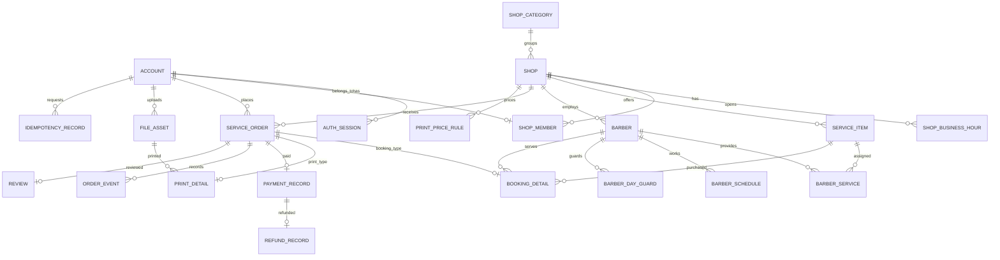

# V1 数据库设计

版本：讨论稿 0.1，2026-10-12。本文描述逻辑表、约束及事务要求，不是可执行 DDL。业务来源见 [ADR-0001](decisions/0001-v1-baseline.md)，操作规则见 [状态迁移文档](v1-state-transitions.md)。

2026-10-15 实现进度：account、auth_session 已落地为 [Flyway V1](../src/main/resources/db/migration/V1__create_account_and_auth_session.sql)，支持注册、登录、会话撤销与改密，在临时 MySQL 8.0.45 验证通过；其余表仍是设计。用户已在本机完成正式库创建及启动，见 [MySQL 接入](mysql-setup.md)。

## 1. 全局约定

| 项目 | 约定 |
|---|---|
| 数据库 | MySQL 8.4 LTS，InnoDB，utf8mb4 |
| 主键 | 除业务扩展表外使用 BIGINT 自增；V1 不引入分布式 ID；扩展表以 order_id 为主键 |
| 金额 | BIGINT，单位为人民币分；禁止浮点金额；计算时检查溢出与上限 |
| 时间 | DATETIME(3) 保存 UTC；Java 边界使用 Instant；校园日期和排班输入按 Asia/Shanghai 换算 |
| 日期 | DATE，明确表示校园本地日期，不能从 UTC 日期直接截取 |
| 状态 | VARCHAR + CHECK 约束；不依赖枚举序号，不直接暴露数据库实体 |
| 版本 | 可变配置及订单使用 version BIGINT NOT NULL DEFAULT 0 |
| 记录保留 | 账号停用、店铺停业、服务下架；不物理删除订单、流水与评价历史 |
| 外键 | 核心实体使用外键，ON DELETE RESTRICT；交易记录不级联删除 |
| 事务 | 单次业务状态变更在一个本地事务中完成；不在数据库事务中调用对象存储或解析 PDF |

以下所有表包含 created_at、updated_at（DATETIME(3)，非空）；不可变日志通常二者相同。除明确标记“可空”外，列均为非空。文本长度、金额和页数上限要同时体现在参数校验与后续 DDL 中。

业务时钟从服务端获取，不能信任客户端时间。精确截止判断以数据库锁获取后的服务端时间为准；同一操作只使用一次判定时间。

## 2. ER 与业务不变量

两条订单扩展关系互斥：每笔主订单必须恰好拥有一种扩展，且与 order_type 一致。普通外键与唯一约束不能独立保证这个跨表条件，由创建事务、禁止直接写库及一致性检查共同保证。

其他核心不变量：

- 订单学生身份来自当前会话，不接受客户端指定 student_id。
- 服务、理发师和订单必须归属同一家店铺；理发师必须能提供所选服务。
- 理发和打印服务类型分别为 HAIRCUT、PRINT；订单类型为 BOOKING、PRINT。
- 每笔订单只能有一条成功模拟支付、最多一条全额成功模拟退款。
- 主订单金额、流水金额和退款金额必须一致，V1 discount_amount 固定为 0。
- 预约主状态、占用状态、打印进度及支付状态按状态迁移表组合，不允许单独修改。
- 评价学生、店铺来自订单，不由客户端传入或覆盖。

## 3. 账号与登录

### account

| 字段 | 类型 | 说明 |
|---|---|---|
| id | BIGINT | 主键 |
| username | VARCHAR(32) | 登录名，4～32 位小写 ASCII 字母、数字及下划线；服务端归一化 |
| password_hash | VARCHAR(100) | BCrypt 摘要，不保存明文 |
| nickname | VARCHAR(40) | 展示名，允许中文 |
| role | VARCHAR(16) | STUDENT / MERCHANT / ADMIN |
| status | VARCHAR(16) | ACTIVE / DISABLED |
| version | BIGINT | 配置更新版本 |

约束：username 唯一，使用确定的大小写比较规则；注册、修改密码校验 BCrypt 可处理的 UTF-8 字节长度。V1 不存储真实手机号、学号或身份证号。

已实现的改密在同一事务中更新摘要、递增 account.version，并撤销本人全部会话；先锁账号再锁当前会话，与登录创建会话共用账号锁协议，不新增表结构，见 [改密决策](decisions/0006-password-change.md)。

已实现的昵称修改同样使用账号版本；实际变更 version + 1，无变化不递增，旧页面版本返回冲突。事务按账号、当前会话顺序加锁并复核身份，更新仅限本人 nickname，保留会话，见 [资料决策](decisions/0007-profile-update.md)。

学生注册接口固定创建 STUDENT。商家申请入口固定建立 MERCHANT 申请账号及待审店铺，未审核不能经营；学生账号不自动改成商家。ADMIN 仅受控创建，角色不能通过普通资料接口修改。

### auth_session

| 字段 | 类型 | 说明 |
|---|---|---|
| id | BIGINT | 主键 |
| account_id | BIGINT | FK account |
| jti | CHAR(36) | JWT 唯一会话标识，不是原始 token |
| expires_at | DATETIME(3) | 到期时间 |
| revoked_at | DATETIME(3)，可空 | 主动退出或撤销时间 |

约束：jti 唯一。索引 account_id、expires_at。认证检查 JWT 签名与期限，再检查会话未撤销及账号 ACTIVE；数据权限从数据库中的角色和成员关系取得，不能只信 token 内历史角色。

V1 不实现 refresh token。退出更新 revoked_at；过期会话可按清理策略删除。JWT 密钥只从环境配置读取。

## 4. 商家、服务与排班

### shop_category

字段：id BIGINT、code VARCHAR(32)、name VARCHAR(40)、sort_order INT、enabled BOOLEAN。

约束：code 唯一。初始分类仅“理发”“打印”；分类不等同于订单类型，不直接决定订单处理器。

### shop

字段：id BIGINT、category_id BIGINT（FK）、name VARCHAR(80)、campus_code VARCHAR(32)、location_text VARCHAR(200)、description VARCHAR(1000)、approval_status VARCHAR(16)、approval_reason VARCHAR(300，可空)、reviewed_by BIGINT（FK account，可空）、reviewed_at DATETIME(3，可空)、business_enabled BOOLEAN、version BIGINT。

approval_status：PENDING / APPROVED / REJECTED / SUSPENDED。公开查询仅展示 APPROVED 店铺；下单还要求营业开关、营业时间及服务上架均允许交易。

索引：(approval_status, category_id, id)。V1 名称搜索使用数据库分页；包含匹配不承诺由普通 B-tree 索引加速，搜索性能后续用 EXPLAIN 评估。

### shop_business_hour

字段：id BIGINT、shop_id BIGINT（FK）、weekday TINYINT（1～7）、start_time TIME、end_time TIME。

约束：(shop_id, weekday, start_time) 唯一，start_time < end_time。支持同一天上午/下午两个区间；更新事务必须检查区间不重叠。V1 不跨午夜，休息日无记录。

### shop_member

字段：id BIGINT、shop_id BIGINT（FK）、account_id BIGINT（FK）、member_role VARCHAR(16，OWNER / STAFF)、status VARCHAR(16，PENDING / ACTIVE / DISABLED)。

约束：account_id 唯一，表达 V1 一个商家账号只管理一家店；(shop_id, account_id) 关系不得重复。店铺申请创建 PENDING 成员，管理员批准店铺时同事务激活成员。后续允许多店时以迁移移除 account_id 唯一约束。

事务校验：成员账号必须为 MERCHANT；同一家店只有一个有效 OWNER。多店、多成员权限的进一步拆分留到后续。

### service_item

字段：id BIGINT、shop_id BIGINT（FK）、service_type VARCHAR(16，HAIRCUT / PRINT)、name VARCHAR(80)、description VARCHAR(500)、price_amount BIGINT、duration_minutes INT（可空）、enabled BOOLEAN、version BIGINT。

HAIRCUT 的 duration_minutes 为正且按 15 分钟倍数配置，price_amount 为固定服务价格；PRINT 的时长为空，最终金额由 print_price_rule 计算，price_amount 仅作起价展示，不用于订单计算。

索引：(shop_id, enabled, id)。下架仅阻止新订单，不改变存量订单快照。理发师禁用同样不直接关闭已有订单，需要先处理存量预约。

### barber

字段：id BIGINT、shop_id BIGINT（FK）、display_name VARCHAR(40)、enabled BOOLEAN、version BIGINT。

索引：(shop_id, enabled, id)。理发师不是登录账号。V1 不在预约创建后更换理发师所属店铺；停用旧记录、创建新店铺资源，保留历史关联。

### barber_service

字段：id BIGINT、barber_id BIGINT（FK）、service_id BIGINT（FK）。

约束：(barber_id, service_id) 唯一。事务验证二者 shop_id 相同且 service_type 为 HAIRCUT。

### barber_schedule

字段：id BIGINT、barber_id BIGINT（FK）、service_date DATE、start_at DATETIME(3)、end_at DATETIME(3)。

约束：(barber_id, service_date, start_at) 唯一，start_at < end_at，时间换算后均落在 service_date 的校园本地同一天。允许午休分段；事务校验同日排班不重叠、位于店铺营业区间，且不侵占现有有效预约。

索引：(barber_id, service_date, start_at)。

### barber_day_guard

字段：id BIGINT、barber_id BIGINT（FK）、service_date DATE。

约束：(barber_id, service_date) 唯一。配置排班时建立对应保护行；预约只能锁已存在且有有效排班的日期，不以“当天还没有预约”为理由绕过锁。

取消、拒单、超时、开始、完成、管理员异常处理与改排班都遵守保护行锁协议。暂停全店业务仅禁止新订单；若要修改影响已有日期的营业时间，应锁定相关保护行并检查存量预约。

## 5. 通用订单及业务扩展

### service_order

| 字段 | 类型 | 说明 |
|---|---|---|
| id | BIGINT | 主键 |
| order_no | VARCHAR(32) | 对外订单号，唯一；不当作访问凭证 |
| student_id | BIGINT | FK account |
| shop_id | BIGINT | FK shop |
| order_type | VARCHAR(16) | BOOKING / PRINT |
| status | VARCHAR(24) | 见状态文档 |
| payment_status | VARCHAR(16) | NOT_PAID / PAID / REFUNDED；退款中属于未来异步退款扩展 |
| original_amount | BIGINT | 原价，正数 |
| discount_amount | BIGINT | V1 固定 0 |
| payable_amount | BIGINT | original_amount - discount_amount |
| currency | CHAR(3) | V1 固定 CNY |
| shop_name_snapshot | VARCHAR(80) | 下单时店铺名 |
| student_note | VARCHAR(300)，可空 | 学生备注 |
| payment_deadline | DATETIME(3) | 创建时间 + 15 分钟 |
| acceptance_deadline | DATETIME(3)，可空 | 支付时间 + 30 分钟 |
| paid_at | DATETIME(3)，可空 | 支付完成时间 |
| accepted_at | DATETIME(3)，可空 | 商家接单时间 |
| started_at | DATETIME(3)，可空 | 开始履约时间 |
| completed_at | DATETIME(3)，可空 | 完成时间 |
| closed_at | DATETIME(3)，可空 | 关闭时间 |
| close_reason | VARCHAR(32)，可空 | 机器可读原因 |
| close_note | VARCHAR(300)，可空 | 人工说明 |
| version | BIGINT | 状态每变更一次加 1 |

数据库 CHECK：金额非负、应付金额等式成立、currency 为 CNY、状态在允许集合内。跨表支付金额等式与合法状态组合由事务保证。

索引：UNIQUE(order_no)、(student_id, created_at, id)、(shop_id, status, created_at, id)、(status, payment_deadline, id)、(status, acceptance_deadline, id)。时间排序使用 id 作为稳定的第二排序键。

订单创建后金额及店铺、学生、类型不可改。不能提供任意修改 status 的通用接口。

### booking_detail

| 字段 | 类型 | 说明 |
|---|---|---|
| order_id | BIGINT | PK、FK service_order |
| service_id | BIGINT | FK service_item |
| barber_id | BIGINT | FK barber |
| service_date | DATE | 校园本地预约日期 |
| start_at / end_at | DATETIME(3) | 左闭右开预约区间 |
| occupancy_status | VARCHAR(16) | HELD / ACTIVE / CONSUMED / RELEASED |
| service_name_snapshot | VARCHAR(80) | 服务名 |
| barber_name_snapshot | VARCHAR(40) | 理发师名 |
| duration_minutes_snapshot | INT | 下单时长 |
| service_price_snapshot | BIGINT | 下单单价 |
| source_service_version | BIGINT | 用于报价与审计 |

约束：start_at < end_at、服务时长与区间相符、start_at 按本地 15 分钟对齐。索引：(barber_id, service_date, start_at)。不能用 UNIQUE(barber_id, start_at) 替代区间重叠判断。

占用集合为 HELD、ACTIVE、CONSUMED。RELEASED 不参与冲突检查。过期 HELD 在实际关闭事务完成前仍占用；可约查询允许短暂保守显示无空位，创建事务在保护行锁内清理过期暂占后重新检查。

### print_price_rule

字段：id BIGINT、shop_id BIGINT（FK）、service_id BIGINT（FK）、paper_size VARCHAR(8，V1 A4)、color_mode VARCHAR(16，BW / COLOR)、side_mode VARCHAR(16，SINGLE / DOUBLE)、price_per_impression BIGINT、enabled BOOLEAN、version BIGINT。

约束：(service_id, paper_size, color_mode, side_mode) 唯一；价格为正。验证 service_id 属于 shop_id 且为 PRINT 类型；只更新原规则并递增 version，不重复插入同规格“有效版本”。

报价以印刷面计：page_count × copies × price_per_impression。双面仅影响纸张数，不把印刷面数除以二。V1 不另收纸张费或装订费。

### print_detail

| 字段 | 类型 | 说明 |
|---|---|---|
| order_id | BIGINT | PK、FK service_order |
| service_id | BIGINT | FK service_item |
| file_id | BIGINT | FK file_asset |
| price_rule_id | BIGINT | FK print_price_rule |
| paper_size / color_mode / side_mode | VARCHAR | 按报价规则定义 |
| page_count | INT | 服务端验证后的 PDF 页数 |
| copies | INT | 正整数，建议上限 100 |
| sheet_count | INT | 单面：页数 × 份数；双面：每份向上取整(页数 / 2) × 份数 |
| unit_price_snapshot | BIGINT | 每印刷面单价 |
| source_price_version | BIGINT | 报价版本 |
| service_name_snapshot | VARCHAR(80) | 服务名 |
| file_name_snapshot | VARCHAR(200) | 展示用名称，不是路径 |
| progress | VARCHAR(24) | QUEUED / PRINTING / READY_FOR_PICKUP / PICKED_UP / ABORTED |
| ready_at | DATETIME(3)，可空 | 进入待取件时间 |
| picked_up_at | DATETIME(3)，可空 | 学生确认取件时间 |

约束：页数、份数、单价为正；同一文件可以被多笔本人订单引用。索引 file_id，用于访问授权与生命周期判定。

文件所属学生必须与订单学生一致，文件必须可读且未过期；文件、服务和价目配置在创建事务中检查。进度与主订单状态必须同时更新。

## 6. 文件元数据与生命周期

### file_asset

字段：id BIGINT、owner_id BIGINT（FK account）、storage_bucket VARCHAR(63)、object_key VARCHAR(255)、original_name VARCHAR(200)、byte_size BIGINT、media_type VARCHAR(64)、sha256 CHAR(64)、pdf_page_count INT、status VARCHAR(16，AVAILABLE / DELETING / DELETED)、expires_at DATETIME(3，可空)、deleted_at DATETIME(3，可空)、version BIGINT。

约束：(storage_bucket, object_key) 唯一；byte_size 在 1～20 MiB；pdf_page_count 为正；SHA-256 用于校验，不作为跨用户文件去重或权限依据。

索引：(status, expires_at, id)、owner_id。数据库不保存 PDF 二进制，也不保存长期公开下载 URL。

有效期规则：

- 新上传、未关联订单：expires_at = 上传完成时间 + 24 小时。
- 有至少一笔未终结订单：expires_at = NULL，保护履约文件。
- 所有关联订单已终结：expires_at = 最晚终结时间 + 7 天。
- 文件仍可用时可以再次创建本人订单；新的有效引用将其有效期设为 NULL。

订单终结时，在同一事务内锁定关联文件，重新计算所有引用的有效期，不能单凭当前订单已完成就删除文件。清理程序持有文件锁时不反向锁订单，使用 READ COMMITTED 下的当前已提交查询复核；所有新关联操作都必须先锁文件。

清理采用两步：数据库标记 DELETING 并提交，再删除存储对象，成功后标记 DELETED；失败保留 DELETING 以供重试。标记后禁止新订单引用和签发下载凭证。对象不存在可视为重复删除成功。

上传先校验大小、文件签名和 PDF 可解析性，解析页数及校验值，再上传私有对象，最后落元数据；数据库失败时尝试删除对象，孤立对象通过独立盘点清理，不能假设对象存储与 MySQL 共享事务。

学生可访问本人尚未进入删除流程且未过期的文件；商家仅在本人店铺打印订单为 ACCEPTED / IN_SERVICE 时访问。管理员默认仅访问元数据。

V1 下载优先经服务端鉴权后流式返回，避免已关闭订单仍凭旧长效链接下载。文件名按安全附件名处理，不拼接本地路径；预览和真正打印机控制不在范围内。

## 7. 模拟支付、退款与订单事件

### payment_record

字段：id BIGINT、order_id BIGINT（FK）、payment_no VARCHAR(40)、amount BIGINT、channel VARCHAR(16，MOCK)、status VARCHAR(16，SUCCEEDED)、paid_at DATETIME(3)。

约束：order_id 唯一、payment_no 唯一、amount 为正。V1 模拟支付只在业务条件全部满足时成功，拒绝请求不生成资金流水，可记录应用日志。

V1 不支持部分支付、多笔成功支付、真实支付回调。若以后增加支付尝试，应拆分“尝试记录”和“成功支付事实”，不能直接移除唯一约束。

### refund_record

字段：id BIGINT、order_id BIGINT（FK）、payment_id BIGINT（FK）、refund_no VARCHAR(40)、amount BIGINT、reason VARCHAR(32)、reason_note VARCHAR(300，可空)、status VARCHAR(16，SUCCEEDED)、refunded_at DATETIME(3)。

约束：order_id、payment_id、refund_no 分别唯一。退款金额等于该订单成功支付金额；V1 只允许全额一次模拟退款。

关闭、支付状态变更、退款记录与事件在同一 MySQL 事务内完成，V1 不产生持久化 REFUNDING 中间状态。未来真实或异步退款需单独 ADR、失败状态和补偿设计。

### order_event

字段：id BIGINT、order_id BIGINT（FK）、event_seq BIGINT、action VARCHAR(32)、from_status VARCHAR(24，可空)、to_status VARCHAR(24)、actor_type VARCHAR(16，STUDENT / MERCHANT / ADMIN / SYSTEM)、actor_id BIGINT（FK account，可空）、reason VARCHAR(300，可空）、occurred_at DATETIME(3)。

约束：(order_id, event_seq) 唯一。创建订单 version 为 0，创建事件序号为 0；每次公共状态或打印进度变化均递增 version，记录同序号事件。SYSTEM 的 actor_id 为空，其他操作者非空。

打印 READY_FOR_PICKUP 事件可以 from_status = to_status = IN_SERVICE，但必须记录 action。订单事件不能替代登录、商家审核等全平台审计。

## 8. 评价与幂等

### review

字段：id BIGINT、order_id BIGINT（FK）、student_id BIGINT（FK）、shop_id BIGINT（FK）、rating TINYINT、content VARCHAR(1000)、visibility VARCHAR(16，VISIBLE / HIDDEN)、moderated_by BIGINT（FK account，可空）、moderation_reason VARCHAR(300，可空）、moderated_at DATETIME(3，可空）。

约束：order_id 唯一，rating 在 1～5。索引：(shop_id, visibility, created_at, id)。

学生只能对本人 COMPLETED 且 payment_status 为 PAID 的订单评价；本轮异常关闭均不可评价。V1 不编辑评分、不重发被隐藏评价。商家回复和图片在 V2 增加。

评分查询以 VISIBLE 评价的 SUM(rating) / COUNT(*) 计算；零条评价返回“暂无评分”，不返回虚构的 5 分。V1 不写冗余平均分，V2 再设计汇总维护。

### idempotency_record

字段：id BIGINT、account_id BIGINT（FK）、operation VARCHAR(32)、request_key VARCHAR(64)、request_hash CHAR(64)、order_id BIGINT（FK）、completed_at DATETIME(3)。

约束：(account_id, operation, request_key) 唯一；键采用区分大小写比较。V1 用于 CREATE_BOOKING / CREATE_PRINT，所有字段随业务事务一起提交。

摘要来自验证、归一化后的业务请求，不对未经规范化的原始 JSON 直接取 hash。同键同请求返回原订单；同键不同请求返回冲突。授权检查仍必须执行。

并发重复创建以唯一约束收敛：失败方回滚整个业务事务，再用新事务读取已提交结果，不在已标记回滚的事务内继续执行。V1 不定期删除绑定订单的幂等记录，以避免旧请求重新创建订单。

支付、取消、接单等以订单状态锁和流水唯一约束实现效果幂等，规则见状态文档；不为所有接口机械增加请求记录表。

## 9. 数据库约束与应用约束的分工

| 不变量 | 数据库直接保障 | 应用事务保障 |
|---|---|---|
| 订单号、登录名唯一 | UNIQUE | 生成、归一化及异常翻译 |
| 每笔订单一条有效评价 | UNIQUE(order_id) | 本人、完成条件、可见性 |
| 成功支付及全额退款不重复 | UNIQUE(order_id)、UNIQUE(payment_id) | 金额一致、状态条件、操作者 |
| 扩展存在且类型匹配 | FK、扩展主键 | 主表与唯一一种扩展同事务创建 |
| 资源和订单同店 | 各实体 FK | shop_id 与服务类型的交叉校验 |
| 排班和预约不重叠 | 保护行唯一、区间 CHECK | 保护行锁 + 当前读 + 所有路径遵守协议 |
| 历史价格不受改价影响 | 快照列、交易记录禁止删除 | 创建时取受锁保护的配置并写快照 |
| 文件不能被越权访问或提前删除 | FK、状态、索引 | 归属授权、引用保护、两阶段删除 |
| 状态合法 | CHECK 限制状态集合 | 迁移条件、同事务跨表更新 |

V1 不用数据库触发器隐藏业务流程。数据库保护行锁是一套必须被所有写路径遵守的协议，并不等同于 MySQL 提供了原生时间区间排斥约束。

## 10. 后续演进与数据设计

V2 增加 facility、favorite、review_image、review_reply、coupon_template、user_coupon、after_sale、notification、audit_log，不提前创建未使用的表。

优惠券进入订单前必须补充优惠分摊、锁券及退款返券规则；不能仅把 discount_amount 改成非零就视为完成营销设计。V3 再增加 outbox_event、消费去重、重试记录。

演示数据按业务关系生成：学生 → 已审核商家 → 服务和排班 → 合法订单及流水 → 已完成订单评价。分别覆盖未支付、待确认、正常完成、拒单退款、过期关闭、非法操作样例。大规模数据生成独立配置数量及随机种子，不伪造性能成绩。

后续 DDL 使用版本化迁移；演示账号和数据只在显式本地演示配置下注入。密码通过应用编码或受控生成程序产生，生产配置不内置默认管理员。
