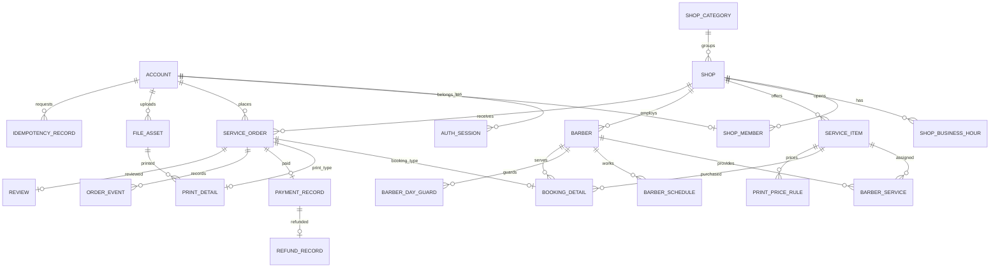

# V1 数据库设计

2026-11-02 M04.2-B：V24放开file_asset的LOCAL/S3存储CHECK，保留UUID/精确随机key约束，新增ix_file_tombstone(storage_id,status,id)；无新表、原四种状态保持，当前32张应用表。S3的DELETED行作为永久墓碑循环复核，不物理清除或复用key；V1～V23迁移不改。真实V23升级兼容及业务保护验证见[报告](reports/s3-file-chain-2026-11-02.md)，不代表已迁移开发库或历史文件。以下为历史阶段记录。

M03.2-B：V21新增message_consumption、notification及outbox重放字段，当前31表；凭据/通知原子提交，无反向账号/订单FK锁，不物理清理去重凭据。

2026-10-30 M03.2-A：V20增加message_outbox，当前29张应用表。逻辑订单/收件人引用与固定JSON快照，消息PK/业务唯一键、READY/PUBLISHING/SENT/DEAD及非空租约CHECK；不反向通过账号FK取锁，恢复不依赖订单实时状态。V1～V19未改。消费凭据与notification表尚未建立，见[ADR-0053](decisions/0053-reliable-order-messaging.md)。

2026-10-30 V19新增`order_coupon`，当前28张应用表；扩展`user_coupon.state/current_order_id/version`。单订单主键快照、当前订单唯一指针，历史券引用不设唯一以支持未付释放后复用；FK及金额/状态/时间CHECK保证基本结构。V1～V18原迁移不改，V18存量持有券默认AVAILABLE/version0，无券旧订单保持无快照。细节见[ADR-0052](decisions/0052-order-coupons.md)。以下为历史阶段记录。

2026-10-30 V18增加user_coupon、coupon_claim_request，当前27表。持有券保存冻结规则与使用窗口，B阶段不可变，过期派生；学生/活动唯一、学生/领取键唯一、请求与券一一对应、外键/金额/时间CHECK。活动issuedCount递增不推进配置版本或updatedAt；订单关联/核销字段由C阶段加入。见[ADR-0051](decisions/0051-synchronous-coupon-claims.md)。

2026-10-29 M08.2-A：V17新增`coupon_campaign`，共25张应用表，详见[迁移](../src/main/resources/db/migration/V17__create_coupon_campaigns.sql)和[ADR-0050](decisions/0050-coupon-business.md)。字段含本店满减/总量与累计发行、四窗口、独立版本、首次发布/停止操作者/原版本/时间；金额、库存、窗口和状态完整性CHECK，店铺/操作者FK，店铺＋created_at/id索引。本批issued_count保持0；领取请求/持有券/订单券表未建，不提前把后续4表方案当作实际表数。既有V1～V16迁移保持原校验和。

2026-10-28 M02.2：V16新增`shop_rating_revision(shop_id PK/FK ON DELETE CASCADE, revision BIGINT>0)`，共24张应用表；它是统计集合的技术版本，不是新业务订单/评价版本，也不保存SUM/COUNT。已有任意评价店铺回填1，无行视为0；首次提交/首次隐藏同原RC事务最后原子推进，失败回滚、重放不变、上限不回绕。新读快照按此版本选择详情评分缓存键，旧回填不覆盖新统计；关闭缓存仍维护。正式范围见[ADR-0048](decisions/0048-public-rating-cache.md)与[验收](reports/redis-rating-cache-2026-10-28.md)。下方V15/23表等为历史阶段记录。

2026-10-26 当前交付：账号停用/恢复按[ADR-0046](decisions/0046-admin-account-status.md)接入。禁止修改本人，双账号按ID排序主键锁后复核正常ADMIN；实际变化时状态/version+1、目标全部旧会话撤销、状态历史原子提交，恢复须重新登录。旧版本409，同版本同状态200无写入；不自动处理订单/资金或改文件期限。V15新增account_status_change，23表；运行62、完整62/62/0，当前规划入口齐全。见[Swagger / Apifox指南](admin-account-status.md)；旧阶段“账号状态待开发”以本次为准，接口齐全不等于公开部署或全部工程工作完成。

2026-10-26 当前交付：管理员账号列表按[ADR-0045](decisions/0045-admin-account-list.md)接入。正常ADMIN查询全部业务账号，角色/状态交集、分页、创建时间/ID倒序，仅六字段AccountView；身份/会话与count/items同一只读RR快照，返回前核对到期，无业务行锁或写入。运行61、完整62/61/1，仍V1～V14/22表，无新迁移；账号停用/恢复尚未实现。见[Swagger / Apifox指南](admin-account-list.md)，旧阶段“账号列表待开发”以本次交付为准。

2026-10-26 当前交付：管理员隐藏评价按[ADR-0044](decisions/0044-admin-review-hide.md)接入。正常ADMIN说明原因后原子保存首次审核记录并隐藏；同人同原因重放保留事实，其他重复409。后续公开评价/真实评分排除，本人仍可读、reviewed=true且不能重发，不改订单/资金/文件期限。V14补三个审核字段，无新表，仍22表；运行60、完整62/60/2，仅管理员账号列表/状态管理待开发。见[Swagger / Apifox指南](admin-review-hide.md)，旧阶段“隐藏后续”以本次交付为准。

当前物理实现（2026-10-24）：V1～V12、21张业务表。新增print_detail，见[ADR-0034](decisions/0034-print-orders.md)；主订单/扩展/事件/幂等/文件期限同事务。以下早期候选和历史阶段不代替实际迁移。

版本：讨论稿 0.1，2026-10-12。本文描述逻辑表、约束及事务要求，不是可执行 DDL。业务来源见 [ADR-0001](decisions/0001-v1-baseline.md)，操作规则见 [状态迁移文档](v1-state-transitions.md)。

2026-10-15 实现进度：account、auth_session 已落地为 [Flyway V1](../src/main/resources/db/migration/V1__create_account_and_auth_session.sql)，支持注册、登录、会话撤销与改密，在临时 MySQL 8.0.45 验证通过；其余表仍是设计。用户已在本机完成正式库创建及启动，见 [MySQL 接入](mysql-setup.md)。

2026-10-20 当前：V1～V6 已实现账号/会话、商家分类/店铺/成员、审核历史、营业时间、服务及打印价目九张表；其他交易表仍为设计稿。以下已实现部分的后续记录优先于初始讨论稿，实际 DDL 见 db/migration。

2026-10-21：V7 新增 barber、barber_service，已实现业务表共十一张。理发师资料和绑定已按 ADR-0017 确认；当时排班、日期保护行及订单相关表仍未建立。

2026-10-21 当前：V8 已建立 barber_day_guard、barber_schedule，共十三张已实现业务表。实际 DDL 见 [V8](../src/main/resources/db/migration/V8__create_barber_schedule.sql)，规则和替代旧锁顺序见 [ADR-0018](decisions/0018-merchant-schedule.md)。订单相关表仍为设计。

## 1. 全局约定

| 项目 | 约定 |
|---|---|
| 数据库 | MySQL 8.4 LTS，InnoDB，utf8mb4 |
| 主键 | 除业务扩展表外使用 BIGINT 自增；V1 不引入分布式 ID；扩展表以 order_id 为主键 |
| 金额 | BIGINT，单位为人民币分；禁止浮点金额；计算时检查溢出与上限 |
| 时间 | DATETIME(3) 保存 UTC；Java 边界使用 Instant；校园日期和排班输入按 Asia/Shanghai 换算 |
| 日期 | DATE，明确表示校园本地日期，不能从 UTC 日期直接截取 |
| 状态 | VARCHAR + CHECK 约束；不依赖枚举序号，不直接暴露数据库实体 |
| 版本 | 可变配置及订单使用 version BIGINT NOT NULL DEFAULT 0 |
| 记录保留 | 账号停用、店铺停业、服务下架；不物理删除订单、流水与评价历史 |
| 外键 | 核心实体使用外键，ON DELETE RESTRICT；交易记录不级联删除 |
| 事务 | 单次业务状态变更在一个本地事务中完成；不在数据库事务中调用对象存储或解析 PDF |

初始逻辑设计建议表包含 created_at、updated_at（DATETIME(3)，非空）；实际表以迁移为准，V8 保护行与可替换时段不增加审计时间列；不可变日志通常二者相同。除明确标记“可空”外，列均为非空。文本长度、金额和页数上限要同时体现在参数校验与后续 DDL 中。

业务时钟从服务端获取，不能信任客户端时间。精确截止判断以数据库锁获取后的服务端时间为准；涉及等待的操作在锁后及写后再次复核截止或日期窗口，不能仅使用请求进入时的时间。

## 2. ER 与业务不变量

两条订单扩展关系互斥：每笔主订单必须恰好拥有一种扩展，且与 order_type 一致。普通外键与唯一约束不能独立保证这个跨表条件，由创建事务、禁止直接写库及一致性检查共同保证。

其他核心不变量：

- 订单学生身份来自当前会话，不接受客户端指定 student_id。
- 服务、理发师和订单必须归属同一家店铺；理发师必须能提供所选服务。
- 理发和打印服务类型分别为 HAIRCUT、PRINT；订单类型为 BOOKING、PRINT。
- 每笔订单只能有一条成功模拟支付、最多一条全额成功模拟退款。
- 主订单金额、流水金额和退款金额必须一致，V1 discount_amount 固定为 0。
- 预约主状态、占用状态、打印进度及支付状态按状态迁移表组合，不允许单独修改。
- 评价学生、店铺来自订单，不由客户端传入或覆盖。

## 3. 账号与登录

### account

| 字段 | 类型 | 说明 |
|---|---|---|
| id | BIGINT | 主键 |
| username | VARCHAR(32) | 登录名，4～32 位小写 ASCII 字母、数字及下划线；服务端归一化 |
| password_hash | VARCHAR(100) | BCrypt 摘要，不保存明文 |
| nickname | VARCHAR(40) | 展示名，允许中文 |
| role | VARCHAR(16) | STUDENT / MERCHANT / ADMIN |
| status | VARCHAR(16) | ACTIVE / DISABLED |
| version | BIGINT | 配置更新版本 |

约束：username 唯一，使用确定的大小写比较规则；注册、修改密码校验 BCrypt 可处理的 UTF-8 字节长度。V1 不存储真实手机号、学号或身份证号。

已实现的改密在同一事务中更新摘要、递增 account.version，并撤销本人全部会话；先锁账号再锁当前会话，与登录创建会话共用账号锁协议，不新增表结构，见 [改密决策](decisions/0006-password-change.md)。

已实现的昵称修改同样使用账号版本；实际变更 version + 1，无变化不递增，旧页面版本返回冲突。事务按账号、当前会话顺序加锁并复核身份，更新仅限本人 nickname，保留会话，见 [资料决策](decisions/0007-profile-update.md)。

学生注册接口固定创建 STUDENT。商家申请入口固定建立 MERCHANT 申请账号及待审店铺，未审核不能经营；学生账号不自动改成商家。ADMIN 仅受控创建，角色不能通过普通资料接口修改。

### auth_session

| 字段 | 类型 | 说明 |
|---|---|---|
| id | BIGINT | 主键 |
| account_id | BIGINT | FK account |
| jti | CHAR(36) | JWT 唯一会话标识，不是原始 token |
| expires_at | DATETIME(3) | 到期时间 |
| revoked_at | DATETIME(3)，可空 | 主动退出或撤销时间 |

约束：jti 唯一。索引 account_id、expires_at。认证检查 JWT 签名与期限，再检查会话未撤销及账号 ACTIVE；数据权限从数据库中的角色和成员关系取得，不能只信 token 内历史角色。

V1 不实现 refresh token。退出更新 revoked_at；过期会话可按清理策略删除。JWT 密钥只从环境配置读取。

## 4. 商家、服务与排班

### shop_category

2026-10-19：入驻规则按 [ADR-0010](decisions/0010-merchant-onboarding.md) 定稿。V2 已定义 shop_category、shop、shop_member 的迁移，初始化理发/打印基础字典；并非演示账号。申请、本人店铺查询、审核与重提均已实现，V3 已增加审核历史表。重提复用现有表，不新增迁移，不改写 V1/V2/V3。

字段：id BIGINT、code VARCHAR(32)、name VARCHAR(40)、sort_order INT、enabled BOOLEAN。

约束：code 唯一。初始分类仅“理发”“打印”；分类不等同于订单类型，不直接决定订单处理器。

### shop

字段：id BIGINT、category_id BIGINT（FK）、name VARCHAR(80)、campus_code VARCHAR(32)、location_text VARCHAR(200)、description VARCHAR(1000)、approval_status VARCHAR(16)、approval_reason VARCHAR(300，可空)、reviewed_by BIGINT（FK account，可空）、reviewed_at DATETIME(3，可空)、business_enabled BOOLEAN、version BIGINT。

approval_status：PENDING / APPROVED / REJECTED / SUSPENDED。公开查询仅展示 APPROVED 店铺；下单还要求营业开关、营业时间及服务上架均允许交易。

2026-10-19：经营资料与手动开关按 ADR-0013 已实现，复用本表，不新增迁移。PATCH 只更新名称/位置/介绍/营业开关，实际变更时同事务递增 version；未传保留、无变更不写入，审核字段与 shop_review 保持不变。店铺锁后的当前读用于合并资料和返回结果，避免 RR 快照在等待并发批准后仍显示旧状态。营业开关不替代后续接单资格检查。

索引：(approval_status, category_id, id)。V1 名称搜索使用数据库分页；包含匹配不承诺由普通 B-tree 索引加速，搜索性能后续用 EXPLAIN 评估。

### shop_business_hour

字段：id BIGINT、shop_id BIGINT（FK）、weekday TINYINT（1～7）、start_time TIME、end_time TIME。

约束：(shop_id, weekday, start_time) 唯一，start_time < end_time。支持同一天上午/下午两个区间；更新事务必须检查区间不重叠。V1 不跨午夜，休息日无记录。

2026-10-19：V4 已建立本表，旧迁移不改写。ADR-0014 将原始请求限制为每天最多 4 段/整周 28 段，严格分钟且不接受 24:00；CHECK 约束星期 1～7、非负同日区间和零秒。相邻区间合并排序，重叠/重复拒绝。先锁 shop 和 OWNER，再以当前读比较时段，同事务整周替换并按实际变化递增 shop.version；清空不关闭手动开关。读模型用 RR 一致快照绑定版本和时段，管理员列表批量加载。当时尚未接入排班保护；现按 ADR-0018 补齐今天及之后（含停用人员）的全部排班覆盖检查，历史不阻止修改，预约/订单保护仍待接入。

### shop_member

字段：id BIGINT、shop_id BIGINT（FK）、account_id BIGINT（FK）、member_role VARCHAR(16，当前仅 OWNER)、status VARCHAR(16，PENDING / ACTIVE / DISABLED)。STAFF 和多人协作以后通过迁移扩展。

约束：account_id、shop_id 各自唯一，表达 V1 一账号一店且一店一个 OWNER；店铺申请创建 PENDING 成员，管理员批准店铺时同事务激活成员。后续允许多店或多成员时以迁移调整相应唯一约束。

初次申请中账号为 ACTIVE / MERCHANT，店铺 PENDING、business_enabled=false、version=0；审批通过后仍默认停业。被拒后重提复用原店铺，版本 + 1、状态回到 PENDING，并保留审核历史。V3 的 shop_review 记录 shop_id、reviewed_version、decision、reason、reviewed_by、reviewed_at，唯一约束 (shop_id, reviewed_version)，已在审批任务中建表。商家读模型当前仅返回基础店铺、分类、审核状态/原因、成员状态、营业开关和版本；每周营业时间已通过 V4 的 shop_business_hour 实现并加入真实 businessHours；评价统计待后续实现。

事务校验：成员账号必须为 MERCHANT；同一家店只有一个有效 OWNER。多店、多成员权限的进一步拆分留到后续。

### service_item

字段：id BIGINT、shop_id BIGINT（FK）、service_type VARCHAR(16，HAIRCUT / PRINT)、name VARCHAR(80)、description VARCHAR(500)、price_amount BIGINT、duration_minutes INT（可空）、enabled BOOLEAN、version BIGINT。

HAIRCUT 的 duration_minutes 为正且按 15 分钟倍数配置，price_amount 为固定服务价格；PRINT 的时长为空，最终金额由 print_price_rule 计算，price_amount 仅作起价展示，不用于订单计算。

索引：(shop_id, enabled, id)。下架仅阻止新订单，不改变存量订单快照。理发师禁用同样不直接关闭已有订单，需要先处理存量预约。

2026-10-20：V5 已建立 service_item，旧迁移不改写。金额约束 1～100000 分、HAIRCUT 时长非空且为 15～240 的 15 倍数、PRINT 时长为空；同时约束类型、非空名称、enabled 与非负版本，外键限制悬空店铺。不加名称唯一索引，允许同名服务。应用在店铺/成员锁内验证分类与服务类型匹配，更新按服务 ID + 本人 shop_id + 原版本限定，实际变化只递增服务版本，不递增 shop.version。没有订单表，当前不声称实现存量快照或预约保护。

### barber

字段：id BIGINT、shop_id BIGINT（FK）、display_name VARCHAR(40)、enabled BOOLEAN、version BIGINT、created_at / updated_at。

索引：(shop_id, enabled, id)。理发师不是登录账号。V1 不在预约创建后更换理发师所属店铺；停用旧记录、创建新店铺资源，保留历史关联。

2026-10-21 按 [ADR-0017](decisions/0017-merchant-barbers.md) 以 V7 实现。创建后归属不可修改，默认停用，允许重名及空绑定；姓名、启停和绑定共用人员版本。实际变化才递增版本，不修改店铺或服务版本，BIGINT 上限只允许无变化；不提供物理删除。当前没有预约表，不声称已完成预约存量保护。

### barber_service

字段：id BIGINT、barber_id BIGINT（FK）、service_id BIGINT（FK）。

约束：(barber_id, service_id) 唯一。事务验证二者 shop_id 相同且 service_type 为 HAIRCUT。

V7 外键限制悬空人员/服务，service_id 另有索引；不重复保存 shop_id。每位人员由应用限制为 0～50 个不同服务，允许绑定下架服务。完整替换在一个 RC 事务中锁后核对全部目标服务与人员版本，仅增删差异项，任一步异常整体回滚；独立外键不保证同店或类型，不能代替应用权限校验。

### barber_schedule

字段：id BIGINT、barber_id BIGINT（FK）、service_date DATE、start_at DATETIME(3)、end_at DATETIME(3)。

约束：(barber_id, service_date, start_at) 唯一，start_at < end_at，时间换算后均落在 service_date 的校园本地同一天。允许午休分段；事务校验同日排班不重叠、位于店铺营业区间。当前实现按 ADR-0018 校验营业覆盖，有效预约保护留到订单模块。

索引：(barber_id, service_date, start_at)。

### barber_day_guard

字段：id BIGINT、barber_id BIGINT（FK）、service_date DATE。

约束：(barber_id, service_date) 唯一。首次成功保存非空排班时建立对应保护行，清空保留，GET/未配置日期空保存不创建；预约只能锁已存在且有有效排班的日期，不以“当天还没有预约”为理由绕过锁。

V8 排班以 (barber_id, service_date) 复合外键指向保护行，保护行有 barber_id 外键；区间唯一键及 start_at < end_at CHECK 已落地。时段按 UTC DATETIME(3)，service_date 按校园日期，日期/时区、15 分钟对齐、最多 4 段、营业覆盖和重叠由应用验证。排班不设独立版本，与 barber.version 共用。

未来取消、拒单、超时、开始、完成、管理员异常处理与改排班都遵守 ADR-0018 的店铺入口 → 日期保护行 → 后续资源协议。暂停全店业务仅禁止新订单；若要修改影响已有日期的营业时间，应锁定相关保护行并检查存量预约。

## 5. 通用订单及业务扩展

### service_order

| 字段 | 类型 | 说明 |
|---|---|---|
| id | BIGINT | 主键 |
| order_no | VARCHAR(32) | 对外订单号，唯一；不当作访问凭证 |
| student_id | BIGINT | FK account |
| shop_id | BIGINT | FK shop |
| order_type | VARCHAR(16) | BOOKING / PRINT |
| status | VARCHAR(24) | 见状态文档 |
| payment_status | VARCHAR(16) | NOT_PAID / PAID / REFUNDED；退款中属于未来异步退款扩展 |
| original_amount | BIGINT | 原价，正数 |
| discount_amount | BIGINT | V1 固定 0 |
| payable_amount | BIGINT | original_amount - discount_amount |
| currency | CHAR(3) | V1 固定 CNY |
| shop_name_snapshot | VARCHAR(80) | 下单时店铺名 |
| student_note | VARCHAR(300)，可空 | 学生备注 |
| payment_deadline | DATETIME(3) | 创建时间 + 15 分钟 |
| acceptance_deadline | DATETIME(3)，可空 | 支付时间 + 30 分钟 |
| paid_at | DATETIME(3)，可空 | 支付完成时间 |
| accepted_at | DATETIME(3)，可空 | 商家接单时间 |
| started_at | DATETIME(3)，可空 | 开始履约时间 |
| completed_at | DATETIME(3)，可空 | 完成时间 |
| closed_at | DATETIME(3)，可空 | 关闭时间 |
| close_reason | VARCHAR(32)，可空 | 机器可读原因 |
| close_note | VARCHAR(300)，可空 | 人工说明 |
| version | BIGINT | 状态每变更一次加 1 |

数据库 CHECK：金额非负、应付金额等式成立、currency 为 CNY、状态在允许集合内。跨表支付金额等式与合法状态组合由事务保证。

索引：UNIQUE(order_no)、(student_id, created_at, id)、(shop_id, status, created_at, id)、(status, payment_deadline, id)、(status, acceptance_deadline, id)。时间排序使用 id 作为稳定的第二排序键。

订单创建后金额及店铺、学生、类型不可改。不能提供任意修改 status 的通用接口。

### booking_detail

| 字段 | 类型 | 说明 |
|---|---|---|
| order_id | BIGINT | PK、FK service_order |
| service_id | BIGINT | FK service_item |
| barber_id | BIGINT | FK barber |
| service_date | DATE | 校园本地预约日期 |
| start_at / end_at | DATETIME(3) | 左闭右开预约区间 |
| occupancy_status | VARCHAR(16) | HELD / ACTIVE / CONSUMED / RELEASED |
| service_name_snapshot | VARCHAR(80) | 服务名 |
| barber_name_snapshot | VARCHAR(40) | 理发师名 |
| duration_minutes_snapshot | INT | 下单时长 |
| service_price_snapshot | BIGINT | 下单单价 |
| source_service_version | BIGINT | 用于报价与审计 |

约束：start_at < end_at、服务时长与区间相符、start_at 按本地 15 分钟对齐。索引：(barber_id, service_date, start_at)。不能用 UNIQUE(barber_id, start_at) 替代区间重叠判断。

占用集合为 HELD、ACTIVE、CONSUMED。RELEASED 不参与冲突检查。过期 HELD 在实际关闭事务完成前仍占用；可约查询允许短暂保守显示无空位，创建事务在保护行锁内清理过期暂占后重新检查。

### print_price_rule

字段：id BIGINT、service_id BIGINT（FK）、paper_size VARCHAR(8，V1 A4)、color_mode VARCHAR(16，BW / COLOR)、side_mode VARCHAR(16，SINGLE / DOUBLE)、price_per_impression BIGINT、enabled BOOLEAN、version BIGINT，及 created_at / updated_at。

2026-10-20 按 [ADR-0016](decisions/0016-merchant-print-prices.md) 确认并以 V6 实现：不再重复存 shop_id，沿服务不可变归属判断店铺，避免两个归属字段不一致。规格唯一键及外键/CHECK 兜底枚举、1～100000 分/印刷面、布尔值及非负版本；PRINT 类型在应用的服务行锁内验证。只更新原规则，不重复插入同规格“有效版本”。实际变更才递增价目版本，不改店铺/服务版本；不删除价目，遗漏规格保留，任一项失败整批回滚。GET/PUT 含停用项，最多四种组合。

报价以印刷面计：page_count × copies × price_per_impression。双面仅影响纸张数，不把印刷面数除以二。V1 不另收纸张费或装订费。

### print_detail

| 字段 | 类型 | 说明 |
|---|---|---|
| order_id | BIGINT | PK、FK service_order |
| service_id | BIGINT | FK service_item |
| file_id | BIGINT | FK file_asset |
| price_rule_id | BIGINT | FK print_price_rule |
| paper_size / color_mode / side_mode | VARCHAR | 按报价规则定义 |
| page_count | INT | 服务端验证后的 PDF 页数 |
| copies | INT | 正整数，建议上限 100 |
| sheet_count | INT | 单面：页数 × 份数；双面：每份向上取整(页数 / 2) × 份数 |
| unit_price_snapshot | BIGINT | 每印刷面单价 |
| source_price_version | BIGINT | 报价版本 |
| service_name_snapshot | VARCHAR(80) | 服务名 |
| file_name_snapshot | VARCHAR(200) | 展示用名称，不是路径 |
| progress | VARCHAR(24) | QUEUED / PRINTING / READY_FOR_PICKUP / PICKED_UP / ABORTED |
| ready_at | DATETIME(3)，可空 | 进入待取件时间 |
| picked_up_at | DATETIME(3)，可空 | 学生确认取件时间 |

约束：页数、份数、单价为正；同一文件可以被多笔本人订单引用。索引 file_id，用于访问授权与生命周期判定。

文件所属学生必须与订单学生一致，文件必须可读且未过期；文件、服务和价目配置在创建事务中检查。进度与主订单状态必须同时更新。

## 6. 文件元数据与生命周期

### file_asset

实际V11按[ADR-0031](decisions/0031-print-file-upload.md)建立：LOCAL存储标识/key、内部UPLOADING及1～500页约束。下方早期bucket和订单关联生命周期为完整目标；实际字段以V11及本篇末尾“V11实际文件表”为准，订单保护尚未接入。

字段：id BIGINT、owner_id BIGINT（FK account）、storage_bucket VARCHAR(63)、object_key VARCHAR(255)、original_name VARCHAR(200)、byte_size BIGINT、media_type VARCHAR(64)、sha256 CHAR(64)、pdf_page_count INT、status VARCHAR(16，AVAILABLE / DELETING / DELETED)、expires_at DATETIME(3，可空)、deleted_at DATETIME(3，可空)、version BIGINT。

约束：(storage_bucket, object_key) 唯一；byte_size 在 1～20 MiB；pdf_page_count 为正；SHA-256 用于校验，不作为跨用户文件去重或权限依据。

索引：(status, expires_at, id)、owner_id。数据库不保存 PDF 二进制，也不保存长期公开下载 URL。

有效期规则：

- 新上传、未关联订单：expires_at = 上传完成时间 + 24 小时。
- 有至少一笔未终结订单：expires_at = NULL，保护履约文件。
- 所有关联订单已终结：expires_at = 最晚终结时间 + 7 天。
- 文件仍可用时可以再次创建本人订单；新的有效引用将其有效期设为 NULL。

订单终结时，在同一事务内锁定关联文件，重新计算所有引用的有效期，不能单凭当前订单已完成就删除文件。清理程序持有文件锁时不反向锁订单，使用 READ COMMITTED 下的当前已提交查询复核；所有新关联操作都必须先锁文件。

清理采用两步：数据库标记 DELETING 并提交，再删除存储对象，成功后标记 DELETED；失败保留 DELETING 以供重试。标记后禁止新订单引用和签发下载凭证。对象不存在可视为重复删除成功。

上传先校验大小、文件签名和 PDF 可解析性，解析页数及校验值，再上传私有对象，最后落元数据；数据库失败时尝试删除对象，孤立对象通过独立盘点清理，不能假设对象存储与 MySQL 共享事务。

学生可访问本人尚未进入删除流程且未过期的文件；商家仅在本人店铺打印订单为 ACCEPTED / IN_SERVICE 时访问。管理员默认仅访问元数据。

V1 下载优先经服务端鉴权后流式返回，避免已关闭订单仍凭旧长效链接下载。文件名按安全附件名处理，不拼接本地路径；预览和真正打印机控制不在范围内。

## 7. 模拟支付、退款与订单事件

### payment_record

字段：id BIGINT、order_id BIGINT（FK）、payment_no VARCHAR(40)、amount BIGINT、channel VARCHAR(16，MOCK)、status VARCHAR(16，SUCCEEDED)、paid_at DATETIME(3)。

约束：order_id 唯一、payment_no 唯一、amount 为正。V1 模拟支付只在业务条件全部满足时成功，拒绝请求不生成资金流水，可记录应用日志。

V1 不支持部分支付、多笔成功支付、真实支付回调。若以后增加支付尝试，应拆分“尝试记录”和“成功支付事实”，不能直接移除唯一约束。

### refund_record

字段：id BIGINT、order_id BIGINT（FK）、payment_id BIGINT（FK）、refund_no VARCHAR(40)、amount BIGINT、reason VARCHAR(32)、reason_note VARCHAR(300，可空)、status VARCHAR(16，SUCCEEDED)、refunded_at DATETIME(3)。

约束：order_id、payment_id、refund_no 分别唯一。退款金额等于该订单成功支付金额；V1 只允许全额一次模拟退款。

关闭、支付状态变更、退款记录与事件在同一 MySQL 事务内完成，V1 不产生持久化 REFUNDING 中间状态。未来真实或异步退款需单独 ADR、失败状态和补偿设计。

### order_event

字段：id BIGINT、order_id BIGINT（FK）、event_seq BIGINT、action VARCHAR(32)、from_status VARCHAR(24，可空)、to_status VARCHAR(24)、actor_type VARCHAR(16，STUDENT / MERCHANT / ADMIN / SYSTEM)、actor_id BIGINT（FK account，可空）、reason VARCHAR(300，可空）、occurred_at DATETIME(3)。

约束：(order_id, event_seq) 唯一。创建订单 version 为 0，创建事件序号为 0；每次公共状态或打印进度变化均递增 version，记录同序号事件。SYSTEM 的 actor_id 为空，其他操作者非空。

打印 READY_FOR_PICKUP 事件可以 from_status = to_status = IN_SERVICE，但必须记录 action。订单事件不能替代登录、商家审核等全平台审计。

## 8. 评价与幂等

### review

字段：id BIGINT、order_id BIGINT（FK）、student_id BIGINT（FK）、shop_id BIGINT（FK）、rating TINYINT、content VARCHAR(1000)、visibility VARCHAR(16，VISIBLE / HIDDEN)、moderated_by BIGINT（FK account，可空）、moderation_reason VARCHAR(300，可空）、moderated_at DATETIME(3，可空）。

约束：order_id 唯一，rating 在 1～5。索引：(shop_id, visibility, created_at, id)。

学生只能对本人 COMPLETED 且 payment_status 为 PAID 的订单评价；本轮异常关闭均不可评价。V1 不编辑评分、不重发被隐藏评价。商家回复和图片在 V2 增加。

评分查询以 VISIBLE 评价的 SUM(rating) / COUNT(*) 计算；零条评价返回“暂无评分”，不返回虚构的 5 分。V1 不写冗余平均分，V2 再设计汇总维护。

### idempotency_record

字段：id BIGINT、account_id BIGINT（FK）、operation VARCHAR(32)、request_key VARCHAR(64)、request_hash CHAR(64)、order_id BIGINT（FK）、completed_at DATETIME(3)。

约束：(account_id, operation, request_key) 唯一；键采用区分大小写比较。V1 用于 CREATE_BOOKING / CREATE_PRINT，所有字段随业务事务一起提交。

摘要来自验证、归一化后的业务请求，不对未经规范化的原始 JSON 直接取 hash。同键同请求返回原订单；同键不同请求返回冲突。授权检查仍必须执行。

并发重复创建以唯一约束收敛：失败方回滚整个业务事务，再用新事务读取已提交结果，不在已标记回滚的事务内继续执行。V1 不定期删除绑定订单的幂等记录，以避免旧请求重新创建订单。

支付、取消、接单等以订单状态锁和流水唯一约束实现效果幂等，规则见状态文档；不为所有接口机械增加请求记录表。

## 9. 数据库约束与应用约束的分工

| 不变量 | 数据库直接保障 | 应用事务保障 |
|---|---|---|
| 订单号、登录名唯一 | UNIQUE | 生成、归一化及异常翻译 |
| 每笔订单一条有效评价 | UNIQUE(order_id) | 本人、完成条件、可见性 |
| 成功支付及全额退款不重复 | UNIQUE(order_id)、UNIQUE(payment_id) | 金额一致、状态条件、操作者 |
| 扩展存在且类型匹配 | FK、扩展主键 | 主表与唯一一种扩展同事务创建 |
| 资源和订单同店 | 各实体 FK | shop_id 与服务类型的交叉校验 |
| 排班和预约不重叠 | 保护行唯一、区间 CHECK | 保护行锁 + 当前读 + 所有路径遵守协议 |
| 历史价格不受改价影响 | 快照列、交易记录禁止删除 | 创建时取受锁保护的配置并写快照 |
| 文件不能被越权访问或提前删除 | FK、状态、索引 | 归属授权、引用保护、两阶段删除 |
| 状态合法 | CHECK 限制状态集合 | 迁移条件、同事务跨表更新 |

V1 不用数据库触发器隐藏业务流程。数据库保护行锁是一套必须被所有写路径遵守的协议，并不等同于 MySQL 提供了原生时间区间排斥约束。

## 10. 后续演进与数据设计

V2 增加 facility、favorite、review_image、review_reply、coupon_template、user_coupon、after_sale、notification、audit_log，不提前创建未使用的表。

优惠券进入订单前必须补充优惠分摊、锁券及退款返券规则；不能仅把 discount_amount 改成非零就视为完成营销设计。V3 再增加 outbox_event、消费去重、重试记录。

演示数据按业务关系生成：学生 → 已审核商家 → 服务和排班 → 合法订单及流水 → 已完成订单评价。分别覆盖未支付、待确认、正常完成、拒单退款、过期关闭、非法操作样例。大规模数据生成独立配置数量及随机种子，不伪造性能成绩。

后续 DDL 使用版本化迁移；演示账号和数据只在显式本地演示配置下注入。密码通过应用编码或受控生成程序产生，生产配置不内置默认管理员。

2026-10-21 公开目录按 [ADR-0019](decisions/0019-public-shop-catalog.md) 复用 shop/category/member/account/business_hour/service_item，无新增迁移，仍 V1～V8、十三张业务表。统一可见性关联 OWNER 和经营账号，过滤在 SQL 中完成；只读 RR 保证资格、分页及关联数据一致，营业时间按页内 ID 批量读取。评价尚无表，公开 rating=null、reviewCount=0 为明确阶段值，不宣称已实现统计。

2026-10-21 公开理发师按 [ADR-0020](decisions/0020-public-barbers.md) 复用现有表，无新迁移。SQL 在 barber、barber_service、service_item 联表中验证同店、理发类型、上架与启用，不依赖两个独立外键保证归属。RR 读取店铺/目标服务/人员关系同一快照，不新增锁或版本；目录不读取预约占用。

2026-10-21 预约候选时段按 [ADR-0021](decisions/0021-booking-slot-candidates.md) 交付，复用 V1～V8 十三张业务表，无新增迁移。以只读 RR 普通 SELECT 保持公开资格、服务价格/版本/时长、人员绑定、营业时间和当天排班的一致快照，不创建/锁定日期保护行，不修改配置。当前尚无订单/占用记录；上文 occupancy 状态及过滤是订单阶段目标，不能视为本次已实现。预约创建接入前必须补齐真实占用过滤、锁内冲突复核及配置变更存量保护。

2026-10-22 V9 按 [ADR-0022](decisions/0022-booking-orders.md) 新增 service_order、booking_detail、order_event、idempotency_record 四张表，当前十七张业务表；支付/退款/打印扩展/文件/评价表仍未建立。订单和预约保留金额/时长/名称快照、服务版本，扩展通过人员/日期复合外键依赖保护行；数据库约束时间长度/网格、金额、占用枚举、非负版本，唯一约束订单号、事件序号及区分大小写的幂等键。区间不重叠、跨表状态、归属及整笔原子性由统一RC锁协议保证。schema详细字段以V9及已确认方案为准，实际结果见[订单验收](booking-orders.md)。

2026-10-22 V10 按 [ADR-0023](decisions/0023-booking-mock-payment.md) 建立 payment_record、refund_record，当前共十九张业务表；覆盖前述 V9 阶段“流水未建立”的描述。成功事实不可改写，支付 order_id/payment_no 各唯一；退款 order_id/payment_id/refund_no 各唯一。正金额、MOCK渠道、SUCCEEDED状态以CHECK限制，订单/支付外键约束引用；事务校验退款支付同订单、金额等于冻结 payableAmount。主单已付待接单与 ACTIVE、全额退款关闭与 RELEASED 原子提交；无新增订单枚举，复用 V9 时间字段及接单截止索引。详见V10迁移与支付指南。

2026-10-22 商家确认按 [ADR-0024](decisions/0024-merchant-booking-confirmation.md) 复用V9/V10，无新迁移，仍19张业务表。使用原accepted_at、close_note及退款reason_note；接单条件UPDATE为PENDING_ACCEPTANCE/PAID+服务器版本，关闭使用明确fromStatus（待接单或已接单）条件。退款、关闭、ACTIVE释放及单条事件整体事务；金额不重算、成功支付不改写。使用订单/日期锁及既有唯一流水约束，不引入数据库触发器或客户端任意状态更新。

2026-10-22 [ADR-0025](decisions/0025-merchant-booking-cancellation.md) 无新迁移，仍V1～V10共19张业务表。复用service_order.close_reason/close_note、refund_record.reason/reason_note、order_event及ACTIVE占用条件更新，写MERCHANT_UNAVAILABLE责任；成功支付不改写。现有按order_id/payment_id唯一退款和订单事件序号唯一约束继续兜底，时间/资格/状态、金额一致性与整笔原子性由原RC锁协议校验。

2026-10-22 预约开始/完成按 [ADR-0026](decisions/0026-booking-fulfillment.md) 复用V9/V10，仍19张业务表，无新迁移。使用原started_at/completed_at、状态IN_SERVICE/COMPLETED、占用CONSUMED与事件START/COMPLETE；SQL条件更新来源状态、PAID及服务器版本，并检查对应时间尚未写入。完成主单、ACTIVE→CONSUMED和事件原子提交，区间start_at/end_at不修改；现有候选/创建继续排除CONSUMED。时间窗口及合法资金/状态组合由锁内应用校验，不依赖数据库触发器，不新增退款或支付事实。

## 管理员预约异常复用（ADR-0027）

本轮不新增迁移，仍V1～V10共19张业务表。service_order既有close_reason/close_note/closed_at/version保存ADMIN_EXCEPTION和核实结论，保留原支付及履约时间。order_event既有actor_type=ADMIN、actor_id、reason、from_status/to_status及event_seq保存操作记录，最后事件与版本共同验证重试。退款使用refund_record既有唯一全额退款及reason_note。开始前释放ACTIVE，开始后转CONSUMED且不修改原booking_detail区间；所有写入同事务。详情接口不提供完整事件查询，审计表存在不代表相应查询已开放。见[ADR-0027](decisions/0027-admin-booking-exception.md)。

## 学生订单分页读取（ADR-0028）

复用service_order和booking_detail及既有ix_order_student(student_id, created_at, id)，仍V1～V10共19张业务表，无新迁移/索引/分页插件。count和当页查询共用本人ID、order_type=BOOKING、可选主状态条件及预约明细联表；按创建时间/ID倒序，LIMIT/OFFSET使用参数绑定、long偏移。名称/金额/起止取订单快照，不联表当前经营资格；不逐单读取资金。两条查询位于同一只读RR事务，真实并发事务的后续提交不改变本次响应快照；跨请求不保证分页固定。未进行生产数据量压测，不宣称性能收益。见[ADR-0028](decisions/0028-student-order-list.md)。

## 商家订单分页读取（ADR-0029）

沿用service_order、booking_detail和ix_order_shop_status(shop_id,status,created_at,id)，无新迁移/索引。RR内先一致性读取本人OWNER归属与资格，再按相同shop_id、BOOKING、可选status查询count/当页冻结摘要；long偏移、绑定LIMIT/OFFSET、创建时间及ID倒序，不联表当前学生资格或逐单查资金。无状态筛选可能排序，不预先声称性能改善。见[ADR-0029](decisions/0029-merchant-order-list.md)。

## 订单事件读取（ADR-0030）

沿用V9 order_event及uk_order_event_seq(order_id,event_seq)，无新表/索引/迁移，仍V1～V10十九张表。RR内归属/资格先行，单条参数化SQL按已授权order_id查询九字段并event_seq ASC；不联表当前操作者账号资料，无业务写锁。OrderEventMapper原latest/append保持原语义，另加listByOrder，映射序号/ID字符串及UTC。授权无记录[]、完整数组无硬上限；不是新增消息或事件发布基础设施。见[ADR-0030](decisions/0030-order-events.md)。

## V11实际文件表（ADR-0031）

file_asset现已实际建立，V1～V11共20张业务表。采用LOCAL存储及当前根的持久storage_id、随机storage_key（唯一组合），取代早期候选bucket/key；其余owner、原名、字节数、sha256、页数、时间、版本按实际迁移。内部UPLOADING新增为可恢复发布占位，公开成功只AVAILABLE；DELETING/DELETED两步清理，状态/大小/页数/hash/存储key/版本/FK有真实约束。未来受订单保护时AVAILABLE expires_at可null，当前发布均24小时；无printing_detail和引用保护实现。索引owner/id与根/状态/期限/id，清理仅当前根；原解析/IO不进事务和按所有订单重算7天的基线不变。见[ADR-0031](decisions/0031-print-file-upload.md)。

2026-10-23 本人PDF下载按[ADR-0032](decisions/0032-file-download.md)复用file_asset，无新表/列/索引/迁移，仍V1～V11及20张业务表。下载只读，不续期或改版本；当前磁盘异常不自动改元数据。未终结打印引用及最终终结后7天保护仍待打印订单任务落实。

2026-10-24 [ADR-0033](decisions/0033-print-quotes.md)报价复用既有file_asset、service_item、shop/category/member/account与print_price_rule，无新增表/列/索引/迁移，仍V1～V11及20张业务表。最终金额仅按启用规格的印刷面单价，最大500×100×100000=5000000000分；只读响应不写快照或文件引用。printing_detail和文件保留引用仍待打印订单。

## V12：打印明细与引用事实

print_detail以order_id为PK/FK，关联service_id、file_id、price_rule_id，保存服务/文件名称快照、页数、份数、A4/颜色/单双面、纸张数、每面单价、source_price_version和progress/ready_at/picked_up_at。ix_print_file(file_id,order_id)支持全部引用检查；枚举、1～500页、1～100份、1～100000分/面、非负版本及单双面纸张公式由CHECK兜底。仅QUEUED/ABORTED本轮可写，其他进度枚举不代表履约已开放。

file_asset行X串行化关联订单创建与终结，文件模块在当前RC事务普通联表统计未终结引用；有任一则expires_at=NULL，否则MAX(对应closed_at/completed_at)+7天。元数据DELETED后仍保留，历史外键及冻结显示不依赖磁盘内容。无另建引用计数表，不改旧迁移或BOOKING金额限制。

2026-10-24 ADR-0035：打印支付直接使用V10 payment_record/refund_record，V12及21张表保持；每单唯一成功支付/全额退款，金额保持BIGINT/long。PRINT的PENDING_ACCEPTANCE/PAID仍QUEUED，关闭REFUNDED/ABORTED；主状态/事实/明细及文件末笔终结+7天由同一RC事务维护，不修改旧迁移。文件元数据保护、锁后主/扩展读取及缓存边界见[ADR-0035](decisions/0035-print-mock-payment.md)。

2026-10-24 [ADR-0036](decisions/0036-merchant-print-confirmation.md)复用service_order.accepted_at/close_reason/close_note、print_detail、唯一payment/refund及order_event，无新表/字段/索引/迁移。商家拒单原因同步保存refund_record.reason_note与事件，资金/状态/进度/全部文件引用期限原子提交；接单不改文件期限。商家混合列表复用ix_order_shop_status和两类扩展联表，RR内count/page同条件，实际DDL仍V1～V12、21张表。

2026-10-25 [ADR-0037](decisions/0037-merchant-print-cancellation.md)复用原退款、关闭、打印进度及文件引用字段，无新表/索引/迁移，仍V1～V12、21张业务表。打印取消退款事件来源为锁后实际ACCEPTED（待接单原退款仍PENDING_ACCEPTANCE），关闭、退款原因及必要expires_at写入同事务；保留原accepted_at。

2026-10-25 [ADR-0038](decisions/0038-merchant-print-download.md)无表/字段/索引或迁移变更。商家成员普通读和有效文件关联EXISTS查询加入既有FileReferenceMapper；使用shop_member账号关系、ix_print_file与主表主键，联表校验本店/PRINT/主状态/付款/进度/时间及文件学生归属。RR内资格、关联与元数据同快照，不持有业务行锁跨IO，仍V1～V12、21张表。

2026-10-25 [ADR-0039](decisions/0039-merchant-print-fulfillment.md)复用started_at、print_detail.progress/ready_at和公共version，无新迁移/字段/索引，仍V1～V12、21表。开始更新主状态与进度，待取件主状态保持IN_SERVICE但递增公共订单版本；时间/版本/事件原子提交。仍是未终结引用，不改文件期限或版本。下载EXISTS增加两种合法履约中组合，文件学生归属及当前成员资格仍同一RR快照。

2026-10-25 [ADR-0040](decisions/0040-student-print-pickup.md)复用service_order.completed_at与print_detail.picked_up_at/progress，V1～V12/21张表不变。确认取件同事务写COMPLETED/PICKED_UP、相同完成/取件时间、公共版本和PICKUP事件，并持文件X按全部引用最晚终结+7天刷新期限；没有未终结引用时才启动保留，重复不写。无新表/索引/文件字段。

2026-10-26 [ADR-0041](decisions/0041-admin-print-exception.md)复用V9/V10/V12主订单、退款、事件、print_detail及file_asset，无新表/迁移/索引，仍V1～V12/21表。打印管理员关闭保留started_at/ready_at，把progress更新ABORTED，主单CLOSED/REFUNDED及close_note/closed_at/version、唯一全额退款/实际ADMIN事件、全部引用期限同事务。退款重放查询额外核对payment_id、reason/说明与时间，最新事件额外读取occurred_at；不新增业务事实表或文件内容权限表。

2026-10-26 [ADR-0042](decisions/0042-student-order-review.md)以V13新增order_review，当前V1～V13/22表。id主键、order_id唯一外键、student_id/shop_id外键、rating TINYINT、content VARCHAR(1000)、visibility VISIBLE/HIDDEN、created_at DATETIME(3)；评分1～5、文字CHAR_LENGTH 1～1000与枚举检查，索引(shop_id,visibility,created_at,id)。学生/店铺取订单，唯一包含隐藏，不新增审核字段或订单reviewed列。订单详情EXISTS查询派生reviewed，不更新订单版本/事件/资源；草案review表由此实际命名和已确认范围取代。

2026-10-26 [ADR-0043](decisions/0043-public-shop-reviews.md)复用V13 order_review的(shop_id,visibility,created_at,id)索引，page按created_at/id倒序、只查VISIBLE；JOIN account仅取当前nickname，不过滤作者状态或角色。统计按页内shop_id批量GROUP BY SUM(rating)/COUNT，无冗余平均分/昵称快照/缓存或新迁移，仍V1～V13/22表。SUM用十进制、COUNT long，输出前HALF_UP两位；公开零条null/0现在为真实统计。

## V14 实际审核字段

order_review现增加moderated_by BIGINT NULL（FK account）、moderation_reason VARCHAR(300) NULL、moderated_at DATETIME(3) NULL；三字段全空或全有，完整记录须HIDDEN、原因长度1～300且moderated_at≥created_at。兼容V13遗留HIDDEN全空，不虚构审核信息；新接口首次隐藏必须完整保存。同人同原因重放不覆盖，其他409。不增加评价版本、审核表或评分缓存；22张业务表、V1～V14。见[ADR-0044](decisions/0044-admin-review-hide.md)。

管理员账号列表按ADR-0045复用account和auth_session：投影id/username/nickname/role/status/version，不加载password_hash；创建时间/ID排序及交集分页，不增加字段、表、索引或迁移。仍V1～V14/22张业务表。

## V15 实际状态变更表

account_status_change：id PK AUTO、actor_account_id/target_account_id（FK account）、from_status/to_status ASCII二进制枚举、from_version/to_version BIGINT、changed_at DATETIME(3) UTC。操作者不同于目标、状态合法且不同、非负版本之差1，UNIQUE(target_account_id,to_version)；仅实际变化追加，不虚构迁移前历史，昵称/改密版本跳号合法。与账号状态/version和会话撤销同事务。现V1～V15/23表；无全局管理员计数表。

## V22 异步领券数据库底座（M08.3-B）

新增coupon_dispatch_gate（campaign_id主键/FK、SYNC/ASYNC、OPEN/PAUSED/REBUILDING、generation/control_version、重建token/lease及Redis运行标识），回填已有活动SYNC/OPEN。技术行随活动物理删除级联，不新增业务删除入口；新建活动原事务创建门闩。现75操作/V22/32张应用表。

coupon_claim_request增加状态/来源/创建及受理期限、reservation_id/accepted_generation/source_campaign_version、failure_code及redis_settled_generation；旧成功不改身份/券/完成时间。coupon/完成时间可空；CHECK明确PENDING、成功、失败形状，ASYNC必须完整预留身份，持久受理截止为正且最多5分钟，孤儿FAILED可无受理时刻。生成列active_campaign_id仅PENDING/SUCCEEDED取campaign_id，唯一(student_id,active_campaign_id)保护进行中与成功次数，FAILED允许新键；原全局student/key及coupon唯一保持，reservation_id另唯一。新增deadline扫描及活动状态索引。

message_outbox扩展COUPON_ISSUE_REQUESTED/COUPON_CLAIM/eventSeq=0白名单，消费凭据沿用message_consumption、consumer_name=coupon-issue-v1；未新增另一套消息事实表。详见[ADR-0054](decisions/0054-async-coupon-claims.md)/[验收指南](async-coupon-foundation.md)。Redis预留/结算、重建与公开新受理尚未实现。

## V23 券Redis重建恢复阶段（M08.3-C）

仅coupon_dispatch_gate新增resume_phase（OPEN/PAUSED或null），REBUILDING必须有明确恢复阶段，其他阶段必须null。旧REBUILDING技术行未知原阶段保守回填PAUSED；不改活动/持有券/请求业务事实。现75操作/V23/32表，V1～V22保持。C使用既有generation/token/lease/run_id及redis_settled_generation协调恢复，不新增券事实或消息表；见[ADR-0054](decisions/0054-async-coupon-claims.md)/[C报告](reports/coupon-redis-recovery-2026-10-31.md)。
