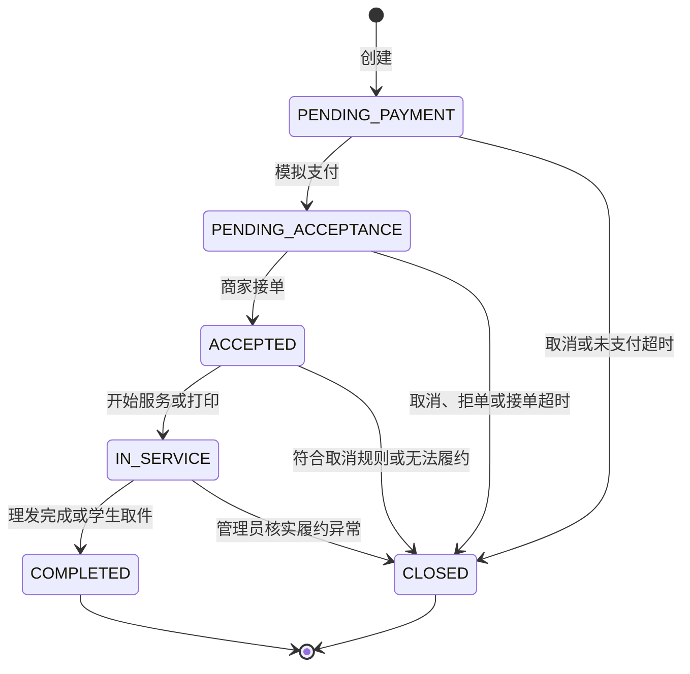

# V1 状态迁移、事务与验收

2026-11-02 M04.2-B：文件原四种状态及打印引用期限保持；UPLOADING提交后按完整定位写LOCAL/S3，S3完整GET校验后复核版本/身份发布。对象IO不进SQL事务；DELETING精确删除后条件回写DELETED，S3墓碑永久轮转回收可能晚到的写入。共享实例互斥及原订单锁序保持；[指南](s3-file-storage.md)/[验收](reports/s3-file-chain-2026-11-02.md)。真JVM及服务端晚到IO的C验证尚未执行。以下为历史阶段记录。

M03.2-B：固定消息/hash校验后消费键串行化，凭据/通知同RC提交、返回后ACK；暂态异常3次有界退避，永久错误/用尽次数进死信。已读按账号→会话→通知锁序，最终会话失败回滚。

2026-10-30 M03.2-A：预约首次ACCEPT和打印首次READY_FOR_PICKUP在原RC事务末尾追加outbox，失败/最终会话复核失败一并回滚；Broker IO仅在后台认领提交后。关闭传输仍写待发事实，合法重试不追加。发布30秒租约、按token条件回写、最多20次指数退避；SENT仅确认及路由成功，不等于通知已消费。[ADR-0053](decisions/0053-reliable-order-messaging.md)。

2026-10-30 M08.2-C用券按[ADR-0052](decisions/0052-order-coupons.md)：AVAILABLE→LOCKED→USED；未付关闭LOCKED→AVAILABLE/EXPIRED，订单快照RELEASED；已付退款保持USED且只退实付。订单/券/资金/事件/资源或文件保护同RC事务。沿资源/订单锁后取券；预约清理旧单先锁订单，再把新旧涉及券按ID排序全锁，锁后判时。旧无券摘要兼容，报价只读RR。

2026-10-30 M08.2-B按[ADR-0051](decisions/0051-synchronous-coupon-claims.md)接入同步领取：账号X→会话X→店铺S→活动X，发行/持有券/成功请求同事务；同键原事实重放，换键重复领409。读取AVAILABLE/EXPIRED按固定业务时刻派生、RR分页；未实现订单锁券/核销或消息。

2026-10-29 M08.2-A活动：DRAFT→PUBLISHED→STOPPED，发布冻结完整规则，停止不恢复；[ADR-0050](decisions/0050-coupon-business.md)。写RC账号→会话→店铺S→OWNER→活动X，锁后当前读和时间判断，提交前会话复核；不更改店铺版本或订单。首次发布/停止保存操作者/原版本/时间，同人同原版本且仍为对应目标状态才重放。查询身份/归属/count/page同RR，返回前校验期限。券持有/锁定/核销及原订单券锁增量已确认但本批未实现，不能用本段替代后续订单用券验收。

2026-10-28 M02.2补充技术协议：评价首次创建/首次隐藏在原账号→会话→店铺S→订单/评价锁之后，最后原子推进`shop_rating_revision`；不升级shop锁、不改订单/配置版本或事件，统计版本写失败则原事务全部回滚，缓存关闭或离线也维护。详情保持单一只读RR，版本门控统计，回填及在途结果发布在读取事务成功返回后。没有新增业务状态或HTTP路径，完整锁/失效/降级边界见[ADR-0048](decisions/0048-public-rating-cache.md)，其验证不替代未来M02.3性能与系统故障对照。

2026-10-26 当前交付：账号停用/恢复按[ADR-0046](decisions/0046-admin-account-status.md)接入。禁止修改本人，双账号按ID排序主键锁后复核正常ADMIN；实际变化时状态/version+1、目标全部旧会话撤销、状态历史原子提交，恢复须重新登录。旧版本409，同版本同状态200无写入；不自动处理订单/资金或改文件期限。V15新增account_status_change，23表；运行62、完整62/62/0，当前规划入口齐全。见[Swagger / Apifox指南](admin-account-status.md)；旧阶段“账号状态待开发”以本次为准，接口齐全不等于公开部署或全部工程工作完成。

2026-10-26 当前交付：管理员账号列表按[ADR-0045](decisions/0045-admin-account-list.md)接入。正常ADMIN查询全部业务账号，角色/状态交集、分页、创建时间/ID倒序，仅六字段AccountView；身份/会话与count/items同一只读RR快照，返回前核对到期，无业务行锁或写入。运行61、完整62/61/1，仍V1～V14/22表，无新迁移；账号停用/恢复尚未实现。见[Swagger / Apifox指南](admin-account-list.md)，旧阶段“账号列表待开发”以本次交付为准。

2026-10-26 当前交付：管理员隐藏评价按[ADR-0044](decisions/0044-admin-review-hide.md)接入。正常ADMIN说明原因后原子保存首次审核记录并隐藏；同人同原因重放保留事实，其他重复409。后续公开评价/真实评分排除，本人仍可读、reviewed=true且不能重发，不改订单/资金/文件期限。V14补三个审核字段，无新表，仍22表；运行60、完整62/60/2，仅管理员账号列表/状态管理待开发。见[Swagger / Apifox指南](admin-review-hide.md)，旧阶段“隐藏后续”以本次交付为准。

2026-10-26 当前公开评价扩展：[ADR-0043](decisions/0043-public-shop-reviews.md)新增匿名GET /shops/{shopId}/reviews，仅公开可见店铺VISIBLE记录、作者当前昵称；停用作者不自动隐藏。商家列表/详情rating/reviewCount改为真实全部VISIBLE均分/数量，两位HALF_UP、零条null/0，同响应短RR、页内批量统计。运行59/完整62/59/3，V1～V13/22表无新迁移，见[点击指南](public-shop-reviews.md)。旧统计阶段值说明由本次取代；隐藏入口后续。

2026-10-26 当前学生评价扩展：[ADR-0042](decisions/0042-student-order-review.md)接入POST/GET /orders/{orderId}/review，合法已付完成单一单一评，详情reviewed真实查询且隐藏也true；评价独立，不改订单版本/状态事件/资金/文件。V13/22表，运行58、完整62/58/4，见[点击指南](student-order-review.md)。公开评价/真实评分统计及隐藏入口后续；旧阶段固定reviewed=false的说明由本次取代。

2026-10-26 当前管理员PRINT扩展：[ADR-0041](decisions/0041-admin-print-exception.md)使原管理员详情/核实关闭支持两类订单；PRINT已付未结束四种阶段可全额模拟退款为CLOSED/REFUNDED/ABORTED，保留已发生时间，reason+expectedVersion防覆盖取件/履约新事实。全部文件引用保护、下载授权及重放沿已确认边界，见[点击指南](admin-print-exception.md)。运行仍56、完整62/56/6，无新迁移；旧阶段管理员仅BOOKING的描述以本次为准。

2026-10-25 当前取件扩展：[ADR-0040](decisions/0040-student-print-pickup.md)新增学生本人POST /orders/{orderId}/pickup，正常打印单可完成；COMPLETED/PAID/PICKED_UP与完成/取件时间、版本/事件、全部引用期限原子提交。合法终态pickup及商家start/ready可重试，不续期/回退，完成单撤销商家下载授权来源。运行56、完整62/56/6，见[点击验收](student-print-pickup.md)。下方旧阶段取件待开发、完成后start/ready拒绝的描述以本次为准。

当前打印履约扩展（2026-10-25）：[ADR-0039](decisions/0039-merchant-print-fulfillment.md)接入开始/待取件及相应商家下载，原阶段只支持已接单内容权限的说明由此替代。待取件仍未终结，不启动7天保留，学生取件与管理员PRINT异常后续开发。

当前下载扩展（2026-10-25）：[ADR-0038](decisions/0038-merchant-print-download.md)开放本店合格ACCEPTED未开始PRINT的商家PDF内容读取，无订单状态迁移。旧商家内容未开放的阶段说明由此替代，未来打印中/待取件授权待对应履约任务。

当前打印取消扩展（2026-10-25）：[ADR-0037](decisions/0037-merchant-print-cancellation.md)接入ACCEPTED/PAID/QUEUED未开始PRINT的商家无法履约取消；原接单后没有退款终结路径的阶段说明已被替代。打印开始/取件及管理员PRINT仍待后续。

当前商家打印扩展（2026-10-24）：[ADR-0036](decisions/0036-merchant-print-confirmation.md)接入PRINT商家确认，旧商家空页说明由此替代；正常打印履约、内容授权、接单后取消与管理员PRINT仍待后续。

当前支付扩展（2026-10-24）：[ADR-0035](decisions/0035-print-mock-payment.md)已接入PRINT模拟付款及待接单全额退款；状态/资金/事件/引用期限同事务。旧阶段仅待支付的说明以ADR-0035为后续扩展。

当前扩展（2026-10-24）：[ADR-0034](decisions/0034-print-orders.md)已接入PRINT待支付与关闭、学生历史及全部文件引用保护。预约原状态机保持；学生PRINT不再空页，商家阶段空页保持。

版本：讨论稿 0.1，2026-10-12。字段定义见 [数据库设计](v1-database-design.md)，已确认规则与待审阅异常边界见 [ADR-0001](decisions/0001-v1-baseline.md)。本文不是已实现接口或已执行测试报告。

## 1. 公共订单状态

2026-10-19 商家入驻与审核规则已定稿，订单部分仍保持原有确认边界：申请事务创建 ACTIVE / MERCHANT + PENDING 店铺 + PENDING OWNER，默认停业；PENDING 经管理员审核变为 APPROVED（激活成员、仍停业）或 REJECTED（成员保持 PENDING）；本人可从 REJECTED 修改重提至 PENDING。审核/重提使用店铺版本和行锁，成功版本 + 1，旧版本/非法状态 409；保留历次审核，见 [ADR-0010](decisions/0010-merchant-onboarding.md)。申请、审核与重提均已实现，锁及事务细节见 ADR-0011 / ADR-0012。重提清空当前审核信息但保留 shop_review 历史。

| 状态 | 含义 | 允许的支付状态 |
|---|---|---|
| PENDING_PAYMENT | 等待模拟支付 | NOT_PAID |
| PENDING_ACCEPTANCE | 已支付，等待商家确认 | PAID |
| ACCEPTED | 已确认，尚未开始履约 | PAID |
| IN_SERVICE | 履约中；打印待取件仍在此状态 | PAID |
| COMPLETED | 履约完成 | PAID |
| CLOSED | 已关闭，不重新打开 | 未支付关闭为 NOT_PAID，已支付关闭为 REFUNDED |

V1 模拟退款在关闭事务中同步成功，不保存外部退款中间状态。真实或异步退款将来可能出现 CLOSED + PAID/REFUNDING，届时必须修改此组合约束与状态文档。

## 2. 公共操作矩阵

本店服务目录按 [ADR-0015](decisions/0015-merchant-service-catalog.md) 已确认并实现：默认下架、显式上架、修改与下架仅变化服务配置，实际变更递增独立服务版本。不开启店铺、不重新审核、不删除历史、不直接操作订单；存量快照与预约保护在交易模块接入。

每周营业时间按 [ADR-0014](decisions/0014-merchant-business-hours.md) 实现：同一个店铺版本保护资料、开关与整周时段，实际变化才加一；相邻合并、重叠拒绝、清空不关闭手动开关。营业时间保存不迁移审核状态、不处理订单；排班保护已由 ADR-0018 补齐；有效预约保护尚未接入。

商家经营资料与手动开关按 [ADR-0013](decisions/0013-merchant-operation.md) 已确认并实现：只有 ACTIVE / MERCHANT + APPROVED 店铺 + ACTIVE OWNER 可操作；不迁移审核状态，不改审核历史。实际修改资料或开关时 shop.version + 1；停业不注销账号或改变审核资格。营业开关独立保存意愿，订单尚未实现，本任务不声称已验证存量订单履约。

任何写操作先验证身份和数据归属，再读取/锁定当前状态；客户端不能自行指定目标状态或金额。

| 操作 | 操作者 | 前置状态与条件 | 目标状态 | 同事务副作用 |
|---|---|---|---|---|
| 创建 | STUDENT | 账号正常、店铺已审核营业、服务可用，报价匹配 | PENDING_PAYMENT | 创建唯一扩展、幂等记录、事件；预约 HELD，打印 QUEUED |
| 模拟支付 | 本人学生 | PENDING_PAYMENT，now < payment_deadline，模拟功能启用 | PENDING_ACCEPTANCE | 支付流水、PAID、paid_at、acceptance_deadline；预约 ACTIVE |
| 未支付取消 | 本人学生 | PENDING_PAYMENT | CLOSED | NOT_PAID；预约 RELEASED 或打印 ABORTED；USER_CANCEL |
| 未支付超时 | SYSTEM | PENDING_PAYMENT，now >= payment_deadline | CLOSED | 同上；PAYMENT_TIMEOUT |
| 接单前取消 | 本人学生 | PENDING_ACCEPTANCE | CLOSED | 全额退款；释放预约或终止打印；USER_CANCEL |
| 商家接单 | 本店商家 | PENDING_ACCEPTANCE，now < acceptance_deadline；预约还未开始 | ACCEPTED | accepted_at、事件 |
| 商家拒单 | 本店商家 | PENDING_ACCEPTANCE，未超过接单期限，必须说明原因 | CLOSED | 全额退款、释放预约或终止打印；MERCHANT_REJECT |
| 接单超时 | SYSTEM | PENDING_ACCEPTANCE，now >= acceptance_deadline | CLOSED | 全额退款、释放预约或终止打印；ACCEPTANCE_TIMEOUT |
| 预约接单后取消 | 本人学生 | BOOKING + ACCEPTED，start_at - now >= 1 小时 | CLOSED | 全额退款、RELEASED；USER_CANCEL |
| 接单后无法履约 | 本店商家 | ACCEPTED，未开始履约，必须说明原因 | CLOSED | 全额退款、释放预约或终止打印；MERCHANT_UNAVAILABLE |
| 核实履约异常 | ADMIN | 已支付未终结，记录核实原因；普通用户无此权限 | CLOSED | 全额退款；开始前 RELEASED，开始后 CONSUMED；打印 ABORTED；ADMIN_EXCEPTION |

支付/接单请求若在锁内发现对应期限已到，必须拒绝业务操作，并可在同一事务转为超时关闭；业务响应在提交后返回，不能“关闭后抛回滚异常”导致关闭被撤销。另一种允许的实现是拒绝后由独立超时事务关闭，须在实现 ADR 中选定一种。

已终结订单禁止继续接单、开始、支付或完成。普通商家取消不是履约中退款入口，服务已开始后须走管理员异常处理。

## 3. 理发预约状态组合

2026-10-21：本店理发师资料、启停和服务绑定按 [ADR-0017](decisions/0017-merchant-barbers.md) 已实现，当时排班/预约仍未实现；本轮按日排班已按 ADR-0018 实现，预约仍待开发。配置写事务使用 RC，锁顺序为本人账号 → 当前会话 → 店铺 → OWNER → 目标服务 ID 升序 → 理发师 → 关系；PATCH 可跳过服务锁，绑定完整替换与资料共用人员版本。读取使用只读 RR，批量加载关系，保证同一响应内资料/版本/绑定一致。停用和解绑暂只改变配置；预约接入前必须补齐有效预约保护，并遵守 ADR-0018 更新的统一顺序：店铺入口先于日期保护行，再访问人员/时段；旧的日期行先于店铺草案已被替代。

| 公共订单状态 | occupancy_status | 时间是否占用 |
|---|---|---|
| PENDING_PAYMENT | HELD | 是，事务关闭前保守占用 |
| PENDING_ACCEPTANCE / ACCEPTED / IN_SERVICE | ACTIVE | 是 |
| COMPLETED | CONSUMED | 原时间区间保留占用 |
| CLOSED（尚未开始） | RELEASED | 否 |
| CLOSED（开始后异常） | CONSUMED | 保留原区间，不重新售卖 |

HELD → ACTIVE 随支付发生；ACTIVE → CONSUMED 随完成或开始后异常关闭发生；未开始的占用 → RELEASED 随关闭发生。状态不能独立调用接口修改。

| 预约操作 | 条件 | 结果 |
|---|---|---|
| 查询候选时段（已实现 ADR-0021/0022） | 公开理发资格、上海今天至第 6 天、至少提前 2 小时、完整落在营业/排班交集 | 排除 HELD/ACTIVE/CONSUMED 真实占用，不预留资源 |
| 开始服务 | 本店商家，ACCEPTED，start_at <= now < end_at | IN_SERVICE，写 started_at，占用仍 ACTIVE |
| 完成服务 | 本店商家，IN_SERVICE | COMPLETED，写 completed_at，占用 CONSUMED |
| 未开始且预约结束 | 已支付、到 end_at 仍未开始 | 提示异常，不自动完成或自动扣款；管理员核实后退款关闭 |
| 修改排班 | 本店商家，锁当天保护行 | 新排班须覆盖存量有效预约；冲突则拒绝修改 |

2026-10-13 用户已确认：未到店和服务中异常使用管理员核实后的全额模拟退款并关闭订单；V2 再区分学生缺席、商家过失及售后责任。

### 区间冲突与锁协议

区间为 [start_at, end_at)。冲突条件：existing.start_at < requested.end_at 且 existing.end_at > requested.start_at。10:00～10:30 与 10:30～11:00 相邻可约，10:15～10:45 与前者重叠。

创建预约事务的逻辑顺序：

1. 验证身份及幂等键格式，对已存在请求检查归属与摘要。
2. 先取得店铺 FOR SHARE，再查找并 SELECT ... FOR UPDATE 锁定 barber_day_guard；没有合法排班则拒绝（预约仍为后续实现要求）。
3. 在锁内检查排班、已开始/提前时间限制及可提供服务，用受锁保护的配置生成报价快照。
4. 在同一保护行下关闭到期的 HELD 订单及到期未接单订单，写相应事件；按订单 ID 升序处理。
5. 对占用集合使用当前读查询重叠，不使用早先普通 SELECT 的快照结果。
6. 创建主订单、BOOKING 扩展、HELD 占用、创建事件和完成幂等记录。
7. 提交；唯一键冲突时整笔回滚，再在新事务读取原请求结果。

同一理发师当天的取消、拒绝、超时、支付、开始和完成均先锁店铺 FOR SHARE，再锁保护行及订单。获取保护行定位信息可先做普通查询，但拿到锁后必须重新验证订单归属、日期及状态。

预约相关事务建议采用 READ COMMITTED；冲突查询仍显式使用锁定当前读。所有锁保持到事务结束，排班写入遵守同样协议。保护行不能因没有预约而跳过。

2026-10-21 用户已确认 [ADR-0018](decisions/0018-merchant-schedule.md)，明确替代旧的“日期行先于店铺”顺序：配置写先取得店铺 FOR UPDATE，未来预约先取得店铺 FOR SHARE，然后统一获取日期保护行及人员/时段等后续资源。多个保护行按 (barber_id, service_date) 升序；不得持有日期行后再申请店铺锁。营业时间在店铺 X 下枚举并检查今天及之后所有排班，防止漏掉并发新建日期。读取为 RR，排班/营业时间写为 RC；排班等待后和实际写后复查会话及日期窗口。

本方案不依赖 JVM 的 synchronized，也不依赖 Redis 锁；多个应用实例通过同一 MySQL 事务协议协调。参考 [MySQL 锁定读](https://dev.mysql.com/doc/refman/8.4/en/innodb-locking-reads.html)。

## 4. 打印进度与状态组合

| progress | 公共状态 | 操作者与触发 |
|---|---|---|
| QUEUED | PENDING_PAYMENT / PENDING_ACCEPTANCE / ACCEPTED | 创建后等待支付和接单 |
| PRINTING | IN_SERVICE | 本店商家在 ACCEPTED 下开始打印 |
| READY_FOR_PICKUP | IN_SERVICE | 本店商家从 PRINTING 标记可取件 |
| PICKED_UP | COMPLETED | 本人学生从 READY_FOR_PICKUP 确认取件 |
| ABORTED | CLOSED | 取消、拒单、超时或管理员异常关闭 |

商家不能跳过 PRINTING 直接完成；学生不能在未待取件时确认取件。进入 READY_FOR_PICKUP 虽然公共状态不变，仍记录事件并递增订单 version。

创建打印订单前，PDF 已完成校验及上传；事务内锁定最新价目和文件，验证版本、归属、有效期，计算金额并保存快照。页面显示的旧金额不能作为扣款依据；报价变化返回可识别的业务冲突，让学生重新确认。

2026-10-20 商家价目配置已按 [ADR-0016](decisions/0016-merchant-print-prices.md) 实现，不创建订单或报价。写锁为本人账号 → 会话 → 店铺 → OWNER → 服务 → 固定顺序价目；READ COMMITTED 写事务用父服务锁协调不存在的规格，避免不同店铺空价目范围间隙锁相互阻塞。当前读校验全部版本后批量写入，任何失败回滚；每条规则独立版本，无变化不递增，不影响参考起价。报价/订单仍须在对应任务落实配置锁协调、重新计价与冻结快照，本次配置验收不能代替。

文件上传、PDF 解析、对象下载/删除都在数据库事务外执行。订单事务只处理元数据、引用和有效期。

## 5. 幂等行为

| 重复请求 | 处理规则 |
|---|---|
| 相同创建键、相同归一化内容 | 返回原订单，终态订单也不重新创建 |
| 相同创建键、不同内容 | 返回请求键冲突 |
| 重复模拟支付 | 已有成功支付且未退款时返回该支付事实；已退款时返回订单已关闭，不重新支付 |
| 重复学生取消 | 本人以 USER_CANCEL 关闭时返回原结果；其他关闭原因返回对应业务状态 |
| 重复商家接单 | 同一店铺已接单或已开始/完成时返回原接单事实；拒绝或关闭后不能恢复 |
| 重复开始/完成/待取件 | 目标事实已存在且后续状态合法时返回原结果，不重写时间，不新增事件 |
| 重复拒单或无法履约 | 同原因且本店权限成立时返回原结果；不同状态或原因拒绝 |
| 重复退款 | 读取唯一成功退款，不重复生成流水 |
| 重复评价 | 同订单已有评价返回已评价冲突，不覆盖原内容 |

效果幂等不意味着每次返回相同的 HTTP 响应体；客户端重试获得原事实，后续状态可能已经推进。任何“返回原结果”之前仍需执行身份及数据权限检查。

## 6. 锁顺序与事务边界

| 业务 | 必需锁及更新 |
|---|---|
| 创建预约（ADR-0022 已实现） | 店铺 S → 日期保护行 → 受保护配置/到期订单 → 新订单；扩展与幂等记录同事务 |
| 预约未支付取消/超时（ADR-0022 已实现） | 店铺 S → 日期保护行 → 订单 → 释放占用/事件记录 |
| 预约支付、接单、开始、完成（待实现） | 店铺 S → 日期保护行 → 订单 → 支付/退款/事件记录 |
| 打印创建 | 价目配置 → 文件；再创建新订单与扩展、幂等记录，不调用外部存储 |
| 打印支付、接单、进度 | 订单 → 必要的流水与事件；终结操作再锁文件 |
| 文件清理 | 只锁文件、当前读复核引用，不持文件锁反向锁已有订单 |
| 评价 | 锁订单验证完成和归属 → 插入唯一评价 |
| 排班修改（配置已实现） | 账号 → 会话 → 店铺 X → OWNER → 日期保护行 → 人员/时段；预约接入前再补有效占用保护 |
| 营业时间修改（已实现） | 店铺 X 入口后按人员/日期升序锁保护行，覆盖今天及之后全部排班才保存 |

访问多个订单或文件时按 ID 升序获取同类锁。订单在创建后不换店、不换理发师、不换文件，避免定位信息漂移。不同路径遵守同一锁顺序，不仅检查单个方法里的锁。

预期死锁/锁超时要整笔回滚；后续可对确认幂等的完整事务做有限重试，不能从失败 SQL 中间继续，也不能无上限重试。真实并发测试后再决定重试次数和退避配置。

状态变更可以在订单锁内附加旧状态/version 条件更新，影响行数必须为 1。数据库状态、支付事实、资源占用和日志全部成功才提交。

## 7. 超时与恢复

- 未支付扫描：status = PENDING_PAYMENT 且 payment_deadline <= now。
- 待接单扫描：status = PENDING_ACCEPTANCE 且 acceptance_deadline <= now。
- 批量扫描仅定位候选 ID，不等于状态已确认；逐笔使用正常业务事务重新锁定和判断。
- 预约关闭先获取保护行再获取订单；任务不能先锁订单再反向获取保护行。
- 多实例或重复调度允许重复扫描，通过锁、状态条件及流水唯一约束收敛为一次变更。
- 应用重启后扫描历史到期记录，截止时间存在数据库，不依赖内存定时器。
- 任务失败不吞异常：记录订单 ID、原因，后续扫描重试；不能在一个巨大事务里关闭所有订单。
- 支付及接单接口自行检查期限，任务延迟不会延长操作窗口。
- V1 不自动关闭已经开始的服务，也不自动完成待取件订单。

## 8. 评价、优惠券及后续状态

评价生命周期只有 VISIBLE / HIDDEN；它与订单完成状态独立。隐藏不删除记录、不解除 order_id 唯一约束，评分聚合排除隐藏记录。V2 回复、举报及编辑需单独补充迁移规则。

优惠券不在 V1 建表。V2 设计方向为：模板 DRAFT / PUBLISHED / STOPPED；用户券 AVAILABLE / LOCKED / USED / EXPIRED。领取窗口和使用窗口分开校验；创建订单锁券、支付核销、未支付关闭后释放或过期。已支付后退款默认不返券，领取数量也不退回。

该方向不是完整优惠券实现契约；引入前还需确定库存回补、锁券关联唯一性及多请求领取事务，再评估 Redis/Lua。消息同样先定义业务事件，V3 引入 Outbox 与消费幂等，不让 Redis/MQ 成为 V1 数据正确性的条件。

## 9. 原始 V1 目标验收清单（执行结果按各阶段指南记录）

| 编号 | 场景 | 预期不变量 |
|---|---|---|
| AUTH-01 | 伪造角色、已撤销 JWT、停用账号 | 拒绝访问；不产生业务写入 |
| ACL-01 | 学生访问他人订单，商家操作他店订单 | 拒绝，订单及流水不变 |
| BOOK-01 | 20 个不同学生并发预约同一区间 | 恰好 1 个成功、1 笔占用，其余业务冲突 |
| BOOK-02 | 10:00～10:30 与 10:15～10:45 并发 | 最多 1 个成功，不只校验相同开始时间 |
| BOOK-03 | 相邻区间、不同理发师 | 均可成功，不能错误冲突 |
| BOOK-04 | 空日首次预约并发 | 仍只有一个重叠预约，验证保护行作用 |
| BOOK-05 | 取消与新建重叠预约并发 | 最终没有两笔有效重叠占用 |
| BOOK-06 | 修改排班与预约并发 | 新排班和成功预约相容，否则一方被拒绝 |
| BOOK-07 | 提前完成后再约原剩余时间 | 仍被原区间阻止 |
| ORDER-01 | 同创建键重试及改内容 | 同请求只一单，不同内容冲突 |
| ORDER-02 | 支付与超时关闭竞争 | 要么待接单且一条支付，要么未支付关闭；不出现已扣款但无退款的关闭 |
| ORDER-03 | 接单与确认超时竞争 | 要么已接单，要么关闭且一条全额退款 |
| ORDER-04 | 重复支付、取消、完成 | 时间不覆盖，流水和事件不重复 |
| ORDER-05 | 主表插入后模拟扩展/事件写入失败 | 全事务回滚，无半笔订单或残留占用 |
| PRINT-01 | 黑白/彩色、单双面、奇数页、多份 | 印刷面金额和纸张数分别正确，无浮点误差 |
| PRINT-02 | 显示报价后商家改价 | 下单返回报价变化；原订单快照不变 |
| FILE-01 | 伪装/加密/损坏 PDF、超限文件 | 不形成可下单文件，无长期孤立对象 |
| FILE-02 | 未接单商家、其他店铺、其他学生下载 | 拒绝，私有对象不能绕过应用公开访问 |
| FILE-03 | 一个文件关联多个订单，部分终结 | 未终结引用仍保护文件，最后终结后计保留期 |
| FILE-04 | 清理与新下单竞争、存储删除失败 | 不产生引用已删除文件的新单；失败可重试 |
| REVIEW-01 | 未完成、他人、重复评价 | 均拒绝，仅一条合法评价 |
| REVIEW-02 | 零评价、隐藏评价 | 暂无评分或按有效评价正确聚合 |
| RECOVER-01 | 重启前存在到期订单 | 重启扫描可关闭，释放占用，退款不重复 |

测试使用真实 MySQL 8.4 的独立测试库，多线程通过屏障同时发起请求，并在结束后校验数据库不变量。用例可通过 JUnit 集成测试或本地压测客户端执行；内存数据库和 Mockito 不能证明 InnoDB 锁的正确性。

订单和元数据事务的回滚测试需要故障注入；文件删除需要对象存储故障与重复任务场景。本表形成于最小 Web 阶段，不代表各项均已实现或执行。待支付预约、真实占用与配置保护按 ADR-0022 落实，其实际执行结果见[订单验收](booking-orders.md)；支付/履约和文件等后续目标仍待对应模块验证。不记录虚构通过率、吞吐量或延迟成绩。

2026-10-21 公开商家目录按 [ADR-0019](decisions/0019-public-shop-catalog.md) 实现：公开资格为店铺 APPROVED + OWNER ACTIVE + 账号 ACTIVE/MERCHANT；停业与分类字典停用不隐藏。三个只读 GET 使用 RR 绑定总数、数据和营业时间/服务，不加写锁，不改变版本。openNow 按一次响应的校园 Clock 与开关/营业区间判断，不等于预约资格；创建订单仍须锁内重新核验。

2026-10-21 公开理发师按 [ADR-0020](decisions/0020-public-barbers.md) 实现：复用公开店铺资格，读取人员及本店上架理发绑定，不写状态/版本。只读 RR 保持店铺、目标服务与结果一致；联表限制同店/类型/上架，EXISTS 只筛选人员，不截断全部公开服务 ID。人员启用或目录可见不等于可约；日期和占用在后续可约/预约模块验证。

2026-10-21 [ADR-0021](decisions/0021-booking-slot-candidates.md)：候选查询只读 RR，所有资源合格后才允许停业返回空数组；每请求只捕获一次 Clock，统一判定日期和提前边界，不写保护行或版本。当前未实现真实订单占用；本篇预约创建、支付及占用迁移仍为后续目标，创建开放前必须实现占用过滤、锁内复核和有效预约对停用/解绑/排班/营业时间变更的保护，沿用 ADR-0018 的店铺 → 日期保护行 → 人员/时段锁顺序。

2026-10-22 [ADR-0022](decisions/0022-booking-orders.md) 已实现创建待支付预约、本人详情、未支付取消及超时关闭。实际状态为 PENDING_PAYMENT/NOT_PAID/HELD → CLOSED/NOT_PAID/RELEASED；创建事件0，关闭版本及事件序号+1。相同创建键绑定原订单，关闭后不新建。取消到期先提交 TIMEOUT 再由外层返回409；扫描每30秒最多100个ID、每单独立事务，启动首扫，失败下次重试。候选只读RR排除真实占用；交易RC按店铺S→日期行→后续资源，配置店铺X→日期行→后续资源，锁等待/写后复核会话及时间。人员停用/解绑保护未结束 HELD/ACTIVE，时段保护含 CONSUMED；名称/价格/时长和关闭营业开关不自动取消旧订单。支付及后续ACTIVE/CONSUMED状态转换仍待实现，前文完整生命周期不能当作已交付。验证与复现见[订单验收](booking-orders.md)。

2026-10-22 [ADR-0023](decisions/0023-booking-mock-payment.md) 已落实模拟支付及待接单退款：PENDING_PAYMENT/NOT_PAID/HELD → PENDING_ACCEPTANCE/PAID/ACTIVE → CLOSED/REFUNDED/RELEASED。付款写一条PAYMENT事件/版本+1；退款关闭只写一条USER_CANCEL或ACCEPTANCE_TIMEOUT事件/版本+1。两种期限的相等时刻均到期，先提交关闭再由事务外边界抛409；重复付款/取消返回原事实不改时间版本。写RC，账号→会话→店铺S→日期行→订单及占用→流水/事件，SYSTEM省略身份锁；锁后当前读，付款时间只在取得业务锁后确定，提交前身份过期整笔回滚。开关关闭保留已付到期占用，扫描两组各100条独立事务，恢复按原期限补偿；创建锁内清理与新建整体回滚。读取RR，未提交退款保持占用。商家确认及后续状态仍为未实现目标，点击及验证见[支付指南](booking-payments.md)。

2026-10-22 [ADR-0024](decisions/0024-merchant-booking-confirmation.md) 已落实 PENDING_ACCEPTANCE→ACCEPTED（ACCEPT事件/MERCHANT、acceptedAt、版本+1，保持PAID/ACTIVE）及待接单MERCHANT_REJECT全额退款关闭；ACCEPTED本人距开始至少1小时可USER_CANCEL全额退款关闭。拒单归一化原因同原单结果一致才可幂等重放，接单不延长任何期限，已关闭不可恢复。商家写账号→会话→店铺S→OWNER当前复核→日期行→订单/预约→流水/事件，RC等待后复核状态/期限，提交前复查会话；详情RR。接单与待接单超时只允许一条合法路径提交，ACCEPTED不再由原超时扫描或创建清理退款；所有新增退款沿用模拟开关。停业/下架不影响原单；失去APPROVED后仅拒绝接单，正常账号及有效店主仍可读取/拒单。验证及范围见[验收](merchant-booking-confirmation.md)，后续履约仍未开放。

2026-10-22 [ADR-0025](decisions/0025-merchant-booking-cancellation.md) 已落实ACCEPTED→CLOSED商家无法履约取消：锁后严格早于预约startAt，正常商家/本店ACTIVE OWNER可在暂停店铺下处理旧单，不受学生提前1小时限制；到开始时刻409 CANCEL_WINDOW_CLOSED无写入。整笔全额退款、RELEASED、MERCHANT_UNAVAILABLE及原因、版本+1、MERCHANT关闭事件；同原因重放不重复资金/事件或覆盖时间，不同原因及其他关闭结果冲突。复用RC账号→会话→店铺S→OWNER→日期行→订单/预约→流水/事件，等待后当前读、提交前复查会话；新退款受模拟开关保护。原30分钟接单截止对ACCEPTED不重新应用。到开始后的异常、服务中退款仍待后续管理员/履约任务，实际验证见[取消指南](merchant-booking-cancellation.md)。

2026-10-22 [ADR-0026](decisions/0026-booking-fulfillment.md) 已落实ACCEPTED→IN_SERVICE→COMPLETED：开始窗口[startAt,endAt)，固定锁后startedAt；完成可立即/提前/超过endAt，但now不得早于startedAt。两次迁移各一条MERCHANT事件及版本+1，ACTIVE在完成时改为CONSUMED，保留原区间，不退款或重新开放。重复开始在IN_SERVICE/COMPLETED、重复完成在COMPLETED时仅重放合法旧事实；关闭不可恢复。RC复用商家统一锁入口，锁后当前读及提交前会话复核，状态/占用/事件失败整体回滚；RR候选在完成前后均保留占用。暂停店铺有效店主可履行已接旧单，资金开关关闭可用；普通取消/退款不能改变服务中或已完成状态。晚完成不延长原预约区间；未到店、服务中异常仍待管理员任务，真实验证见[履约指南](merchant-booking-fulfillment.md)。

## 管理员预约异常（ADR-0027，已实现）

正常ADMIN核实后可将BOOKING的已付PENDING_ACCEPTANCE/ACCEPTED/IN_SERVICE关闭为CLOSED/REFUNDED，记录ADMIN_EXCEPTION、原因、实际操作人、锁后时间及版本+1。前两种状态ACTIVE→RELEASED；IN_SERVICE转CONSUMED保留原区间及startedAt，不恢复、不截短原预约。已完成或未付款不支持此入口。

请求携带核实前读取的expectedVersion，非关闭版本冲突拒绝，不能沿旧核实覆盖随后开始/完成。关闭重试只重放同管理员/同原因/原版本及对应最后事件，不覆盖已关闭原因。所有新退款受模拟资金开关保护；目标账号/OWNER停用仍可由正常ADMIN处理。RC写锁管理员账号→会话→店铺S→日期行→订单/预约→资金/事件，不锁目标账号；与到期扫描/开始/完成/普通取消按当前状态及版本决定，只有一次关闭退款。详情RR不清理到期订单，管理员入口不代跑超时退款。规则与验证见[ADR-0027](decisions/0027-admin-booking-exception.md)及[点击指南](admin-booking-exception.md)。

## 学生列表读取（ADR-0028，已实现）

GET /orders仅正常STUDENT查本人BOOKING摘要，支持六种真实主状态；PRINT当前空页。不执行关闭、释放、退款、开始/完成或事件写入，不递增版本，也不根据截止时间临时映射状态。单次RR快照内读取total/items，保持状态和快照字段一致；后续独立请求可见已提交变化。本人历史不依赖当前店铺/经营账号/OWNER资格，退款后仍显示原应付金额。此只读入口不获取业务写锁，不改变原账号→会话→店铺→日期行→订单协议。见[ADR-0028](decisions/0028-student-order-list.md)。

## 商家列表读取（ADR-0029，已实现）

GET /merchant/orders仅正常MERCHANT及ACTIVE OWNER读取本店BOOKING摘要，暂停店铺仍可读旧单；不触发状态、占用、版本、资金或事件变化。RR从店铺归属读取开始，使成员资格及count/page处于同一快照；快照后的停用在下次请求生效。不新增业务写锁，目标学生停用不隐藏本店历史；原接单/履约权限和写锁顺序不变。细则见[ADR-0029](decisions/0029-merchant-order-list.md)。

## 订单事件读取（ADR-0030，已实现）

学生本人及商家本店两个GET /.../{orderId}/events在RR内先校验归属/成员，再按eventSeq升序读取已保存事实，不根据当前状态合成记录。只读不改变既有迁移、重复操作或管理员latest重放规则；不触发超时关闭/退款/占用/版本/事件写入。原关闭动作包含退款结果而不额外合成REFUND，原因与实际操作者按原记录返回。历史及快照权限见[ADR-0030](decisions/0030-order-events.md)。

## 私有文件发布与清理（ADR-0031，已实现无订单阶段）

PDF流式校验→短RC创建UPLOADING（30分钟期限）→事务外移动→短RC身份复核发布AVAILABLE（24小时）。写锁账号→会话→文件；实例内按对象key互斥覆盖发布/清理，避免IO放入数据库事务。失败只清理尚未发布占位，不能因响应丢失删除已提交AVAILABLE。到期/中断占位→DELETING提交→事务外删除→DELETED；删除失败重试，当前根标识限制范围，不反向锁账号或未来订单。GET先归属、未发布404、本人过期/删除410，读不触发清理。未终结订单保护及全部终结后7天在打印创建接入前必须落实，当前不声称已实现；见[ADR-0031](decisions/0031-print-file-upload.md)。

2026-10-23 本人PDF下载按[ADR-0032](decisions/0032-file-download.md)：无新状态迁移。只读定位→事务外取得现有文件互斥→新RR快照复核账号/会话/文件/期限→事务外打开及流式传输→finally关闭/释放。清理tryLock忙时跳过，不先写DELETING；清理先提交则下载拒绝。复核后的身份/期限变化不撤回本次已获准传输，后续请求再校验；不以数据库行锁或长事务覆盖磁盘/客户端等待，不生成事件/资金。

2026-10-24 打印报价按[ADR-0033](decisions/0033-print-quotes.md)实现，无状态迁移。只读RR内普通读账号/会话、本人文件、上架PRINT服务、公开可见店铺和启用规格，完成读取后一次Clock判会话/文件期限；身份→文件→服务→价目的错误优先级不变。快照后改价/停用/清理/退出本次可返回原快照，下次看到变更；不取行锁/文件互斥、不访问磁盘或续期，不阻止下载和清理，不创建订单/事件/资金。下单冻结及全部引用终结后保留7天仍待打印订单落实。

## PRINT待支付闭环：ADR-0034

PENDING_PAYMENT / NOT_PAID / QUEUED → CLOSED / NOT_PAID / ABORTED。学生截止前为USER_CANCEL，达到15分钟为PAYMENT_TIMEOUT（SYSTEM、actorId=null）。取消发现到期先提交状态、进度、事件和引用保留期，再由外层返回409；扫描按每单RC事务，重复无写入。无支付/退款事实，不依赖模拟资金开关。

创建、取消与系统超时持有店铺S→文件X→目标订单；学生操作先账号X/会话X，系统不反向锁账号。创建实例文件互斥在数据库事务外获取，持有到事务结束，IO在事务外；取消/扫描不取实例互斥。文件X保护全部引用的状态转换和终结后7天重算，跨店其他关联订单不加行锁。清理标记DELETING前在文件X内复核期限及无未终结引用，避免与创建/最后关闭竞争误删。

学生详情/列表/事件只读RR，如实读取冻结状态，不清理、续期或推断。列表左右连接两类明细并同条件count/page，避免预约时间非空假设。打印业务动作独立服务，不误入原预约日期锁及资金事务。

## PRINT支付与待接单退款：ADR-0035

PENDING_PAYMENT/NOT_PAID/QUEUED → PENDING_ACCEPTANCE/PAID/QUEUED → CLOSED/REFUNDED/ABORTED。创建事件0、支付事件1、关闭事件2；不额外合成REFUND事件。paidAt在必要锁后固定，支付截止等于拒绝；acceptanceDeadline=paidAt+30分钟。本人在截止前取消USER_CANCEL，等于/超过则ACCEPTANCE_TIMEOUT退款后409；扫描同路径SYSTEM关闭。重复不重写时间/资金/事件/文件期限，GET不触发转换。

RC账号→会话→店铺S→文件X→订单X→打印明细X→资金/事件；系统省略账号/会话。PRINT所有状态写先文件X，其他关联订单仅普通读聚合，末笔终结后7天。支付/退款无实例互斥或磁盘IO；首次付款要求元数据保护，正常引用不因超过原上传24小时而失效。支付后不改文件版本，退款涉及实际期限写入失败则连同资金回滚。

定位selectById仅提供入口；后台可能在等待文件锁前已提交退款。写返回/创建重放用锁后主订单及明细，避免MyBatis一级缓存返回定位旧状态，不能仅依赖数据库RC声称当前读正确。只读详情仍RR快照。打印扫描未付/待接单各100条，新资金关闭不影响未付组，恢复后从原截止补退款。

## PRINT商家确认：ADR-0036

| 起点 | 动作/条件 | 原子结果 |
|---|---|---|
| PENDING_ACCEPTANCE/PAID/QUEUED | 本店有效商家/OWNER，APPROVED，锁后now<期限 | ACCEPTED/PAID/QUEUED，acceptedAt/版本+1及MERCHANT ACCEPT；无资金/文件期限写入 |
| PENDING_ACCEPTANCE/PAID/QUEUED | 有效商家/OWNER，期限前说明原因拒单，暂停也允许 | 全额退款、CLOSED/REFUNDED/ABORTED、MERCHANT_REJECT/原因、事件和全部引用期限同事务 |
| PENDING_ACCEPTANCE/PAID/QUEUED | 合法接/拒单到达期限 | SYSTEM ACCEPTANCE_TIMEOUT全额退款/关闭/引用期限提交后409 |
| 已合法接单 | 重复accept且当前APPROVED/成员有效 | 200原acceptedAt/版本/事件，不重判首次窗口或文件 |
| MERCHANT_REJECT/REFUNDED | 同原因重复reject | 200原事实；异原因409，不改原因/版本/保留期 |

写RC商家账号→会话→店铺S→OWNER复核→文件X→订单/打印明细→资金/事件，提交前复核会话；不锁目标学生账号。写返回用锁后视图避免MyBatis定位缓存陈旧，读取仍RR。所有新退款受模拟开关保护，关闭时503无写入。接单先提交后，学生cancel409、扫描不再退款；文件仍NULL，直到后续已授权终结路径落实。商家cancel/start/complete和管理员预约入口继续拒绝PRINT。

## PRINT接单后无法履约取消：ADR-0037

ACCEPTED/PAID/QUEUED（acceptedAt非空，startedAt/readyAt/pickedUpAt空）→CLOSED/REFUNDED/ABORTED。本店正常商家/ACTIVE OWNER说明原因，暂停/停业仍可处理；无预约startAt限制，不重新判断原接单截止。统一锁后毫秒closedAt，唯一全额退款、MERCHANT_UNAVAILABLE/closeNote、版本+1和一次MERCHANT事件（fromStatus=ACCEPTED，通常seq=3）与全部引用期限同事务。保留acceptedAt与原支付，不合成开始/取件或REFUND事件。

同原因成功重放200，异原因/其他状态409且无写入；未付/待接单/开始/完成不走本取消，待接单到期也不代跑超时退款。资金关闭时首次503保持原状态，重放仍允许。RC沿商家账号→会话→店铺S→OWNER→文件X→主订单/打印明细→资金/事件，锁后复核状态、提交前复核会话，写返回用锁后视图。拒单/待接单退款仍从PENDING_ACCEPTANCE关闭。文件任一未终结NULL，全部终结后最晚终结+7天，必要写失败全部回滚。

## 商家PDF下载与取消并发：ADR-0038

下载只读RR，不改状态、进度、资金、事件、文件期限或版本。商家以本店至少一个ACCEPTED/PAID/QUEUED且未开始、文件属于订单学生的关联授权；取消最后有效关联后，即使7天仍存储，之后商家请求404。本店另一有效关联可独立授权，跨店引用只保护存储、不共享内容权限。

先短RR定位，在事务外等待既有文件互斥，再新RR复核身份/OWNER/任务/文件。等待期间已提交的取消或停用应拒绝；互斥后快照建立后取消/停用不打断本次获准传输。取消元数据事务不取实例互斥，不等待PDF IO；清理tryLock跳过传输，释放后按真实期限处理。始终无业务行锁/数据库事务覆盖IO；学生本人下载生命周期沿ADR-0032。

## PRINT开始与待取件：ADR-0039

| 动作 | 起点 | 原子结果 |
|---|---|---|
| START | ACCEPTED/PAID/QUEUED、未开始，now≥acceptedAt | IN_SERVICE/PAID/PRINTING，startedAt、版本+1、MERCHANT START（ACCEPTED→IN_SERVICE） |
| READY_FOR_PICKUP | IN_SERVICE/PAID/PRINTING、未标待取件，now≥startedAt | 主状态仍IN_SERVICE，进度READY_FOR_PICKUP/readyAt、版本+1、MERCHANT同名事件（IN_SERVICE→IN_SERVICE） |

允许相同毫秒与立即待取件，时钟倒退409 PRINT_TIME_INVALID无写入；不存在、跨店、BOOKING待取件404，非法状态409。start在PRINTING/READY、ready在READY合法重放200，保留原时间/版本/事件，不回退进度；关闭/合成完成不重放。首次核对保护文件元数据和资金不变量，无IO或新资金；资金关闭不妨碍履约。RC账号→会话→店铺S→OWNER→文件X→订单/打印明细→事件，提交前复核会话，写返回用锁后视图。文件始终未终结NULL保护，两个动作不更新期限或文件版本。

开始与取消先提交者决定结果：取消先则start409，开始先则普通cancel409不退款。商家complete仅BOOKING；PRINT待取件保持IN_SERVICE，学生取件/管理员PRINT异常后续。合法IN_SERVICE/PRINTING/READY关联持续授予本店下载，普通RR不持业务行锁，原等待复核及获准传输语义保持。

## 学生PRINT确认取件：ADR-0040

PICKUP：IN_SERVICE/PAID/READY_FOR_PICKUP→COMPLETED/PAID/PICKED_UP，阶段时间完整有序、now≥readyAt，completedAt=pickedUpAt=锁后毫秒时刻；订单版本+1，一条STUDENT PICKUP事件（IN_SERVICE→COMPLETED）。允许同毫秒立即确认，倒退409，无自动完成或商家代确认。

RC账号X→会话X→店铺S→文件X→订单/打印明细→事件及引用期限，提交前复核会话，锁后构造响应。首次支付、文件保护元数据及版本检查，时间/进度/版本/事件/文件期限原子提交；无资金、反向商家账号锁、实例互斥等待或磁盘IO。全部引用终结后按最晚closedAt/completedAt+7天，有未结束引用则NULL，必要期限写失败全回滚。

合法COMPLETED/PAID/PICKED_UP及完整一致阶段/支付事实可重放pickup和本店商家start/ready，无文件首次检查/时间重判/续期/回退；当前身份/归属/成员仍校验，关闭和错配完成拒绝。完成撤销该单的商家内容授权来源；授权快照先于取件的传输可完成，等待互斥后的新快照按最新状态判断。

## 管理员PRINT异常：ADR-0041

| 原状态/进度 | 原子终态 | 保留的阶段事实 |
|---|---|---|
| PENDING_ACCEPTANCE/QUEUED | CLOSED/REFUNDED/ABORTED | 原支付，无接单/开始/待取件 |
| ACCEPTED/QUEUED | CLOSED/REFUNDED/ABORTED | acceptedAt |
| IN_SERVICE/PRINTING | CLOSED/REFUNDED/ABORTED | acceptedAt/startedAt |
| IN_SERVICE/READY_FOR_PICKUP | CLOSED/REFUNDED/ABORTED | acceptedAt/startedAt/readyAt |

均PAID未终结，首次匹配原支付、文件保护及读取版本，锁后now不早于付款/已有阶段，倒退409；不填completedAt/pickedUpAt。原子唯一全额退款、ADMIN_EXCEPTION/实际管理员与原因、真实fromStatus→CLOSED事件及版本+1，全部引用终结后最晚终结+7天，有未终结引用仍NULL。

RC管理员账号→会话→店铺S→文件X→订单/明细→资金/事件/期限，提交前复核会话，写返回锁后视图，无目标账号反向锁、预约日期锁、实例互斥等待或事务内IO。任一步失败全回滚。与取件/扫描/普通退款先提交事实保留；非关闭旧版本409需重新核实，同管理员/原因/原版本且关闭事实完整才重放200，重放不重复资金/续期。关闭撤销该单的商家内容授权，获准传输允许结束，后续重判；管理员不因此获得PDF访问权。

## 评价独立事实：ADR-0042

合法COMPLETED/PAID BOOKING/PRINT可由正常本人学生创建VISIBLE评价；阶段时间齐全且锁后now≥completedAt，BOOKING CONSUMED、PRINT PICKED_UP及匹配原支付无退款。无截止期，允许立即评价，不要求当前商家经营资格或有效PDF。重复或隐藏不解除一单唯一，返回REVIEW_ALREADY_EXISTS，不覆盖原内容。

评价不推进订单状态/版本，不追加订单事件，不改资金/占用/文件引用；reviewed仅派生EXISTS全部可见性记录，原OrderDetail读/写/重放响应同步。写RC学生账号X→会话X→店铺S→主订单X→评价；扩展/资金普通读，不补日期/文件X或反向经营账号锁，无IO/实例互斥。插入与最终会话同事务，失败回滚；唯一键冲突只映射明确的订单评价键。本人GET短RR同快照核对身份/归属/评价，未评价404，隐藏仍本人可见。公开统计/隐藏动作后续。

## 公开评价只读边界：ADR-0043

无新状态转换。VISIBLE公开并计入商家rating/reviewCount，HIDDEN不展示不统计；作者停用/角色变化不改变评价可见性，当前昵称后续快照动态显示。隐藏动作另行实现，本人读取和reviewed/一单唯一保持。公开店铺本身仍须ADR-0019资格，不可见统一404。

评价页资格/count/page/昵称，列表资格/页内评分批量聚合，详情资格/评分各在原短只读RR中完成。普通读不取业务锁，不写订单/店铺/账号/评价版本、事件、资金或文件保留，不等实例互斥或做IO；已建立快照后并发新增/隐藏/改名/资格失效下次请求才可见，不承诺跨页同快照。均分用精确SUM和long COUNT、十进制两位HALF_UP，无公开记录null/0。

## 评价隐藏：ADR-0044

独立于订单：VISIBLE→HIDDEN，同管理员同原因合法重放保持HIDDEN；异人/异原因或旧隐藏无审核记录409，首次时钟倒退409。RC管理员账号X→会话X→店铺S→评价X，锁后取当前行并检查提交前会话期限；审核三字段与可见性原子提交。无订单/日期/文件锁，无原学生/经营账号反向锁、磁盘IO或订单事件；原订单和文件生命周期不变。公开RR旧快照可完成，下一请求排除并重算，本人reviewed及一单唯一保持。

## 管理员账号只读列表：ADR-0045

本轮不增加账号状态迁移。普通RR内会话/当前ADMIN资格→同条件count/page→返回前Clock判期限；不取账号/会话业务行锁，无版本或会话写入。快照后角色/状态/撤销变化不打断既有快照，下一请求重新拒绝或展示；返回前自然到期仍拒绝。账号状态PATCH及最后管理员保护待下一任务确认。

## 账号状态写入：ADR-0046

其他账号ACTIVE↔DISABLED；禁止本人（含同状态），操作者当前ACTIVE/ADMIN锁持至提交。RC锁序为双方账号ID升序逐条主键X锁→操作者会话X→目标会话撤销→状态历史，所有账号锁先于任何会话锁，不追加店铺/日期/文件锁。实际变化目标version+1、会话撤销、一次历史原子提交；无变化不写，旧版本409，恢复不复活token。自操作禁止结合锁后资格保证至少保留一名有效ADMIN，互停败方失效拒绝。该操作不改订单、资金、占用或文件期限；跨账号在途业务及旧RR/获准传输沿原授权时点，下一资格读取看到状态变化。

## M08.3-B 异步发行底座

[ADR-0054](decisions/0054-async-coupon-claims.md)已确认；本批只实现MySQL与专用消息消费，默认SYNC，新异步受理未开放。领取PENDING→SUCCEEDED/FAILED唯一终态；过deadline（等值）失败；已受理后STOPPED/claimEnd不撤销，当前账号/经营资格、使用期限、最终库存仍约束发行。

写锁前缀：学生账号X（无原会话要求）→店铺S→gate S→发行活动X→请求/券/消费凭据；超时不取后续活动X，也不得持请求后反取活动。商家修改/发布/停止gate X→活动X；SYNC新领取同样检查gate，缺失失败。PAUSED拒绝新领取、允许旧请求处理；REBUILDING暂停普通发行/超时，不延期。

发行计数/券/请求终态/消费凭据同事务，提交后ACK；业务失败提交FAILED并ACK，技术故障有界重试/死信。终态重复只核对/补记消费凭据，不重新发行或延长期限。GET只读，过期PENDING直到扫描提交前仍返回原状态。孤儿仲裁和Redis结算/重建留C批，不能把B的事务称为跨系统原子。

## M08.3-C Redis预留、仲裁与恢复

[已确认协议](async-coupon-claim-design.md)中的C已实现，[报告](reports/coupon-redis-recovery-2026-10-31.md)记录真实Redis/MySQL/MQ与191项相关检查。孤儿先按学生账号X→店铺S→gate S→请求/唯一键提交FAILED墓碑，再事务外条件释放；PENDING先提交不能释放，成功不返库存。结算checkpoint同代次/运行标识/终态复核，迟到旧操作不影响新代次。

重建短事务店铺S→gate X→活动读取，升generation/记录租约与resume_phase后提交，再逐条按学生前缀清理并分批构造Redis；不持SQL锁做网络IO。REBUILDING暂停正常发行/扫描/checkpoint，5分钟原deadline不延长；30秒技术租约过期接管再次升代次，Redis激活后条件开放DB原阶段。C不提供公开新ASYNC受理/模式切换，D仍待实施。

## M08.3-D 受理与模式维护

原键持久结果优先，ASYNC经SQL预检→事务外Lua→短RC受理；学生账号X→会话X→店铺S→gate S→活动当前读→请求/outbox，提交前复核会话。未提交不返202；SQL/Redis未知回包先查原键，不能盲目释放，30秒孤儿按C仲裁。

本机维护店铺S→gate X→需要时活动X，controlVersion防覆盖；Pause拒绝新领取而旧PENDING可处理，跨模式须排空并核对发行数。ASYNC Resume提交REBUILDING/新代次及OPEN意图，再沿C构建/激活/条件开放；Sync先新代次PAUSED Redis，再固定自身版本切SYNC/PAUSED。IO在维护SQL事务外，REBUILDING租约接管及原deadline保持。参考[指南](async-coupon-admission.md)。
