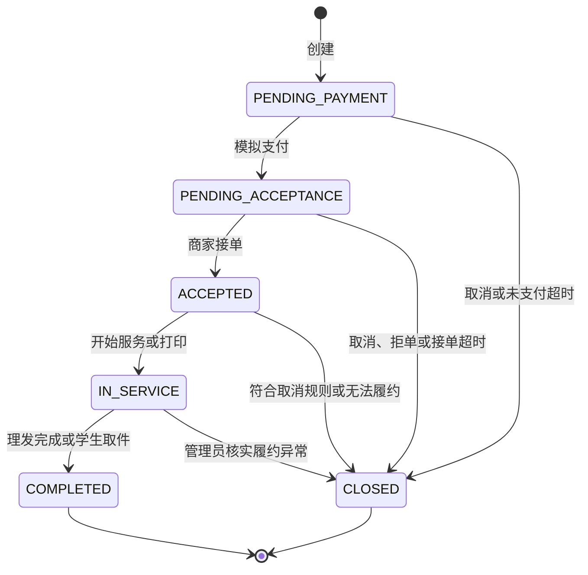

# V1 状态迁移、事务与验收

版本：讨论稿 0.1，2026-10-12。字段定义见 [数据库设计](v1-database-design.md)，已确认规则与待审阅异常边界见 [ADR-0001](decisions/0001-v1-baseline.md)。本文不是已实现接口或已执行测试报告。

## 1. 公共订单状态

| 状态 | 含义 | 允许的支付状态 |
|---|---|---|
| PENDING_PAYMENT | 等待模拟支付 | NOT_PAID |
| PENDING_ACCEPTANCE | 已支付，等待商家确认 | PAID |
| ACCEPTED | 已确认，尚未开始履约 | PAID |
| IN_SERVICE | 履约中；打印待取件仍在此状态 | PAID |
| COMPLETED | 履约完成 | PAID |
| CLOSED | 已关闭，不重新打开 | 未支付关闭为 NOT_PAID，已支付关闭为 REFUNDED |

V1 模拟退款在关闭事务中同步成功，不保存外部退款中间状态。真实或异步退款将来可能出现 CLOSED + PAID/REFUNDING，届时必须修改此组合约束与状态文档。

## 2. 公共操作矩阵

任何写操作先验证身份和数据归属，再读取/锁定当前状态；客户端不能自行指定目标状态或金额。

| 操作 | 操作者 | 前置状态与条件 | 目标状态 | 同事务副作用 |
|---|---|---|---|---|
| 创建 | STUDENT | 账号正常、店铺已审核营业、服务可用，报价匹配 | PENDING_PAYMENT | 创建唯一扩展、幂等记录、事件；预约 HELD，打印 QUEUED |
| 模拟支付 | 本人学生 | PENDING_PAYMENT，now < payment_deadline，模拟功能启用 | PENDING_ACCEPTANCE | 支付流水、PAID、paid_at、acceptance_deadline；预约 ACTIVE |
| 未支付取消 | 本人学生 | PENDING_PAYMENT | CLOSED | NOT_PAID；预约 RELEASED 或打印 ABORTED；USER_CANCEL |
| 未支付超时 | SYSTEM | PENDING_PAYMENT，now >= payment_deadline | CLOSED | 同上；PAYMENT_TIMEOUT |
| 接单前取消 | 本人学生 | PENDING_ACCEPTANCE | CLOSED | 全额退款；释放预约或终止打印；USER_CANCEL |
| 商家接单 | 本店商家 | PENDING_ACCEPTANCE，now < acceptance_deadline；预约还未开始 | ACCEPTED | accepted_at、事件 |
| 商家拒单 | 本店商家 | PENDING_ACCEPTANCE，未超过接单期限，必须说明原因 | CLOSED | 全额退款、释放预约或终止打印；MERCHANT_REJECT |
| 接单超时 | SYSTEM | PENDING_ACCEPTANCE，now >= acceptance_deadline | CLOSED | 全额退款、释放预约或终止打印；ACCEPTANCE_TIMEOUT |
| 预约接单后取消 | 本人学生 | BOOKING + ACCEPTED，start_at - now >= 1 小时 | CLOSED | 全额退款、RELEASED；USER_CANCEL |
| 接单后无法履约 | 本店商家 | ACCEPTED，未开始履约，必须说明原因 | CLOSED | 全额退款、释放预约或终止打印；MERCHANT_UNAVAILABLE |
| 核实履约异常 | ADMIN | 已支付未终结，记录核实原因；普通用户无此权限 | CLOSED | 全额退款；开始前 RELEASED，开始后 CONSUMED；打印 ABORTED；ADMIN_EXCEPTION |

支付/接单请求若在锁内发现对应期限已到，必须拒绝业务操作，并可在同一事务转为超时关闭；业务响应在提交后返回，不能“关闭后抛回滚异常”导致关闭被撤销。另一种允许的实现是拒绝后由独立超时事务关闭，须在实现 ADR 中选定一种。

已终结订单禁止继续接单、开始、支付或完成。普通商家取消不是履约中退款入口，服务已开始后须走管理员异常处理。

## 3. 理发预约状态组合

| 公共订单状态 | occupancy_status | 时间是否占用 |
|---|---|---|
| PENDING_PAYMENT | HELD | 是，事务关闭前保守占用 |
| PENDING_ACCEPTANCE / ACCEPTED / IN_SERVICE | ACTIVE | 是 |
| COMPLETED | CONSUMED | 原时间区间保留占用 |
| CLOSED（尚未开始） | RELEASED | 否 |
| CLOSED（开始后异常） | CONSUMED | 保留原区间，不重新售卖 |

HELD → ACTIVE 随支付发生；ACTIVE → CONSUMED 随完成或开始后异常关闭发生；未开始的占用 → RELEASED 随关闭发生。状态不能独立调用接口修改。

| 预约操作 | 条件 | 结果 |
|---|---|---|
| 查询可约时段 | 日期开放、理发师与服务匹配、完整落在排班内 | 返回候选区间，结果不保证提交时仍有空位 |
| 开始服务 | 本店商家，ACCEPTED，start_at <= now < end_at | IN_SERVICE，写 started_at，占用仍 ACTIVE |
| 完成服务 | 本店商家，IN_SERVICE | COMPLETED，写 completed_at，占用 CONSUMED |
| 未开始且预约结束 | 已支付、到 end_at 仍未开始 | 提示异常，不自动完成或自动扣款；管理员核实后退款关闭 |
| 修改排班 | 本店商家，锁当天保护行 | 新排班须覆盖存量有效预约；冲突则拒绝修改 |

2026-10-13 用户已确认：未到店和服务中异常使用管理员核实后的全额模拟退款并关闭订单；V2 再区分学生缺席、商家过失及售后责任。

### 区间冲突与锁协议

区间为 [start_at, end_at)。冲突条件：existing.start_at < requested.end_at 且 existing.end_at > requested.start_at。10:00～10:30 与 10:30～11:00 相邻可约，10:15～10:45 与前者重叠。

创建预约事务的逻辑顺序：

1. 验证身份及幂等键格式，对已存在请求检查归属与摘要。
2. 查找并 SELECT ... FOR UPDATE 锁定 barber_day_guard；没有合法排班则拒绝。
3. 在锁内检查排班、已开始/提前时间限制及可提供服务，用受锁保护的配置生成报价快照。
4. 在同一保护行下关闭到期的 HELD 订单及到期未接单订单，写相应事件；按订单 ID 升序处理。
5. 对占用集合使用当前读查询重叠，不使用早先普通 SELECT 的快照结果。
6. 创建主订单、BOOKING 扩展、HELD 占用、创建事件和完成幂等记录。
7. 提交；唯一键冲突时整笔回滚，再在新事务读取原请求结果。

同一理发师当天的取消、拒绝、超时、支付、开始和完成均先锁保护行，再锁订单。获取保护行定位信息可先做普通查询，但拿到锁后必须重新验证订单归属、日期及状态。

预约相关事务建议采用 READ COMMITTED；冲突查询仍显式使用锁定当前读。所有锁保持到事务结束，排班写入遵守同样协议。保护行不能因没有预约而跳过。

配置写入不能先锁配置再锁保护行：预约事务先锁保护行再读取受锁保护的服务/理发师配置；商家配置修改事务不在持有配置行锁时反向获取保护行。影响排班的修改先按日期获取保护行。

本方案不依赖 JVM 的 synchronized，也不依赖 Redis 锁；多个应用实例通过同一 MySQL 事务协议协调。参考 [MySQL 锁定读](https://dev.mysql.com/doc/refman/8.4/en/innodb-locking-reads.html)。

## 4. 打印进度与状态组合

| progress | 公共状态 | 操作者与触发 |
|---|---|---|
| QUEUED | PENDING_PAYMENT / PENDING_ACCEPTANCE / ACCEPTED | 创建后等待支付和接单 |
| PRINTING | IN_SERVICE | 本店商家在 ACCEPTED 下开始打印 |
| READY_FOR_PICKUP | IN_SERVICE | 本店商家从 PRINTING 标记可取件 |
| PICKED_UP | COMPLETED | 本人学生从 READY_FOR_PICKUP 确认取件 |
| ABORTED | CLOSED | 取消、拒单、超时或管理员异常关闭 |

商家不能跳过 PRINTING 直接完成；学生不能在未待取件时确认取件。进入 READY_FOR_PICKUP 虽然公共状态不变，仍记录事件并递增订单 version。

创建打印订单前，PDF 已完成校验及上传；事务内锁定最新价目和文件，验证版本、归属、有效期，计算金额并保存快照。页面显示的旧金额不能作为扣款依据；报价变化返回可识别的业务冲突，让学生重新确认。

文件上传、PDF 解析、对象下载/删除都在数据库事务外执行。订单事务只处理元数据、引用和有效期。

## 5. 幂等行为

| 重复请求 | 处理规则 |
|---|---|
| 相同创建键、相同归一化内容 | 返回原订单，终态订单也不重新创建 |
| 相同创建键、不同内容 | 返回请求键冲突 |
| 重复模拟支付 | 已有成功支付且未退款时返回该支付事实；已退款时返回订单已关闭，不重新支付 |
| 重复学生取消 | 本人以 USER_CANCEL 关闭时返回原结果；其他关闭原因返回对应业务状态 |
| 重复商家接单 | 同一店铺已接单或已开始/完成时返回原接单事实；拒绝或关闭后不能恢复 |
| 重复开始/完成/待取件 | 目标事实已存在且后续状态合法时返回原结果，不重写时间，不新增事件 |
| 重复拒单或无法履约 | 同原因且本店权限成立时返回原结果；不同状态或原因拒绝 |
| 重复退款 | 读取唯一成功退款，不重复生成流水 |
| 重复评价 | 同订单已有评价返回已评价冲突，不覆盖原内容 |

效果幂等不意味着每次返回相同的 HTTP 响应体；客户端重试获得原事实，后续状态可能已经推进。任何“返回原结果”之前仍需执行身份及数据权限检查。

## 6. 锁顺序与事务边界

| 业务 | 必需锁及更新 |
|---|---|
| 创建预约 | 日期保护行 → 受保护配置/到期订单 → 新订单；扩展与幂等记录同事务 |
| 预约支付、取消、接单、开始、完成 | 日期保护行 → 订单 → 支付/退款/事件记录 |
| 打印创建 | 价目配置 → 文件；再创建新订单与扩展、幂等记录，不调用外部存储 |
| 打印支付、接单、进度 | 订单 → 必要的流水与事件；终结操作再锁文件 |
| 文件清理 | 只锁文件、当前读复核引用，不持文件锁反向锁已有订单 |
| 评价 | 锁订单验证完成和归属 → 插入唯一评价 |
| 排班修改 | 日期保护行按日期升序 → 排班记录，检查现有占用 |

访问多个订单或文件时按 ID 升序获取同类锁。订单在创建后不换店、不换理发师、不换文件，避免定位信息漂移。不同路径遵守同一锁顺序，不仅检查单个方法里的锁。

预期死锁/锁超时要整笔回滚；后续可对确认幂等的完整事务做有限重试，不能从失败 SQL 中间继续，也不能无上限重试。真实并发测试后再决定重试次数和退避配置。

状态变更可以在订单锁内附加旧状态/version 条件更新，影响行数必须为 1。数据库状态、支付事实、资源占用和日志全部成功才提交。

## 7. 超时与恢复

- 未支付扫描：status = PENDING_PAYMENT 且 payment_deadline <= now。
- 待接单扫描：status = PENDING_ACCEPTANCE 且 acceptance_deadline <= now。
- 批量扫描仅定位候选 ID，不等于状态已确认；逐笔使用正常业务事务重新锁定和判断。
- 预约关闭先获取保护行再获取订单；任务不能先锁订单再反向获取保护行。
- 多实例或重复调度允许重复扫描，通过锁、状态条件及流水唯一约束收敛为一次变更。
- 应用重启后扫描历史到期记录，截止时间存在数据库，不依赖内存定时器。
- 任务失败不吞异常：记录订单 ID、原因，后续扫描重试；不能在一个巨大事务里关闭所有订单。
- 支付及接单接口自行检查期限，任务延迟不会延长操作窗口。
- V1 不自动关闭已经开始的服务，也不自动完成待取件订单。

## 8. 评价、优惠券及后续状态

评价生命周期只有 VISIBLE / HIDDEN；它与订单完成状态独立。隐藏不删除记录、不解除 order_id 唯一约束，评分聚合排除隐藏记录。V2 回复、举报及编辑需单独补充迁移规则。

优惠券不在 V1 建表。V2 设计方向为：模板 DRAFT / PUBLISHED / STOPPED；用户券 AVAILABLE / LOCKED / USED / EXPIRED。领取窗口和使用窗口分开校验；创建订单锁券、支付核销、未支付关闭后释放或过期。已支付后退款默认不返券，领取数量也不退回。

该方向不是完整优惠券实现契约；引入前还需确定库存回补、锁券关联唯一性及多请求领取事务，再评估 Redis/Lua。消息同样先定义业务事件，V3 引入 Outbox 与消费幂等，不让 Redis/MQ 成为 V1 数据正确性的条件。

## 9. 拟定验收案例（全部未执行）

| 编号 | 场景 | 预期不变量 |
|---|---|---|
| AUTH-01 | 伪造角色、已撤销 JWT、停用账号 | 拒绝访问；不产生业务写入 |
| ACL-01 | 学生访问他人订单，商家操作他店订单 | 拒绝，订单及流水不变 |
| BOOK-01 | 20 个不同学生并发预约同一区间 | 恰好 1 个成功、1 笔占用，其余业务冲突 |
| BOOK-02 | 10:00～10:30 与 10:15～10:45 并发 | 最多 1 个成功，不只校验相同开始时间 |
| BOOK-03 | 相邻区间、不同理发师 | 均可成功，不能错误冲突 |
| BOOK-04 | 空日首次预约并发 | 仍只有一个重叠预约，验证保护行作用 |
| BOOK-05 | 取消与新建重叠预约并发 | 最终没有两笔有效重叠占用 |
| BOOK-06 | 修改排班与预约并发 | 新排班和成功预约相容，否则一方被拒绝 |
| BOOK-07 | 提前完成后再约原剩余时间 | 仍被原区间阻止 |
| ORDER-01 | 同创建键重试及改内容 | 同请求只一单，不同内容冲突 |
| ORDER-02 | 支付与超时关闭竞争 | 要么待接单且一条支付，要么未支付关闭；不出现已扣款但无退款的关闭 |
| ORDER-03 | 接单与确认超时竞争 | 要么已接单，要么关闭且一条全额退款 |
| ORDER-04 | 重复支付、取消、完成 | 时间不覆盖，流水和事件不重复 |
| ORDER-05 | 主表插入后模拟扩展/事件写入失败 | 全事务回滚，无半笔订单或残留占用 |
| PRINT-01 | 黑白/彩色、单双面、奇数页、多份 | 印刷面金额和纸张数分别正确，无浮点误差 |
| PRINT-02 | 显示报价后商家改价 | 下单返回报价变化；原订单快照不变 |
| FILE-01 | 伪装/加密/损坏 PDF、超限文件 | 不形成可下单文件，无长期孤立对象 |
| FILE-02 | 未接单商家、其他店铺、其他学生下载 | 拒绝，私有对象不能绕过应用公开访问 |
| FILE-03 | 一个文件关联多个订单，部分终结 | 未终结引用仍保护文件，最后终结后计保留期 |
| FILE-04 | 清理与新下单竞争、存储删除失败 | 不产生引用已删除文件的新单；失败可重试 |
| REVIEW-01 | 未完成、他人、重复评价 | 均拒绝，仅一条合法评价 |
| REVIEW-02 | 零评价、隐藏评价 | 暂无评分或按有效评价正确聚合 |
| RECOVER-01 | 重启前存在到期订单 | 重启扫描可关闭，释放占用，退款不重复 |

测试使用真实 MySQL 8.4 的独立测试库，多线程通过屏障同时发起请求，并在结束后校验数据库不变量。用例可通过 JUnit 集成测试或本地压测客户端执行；内存数据库和 Mockito 不能证明 InnoDB 锁的正确性。

订单和元数据事务的回滚测试需要故障注入；文件删除需要对象存储故障与重复任务场景。当前已建立最小 Web 工程，但本表的订单、数据库和文件业务测试仍全部未执行；不记录虚构通过率、吞吐量或延迟成绩。
